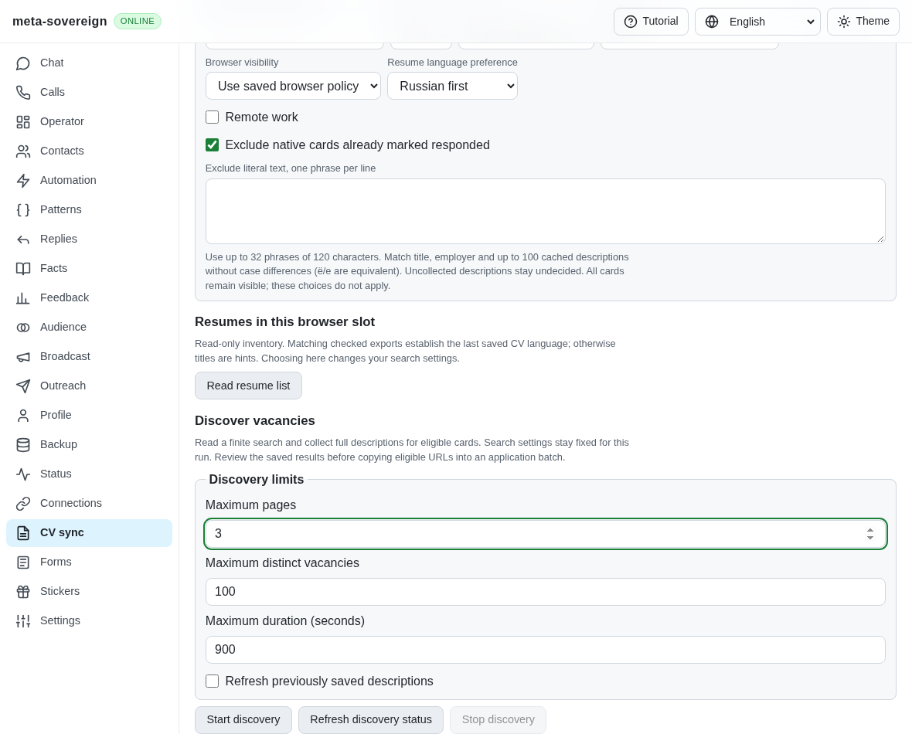
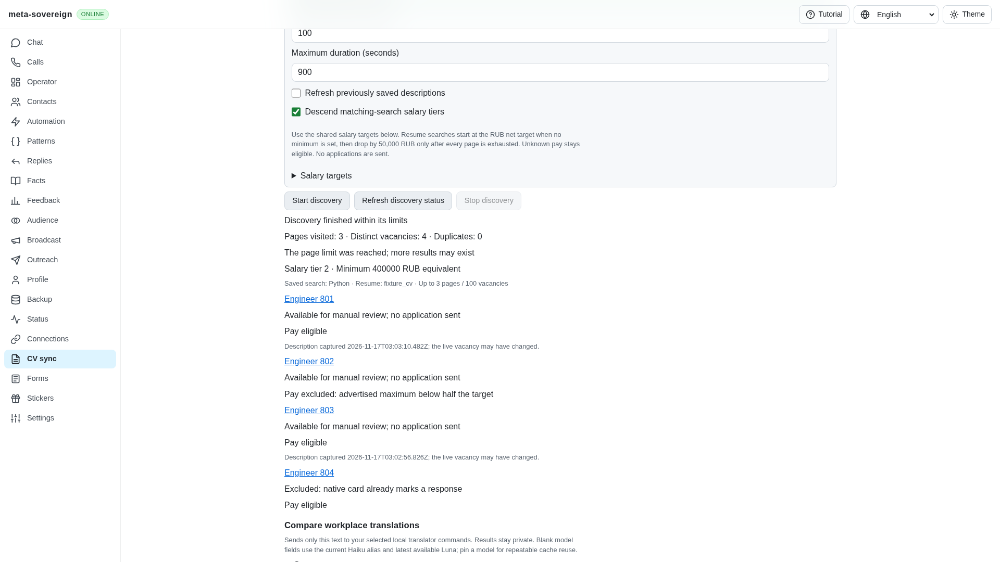
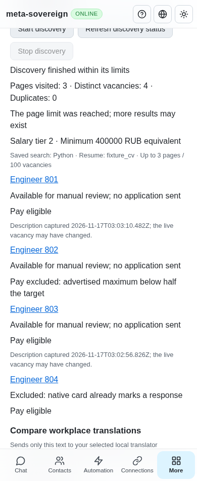

Matching searches previously kept one salary floor for the whole discovery run.
The pinned HH reference requires descending salary tiers only after observed
exhaustion, with low minimum-only offers deferred until their tier is reached.
This change implements that discovery portion of HH02/HH05. Full application,
direct-form and retry admission remain separate unfinished requirements; no
inventory row is accepted by this change.

With enabled shared salary settings and a selected resume, an absent search
minimum starts at the owner's exact RUB monthly net target. The initial page
resets only when that filter changes. An explicit floor, currency and initial
page stay intact. Each observed final page permits a 50,000 RUB-equivalent drop
and a reset to page zero. An unreadable or loading page fails the read; reaching
a page, vacancy or lifetime limit does not pretend that all tiers are exhausted.
An explicit zero remains zero. The default-on ladder has a CLI and UI opt-out.
Other query, resume, region, remote and ordering filters remain frozen.

Advertised maxima strictly below half the independent target are excluded from
the discovery-to-batch handoff. The exact half is deferred normally. Lower
minimum-only offers are retained and re-evaluated when the tier descends; this
does not write a permanent vacancy or questionnaire skip. Responded markers and
owner exclusions still take precedence. Missing, unsupported-period and unknown
currency pay remain eligible. Recognizable annual/hourly pay uses monthly
equivalents without inventing a tax conversion. Foreign filter progression uses
the owner's dated exchange snapshot; stale rates refuse the run.

The foreground CLI accepts `--salary-config=<Lino salary settings>` and
`--no-salary-ladder=true`. Both Lino API transports and the shared four-language
discovery UI use the same normalized settings and validated acknowledged
receipts. Copying eligible URLs fills an unarmed batch draft. Reading a saved
receipt after reload never restarts discovery.

Reproduction uses `salary-ladder-discovery.test.js`: the published parent keeps
the original floor and incorrectly finishes at its first observed exhaustion.
Four parent tests fail; the new progression, interface and existing discovery
checks pass together. A separate parent-bundle browser check captures the missing
controls. The native and independent Playwright MCP checks observe three search
pages, two eligible description reads, one exclusion and one released vacancy,
then check four locales, phone overflow, batch selection and non-replaying reload.
All five native resources close with zero provider clicks. The MCP console also
records a favicon 404 and four browser cache-write failures during reload; all
requested pages and assertions complete, with zero page exceptions. These
console events are preserved without claiming their cause has been diagnosed.

Evidence: [salary-ladder-discovery.tar.gz](data/salary-ladder-discovery.tar.gz),
with source snapshots, published-parent modules, logs, screenshots and SHA-256
manifest. Broad runtime/browser validation belongs to fresh hosted CI.

Before:

After:

Phone:

PR: https://github.com/link-foundation/meta-sovereign/pull/57.
