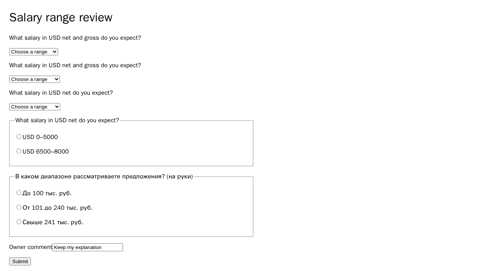

# Reviewed nearest salary bands with two bases

The complete pinned salary selector permits a reviewed form proposal when each
net/gross target independently chooses the same unique nearest band. At
`ddd08a57`, containment worked, but the nearest fallback rejected every question
with two targets. With net USD 3,500 and gross USD 4,500, the form consequently
could not propose its first USD 5,000–8,000 band even though both independently
chose it. This is an original QA13/QA15 requirement in
[PR #57](https://github.com/link-foundation/meta-sovereign/pull/57).

`salary-options.js` now resolves a nearest choice independently for each target
and requires their unique choices to agree. Existing individual overlap,
currency, basis and period guards run first. Ties and different picks retain
review with no proposal. A nearest proposal records `contained: false` and needs
explicit form review. Automatic chat selection continues to require containment.
Configured targets and approved saved answers retain their existing precedence.

Reproduce the three exact-parent failures and passing safety control:

```sh
node --max-old-space-size=384 \
  --import ./experiments/issue-56/salary-nearest-bases-before.mjs \
  --test --test-concurrency=1 js/tests/salary-nearest-bases.test.js
```

The corrected four regressions and sixteen related selection, overlap and watch
checks pass with one worker. They cover agreement, a contained target agreeing
with a gap target, ties, different picks, overlaps, incompatible units, automatic
admission refusal and unchanged form inspection and knowledge records.

The mandatory `forms-answers` group awaits the new native scenario. One focused
Chromium check and independent Playwright MCP checks reproduce the unresolved
parent and explicitly apply the corrected proposal. Each corrected path gets one
native receipt and recovers it without another write. The owner comment remains
unchanged; all owned reviews close with zero submissions. The shared receipt and
MCP setup consolidation also passes the existing saved-baseline scenario, which
retains its separate approved RUB 450,000 radio receipt and zero submissions.

Parent native form:



After explicit native review:


Independent MCP parent and corrected native readback:


The checked archive retains exact parent source bytes, raw failing and passing
logs, both independent MCP responses, drained fixture records, pinned selector
and test bytes, final sources and the four inspected screenshots. The original
unavailable Chromium-cache attempts remain recorded; the successful focused
runs explicitly use the installed Chrome executable. Lint, formatting and the
unchanged 6.5% duplication gate pass. No full local suite or browser matrix runs.

This evidence accepts no inventory criterion. Complete QA15 mapping and all
five exact-source hosted workflows remain required, together with every other
unchecked issue requirement. PR57 stays draft and unmerged.
