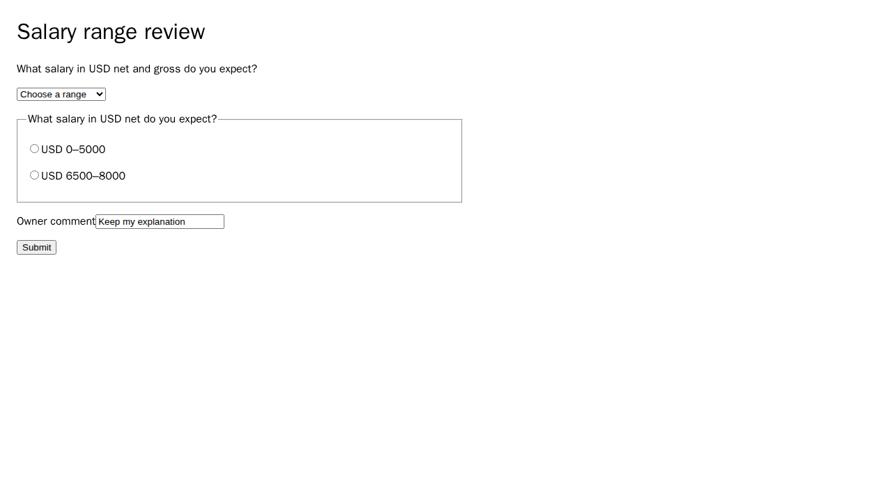
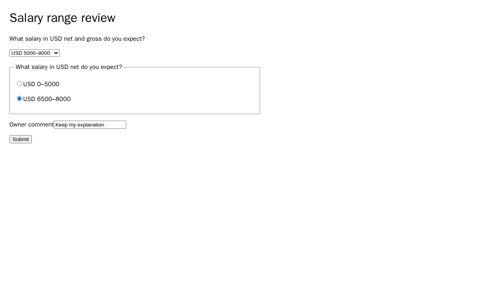
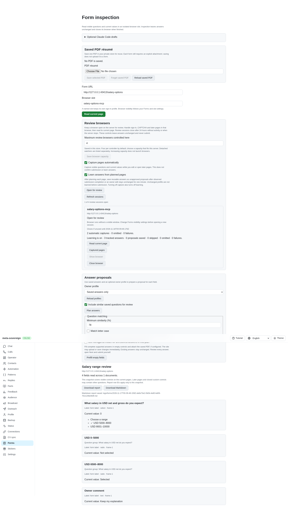

# Salary ranges with two bases and reviewed nearest bands

The [pinned reference README](https://github.com/konard/hh-job-application-automation/blob/fa0991b8c2d0896fb3b4be6c69947f0590094b15/README.md#L765-L783)
requires a contradictory net/gross question to select a chat option only when
both configured amounts fit the same unique band. Its
[salary option tests](https://github.com/konard/hh-job-application-automation/blob/fa0991b8c2d0896fb3b4be6c69947f0590094b15/tests/salary-options.test.mjs)
also require a unique nearest band for reviewed form prefills, while chat gaps,
equidistant bands and incompatible currencies remain unresolved.

At parent `640de38b`, the shared salary planner resolved a dual-basis question to
`amounts: { net: 6000, gross: 7100 }`, but its choice selector accepted only a
single `amount`. It consequently rejected `USD 5000–8000`, even though both
amounts fit that unique range. Separately, the numeric range matcher exposed
only a containment predicate, so forms could not propose a unique nearest band.
These are original QA12/QA13/QA15 requirements, not scope reductions.

The shared matcher now checks every resolved amount against the same band and
retains currency, basis, period and overlap guards. A label specifying only net
or only gross cannot stand in for both bases. A single configured amount may
use a unique nearest band only in field planning; the result explicitly records
`contained: false` and requires review. Chat planning still needs containment,
and a conflicting dual-basis question never uses nearest-band fallback. Current
configured targets override a plain stale saved salary band. Missing targets,
unapproved settings and rejected wording keep their existing holds.

To reproduce the two failures without building another checkout:

```sh
node --max-old-space-size=384 \
  --import ./experiments/issue-56/salary-options-before.mjs \
  --test --test-concurrency=1 js/tests/salary-option-contract.test.js
```

All four new regressions fail on the exact parent modules. The four new checks
and twenty-five related salary, delivery-guard and form-guidance checks pass
with concurrency one. They cover dual-basis agreement, conflicting bases,
overlaps, currency/period mismatch, approval and rejected wording, current-value
priority, nearest-band ties, protected options, CLI, offline planning, both
default Lino transports, real form proposals and preserved knowledge records.
The existing delivery tests still revalidate either configured amount after
typing and refuse delivery/outbox admission when it changes.

The mandatory `forms-answers` browser group now runs the native salary scenario
in both hosted engines. Locally, one Chromium scenario fails on the parent and
passes after the fix. It reads an actual select and radio group through Browser
Commander, verifies planning has no effects, explicitly applies only two chosen
fields, checks positive native readback and retry receipts, preserves the owner's
comment and closes with zero submissions. An independent Playwright MCP session
uses the production UI and Lino API against a second owned fixture; it obtains
the same two receipts and visible selected values. Its fixture records exactly
the two control changes and closes without submission. These are synthetic
forms, with no personal account or live application submitted.

Before, both choices remain unresolved on the parent:



After explicit review, the containing select and nearest radio retain their
actual selected values:



The shared UI independently displays the readback:



The checked evidence archive retains the exact parent modules, all failure and
passing logs, pinned reference responses, source bytes and screenshots. Full
QA12/QA13/QA15 acceptance and every other unchecked original requirement remain
required; this local evidence does not establish hosted acceptance or complete
the issue. PR57 remains draft and unmerged.
