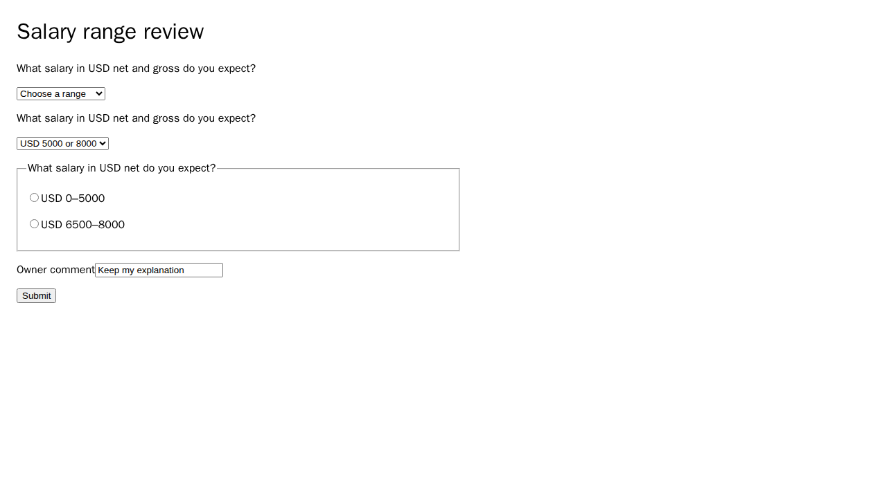
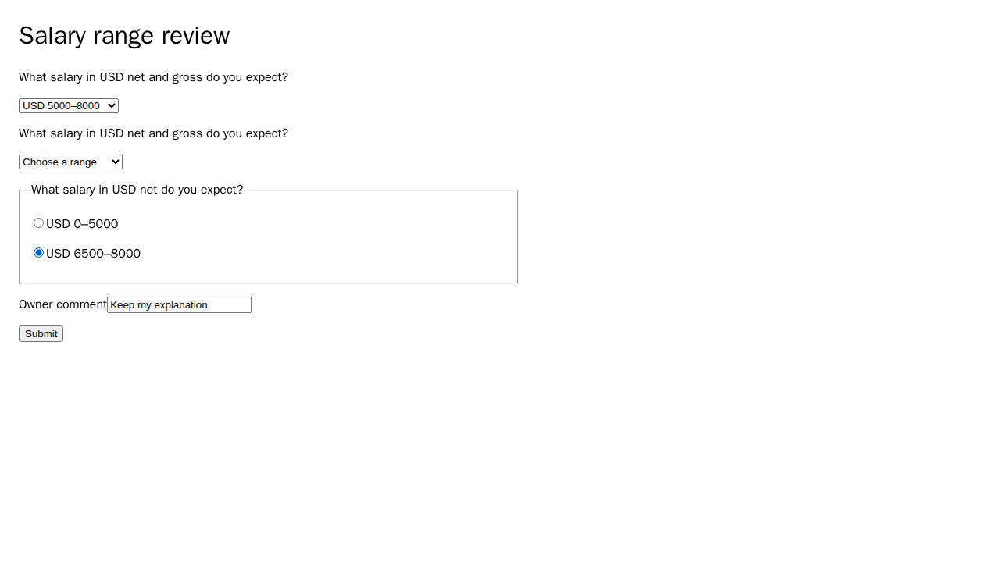

# Distinguish salary intervals from numeric alternatives

The pinned [salary range contract](https://github.com/konard/hh-job-application-automation/blob/fa0991b8c2d0896fb3b4be6c69947f0590094b15/README.md#L765-L783)
requires ambiguous options to remain under review. At parent `13806114`, the
shared planner extracted two numbers and treated them as interval endpoints
without checking the words between them. With approved USD net 6000 and gross
7100, it consequently accepted `USD 5000 or 8000` as a containing range. Adding
that alternative beside the valid `USD 5000–8000` also made the real band appear
ambiguous. Both decisions reached CLI, offline and default Lino previews.

The matcher now requires an explicit range connector: a dash, `to`/`до`, or
`and`/`и` with a preceding `between`/`между`. Existing currency names and symbols
are removed from the connector using the same bounded literal vocabulary as
currency recognition. Thousands, decimal amounts, open bounds, both salary
bases, compatibility checks and reviewed nearest-band behavior are preserved.
Alternatives, slash-separated numbers and unrelated numeric labels do not
become intervals, including during single-target nearest-band form planning.

Reproduce the parent with the small, single-worker check:

```sh
node --max-old-space-size=384 \
  --import ./experiments/issue-56/salary-range-before.mjs \
  --test --test-concurrency=1 js/tests/salary-range-syntax.test.js
```

Three tests fail on the exact parent; the explicit interval compatibility test
already passes there. The repaired draft passes 51 focused salary, vocabulary,
currency-priority, personal-template and strict-option checks. After adding the
single-target nearest-band boundary, the four focused syntax tests pass again.
No full local runtime or browser matrix was run.

The mandatory native salary form scenario now includes an ambiguous select.
It fails on the exact parent and passes after the repair: that select stays
unresolved, only two explicitly selected valid fields change, the owner's
comment remains intact, retry recovers the same positive readback receipts,
and the owned browser closes with zero form submissions. The existing hosted
browser groups retain this scenario and every previous assertion.

An independent Playwright MCP session uses the production Forms UI and Lino
API against an isolated synthetic form. On the parent, explicitly applying the
incorrect proposal selects the alternative, with one native receipt. After the
repair, it stays unresolved while the two valid reviewed fields produce two
receipts. Both retries recover without another native change. Both isolated
servers record the actual select/radio values, preserved owner comment, closed
reviews and zero submissions; no personal account is involved.

Parent, with the alternative incorrectly selected after explicit Apply:



After repair, the alternative stays open while the valid fields are reviewed:



The archive retains the initial MCP function-loader syntax error, then both
successful browser receipts. The probe reuses the existing salary-option runner;
its shared setup keeps the unchanged duplication gate passing. Console logs
include the existing missing favicon and Chromium `ERR_CACHE_WRITE_FAILURE`
messages for the app bundle; the application
loaded and completed the actual review/readback flow. Disk had 102 GiB free.
No browser exception or delivery success is inferred from these console lines.

All source bytes, parent modules, pinned reference responses, finite logs and
inspected PNGs are retained in the checked
[evidence archive](data/salary-range-syntax.tar.gz). This correction does not
accept the full QA15 criterion or any of the other forty unchecked criteria.
Exact-head hosted validation and the complete original scope remain required.
[PR57](https://github.com/link-foundation/meta-sovereign/pull/57) stays draft and
unmerged.
