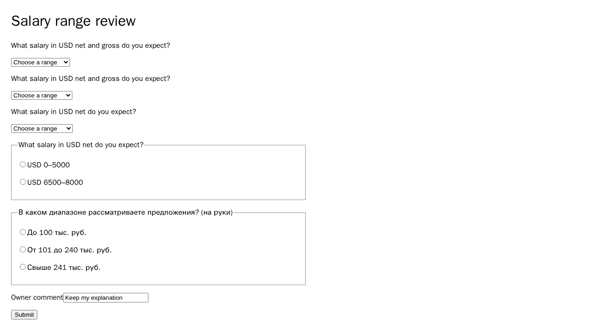
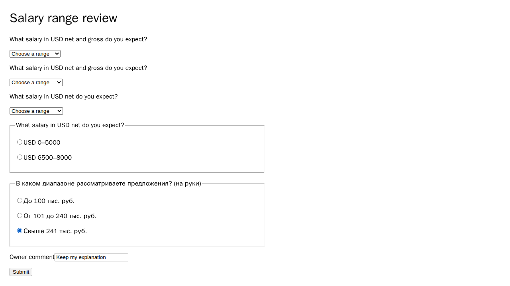

# Approved saved salary amounts as choice baselines

The pinned [salary selector](https://github.com/konard/hh-job-application-automation/blob/fa0991b8c2d0896fb3b4be6c69947f0590094b15/src/salary-options.mjs)
uses a compatible expanded saved answer when the caller has no configured
amount. Its native radio regression expects “От 450 000 ₽ в месяц на руки.”
to select “Свыше 241 тыс. руб” without submitting the form. Published source
`db883377` leaves the same approved answer unresolved because the salary
planner exits without a configuration and literal option matching cannot
match that expanded wording.

The shared planner now derives a temporary baseline from one exact, approved
saved amount with an explicit currency and compatible basis and period.
Configured amounts retain precedence. Disabled configuration, unapproved
answers, multiple amounts, negative or excessive amounts, mixed currencies,
ambiguous units, incompatible periods and authored explanations stay under
review. A failed configured tax calculation cannot fall back to the saved
number. An approved literal offered answer retains ordinary exact reuse.
Hourly saved amounts are used directly without inventing a monthly conversion.
Planning changes neither saved rules nor salary configuration.

Two positive regressions fail against the exact parent, and two safety controls
pass. The corrected focused group passes 28 checks with one worker, including
read-only CLI, offline and both Lino previews, current target precedence,
currency independence and calculation-failure guards.
Four existing configured-currency compatibility checks also pass after sharing
the same preview fixture.
Reproduce the focused regression with:

```sh
node --max-old-space-size=384 --test --test-concurrency=1 js/tests/salary-saved-baseline.test.js
```

For the parent comparison, add
`--import ./experiments/issue-56/salary-saved-baseline-before.mjs`
before `--test` and select the first two tests plus the existing safety controls.
The native check is mandatory in the existing forms browser scenario. Its
focused Chromium run and an independent Playwright MCP run both confirm zero
parent effects, then one corrected radio readback receipt after explicit apply.
Repeating that apply recovers the same receipt without repeating native events.
All fixtures close, no form is submitted and the owner comment stays unchanged.

| Published parent                                                                                       | Corrected explicit apply                                                                                      |
| ------------------------------------------------------------------------------------------------------ | ------------------------------------------------------------------------------------------------------------- |
|  |  |

The independent MCP comparison is preserved as
`issue-56-salary-saved-baseline-mcp-before.png` and
`issue-56-salary-saved-baseline-mcp-after.png` in the screenshot directory.
All six images were validated as PNG files and visually inspected. The MCP
console reports the fixture's missing favicon; both final runs also record
a browser cache-write failure for the loaded bundle. The application still
loads and the complete native receipt and cleanup assertions pass. This cache
diagnostic is retained without attributing an unproven cause. No live provider
is used.

The first test draft incorrectly treated native explicit review as unapproved
reuse and treated an approved literal option as unresolved. Those assertions
were corrected; the initial logs remain. The initial MCP code file's trailing
semicolon was rejected by the tool parser before execution; its generated
expression now omits that semicolon. The initial duplication result slightly
exceeded the unchanged 6.5% limit. Both preview regressions now reuse the
existing shared preview helper, including overlap and configured-currency cases,
and the gate passes.
The initially expanded browser experiment produced two complexity/length lint
warnings. Its final saved-baseline inspection is a separate bounded callback
using the existing MCP code generator; scoped lint is clean.

The [checked archive](data/salary-saved-baseline.tar.gz) and adjacent SHA-256
manifest preserve parent source, raw failures, native and MCP results, source
snapshots, screenshots and scoped checks. Exact-source hosted verification and
the complete QA15 mapping remain required in
[PR #57](https://github.com/link-foundation/meta-sovereign/pull/57).
All 40 unchecked original criteria remain active.
