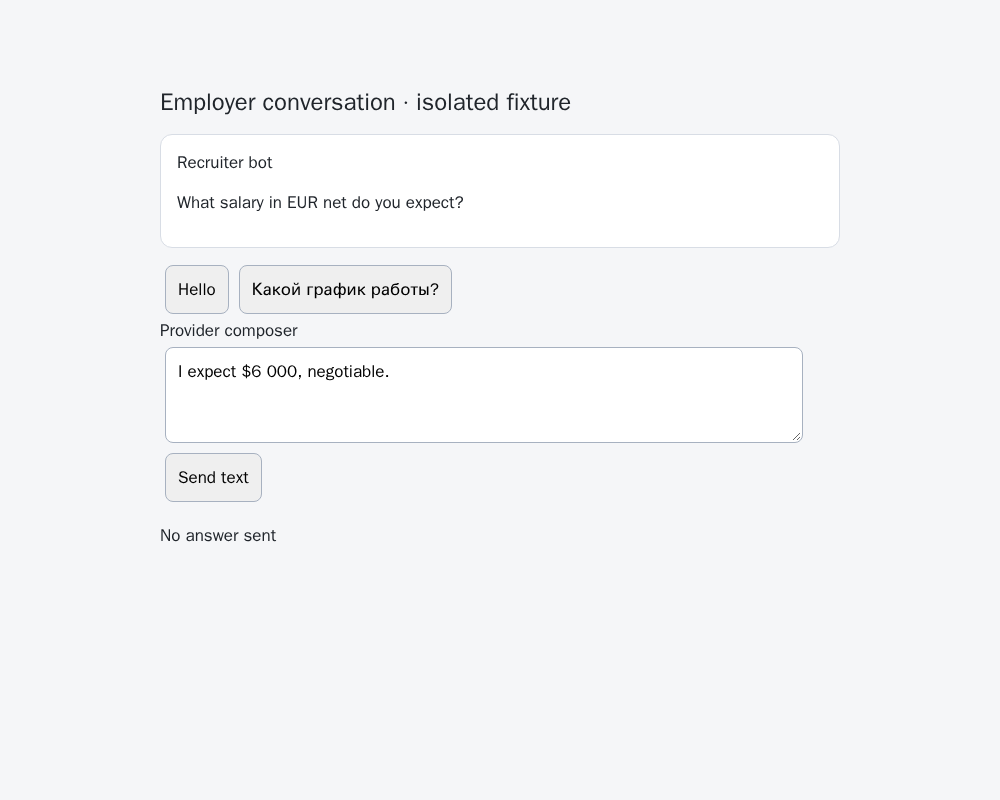
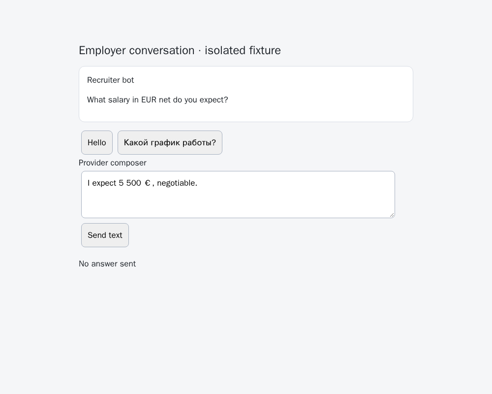

# Contextual personal salary templates

This correction in [PR57](https://github.com/link-foundation/meta-sovereign/pull/57)
addresses part of QA12. All 40 unchecked original criteria remain required;
this evidence does not accept an inventory row.

At parent `e1d8e108`, an approved answer containing `{{salary_net_usd}}`
retains USD amounts when the salary question explicitly requests EUR. The
native composer reads `I expect $6 000, negotiable.`. Currency-specific
placeholders now follow the recognized question or vacancy context, using its
independently configured amount and preserving the owner's explanation.
Unrelated questions retain independent currency placeholders.

Reproduce all six regressions on the exact parent modules:

```sh
node --max-old-space-size=384 --import ./experiments/issue-56/salary-template-context-before.mjs --test --test-concurrency=1 js/tests/salary-template-context.test.js
```

Missing amounts cannot fall back to another currency. Literal stale numbers,
incompatible net/gross basis, wrong pay periods and unapproved targets still
require review. An explicitly configured tax label stays intact for RUB;
the RUB-specific `НДФЛ` becomes generic taxes for other currencies. No tax rate
or jurisdiction is inferred. A tax-label placeholder is not a pay amount.

Thirty-three focused tests pass with one worker, including actual saved CLI,
offline and both Lino previews, unchanged owner settings, all five chat providers,
the existing substitution contract and approved personal wording. The native
regression and an independent Playwright MCP probe acknowledge the corrected
EUR draft with zero sends. Native checks also preserve an owner-written draft
and saved rules. The shared browser helper still verifies the prior inferred
salary path. Both owned browser fixtures close after their receipts drain.





The [checked archive](data/salary-template-context.tar.gz) and
[manifest](data/salary-template-context.tar.sha256.json) preserve source bytes,
the six parent failures, focused checks, native/MCP receipts and screenshots.
The initial MCP file-evaluation syntax error is retained alongside the successful
function evaluation. Exact-source hosted checks and the full original salary
contracts remain required. Synthetic provider pages make no authenticated-account
claim.
