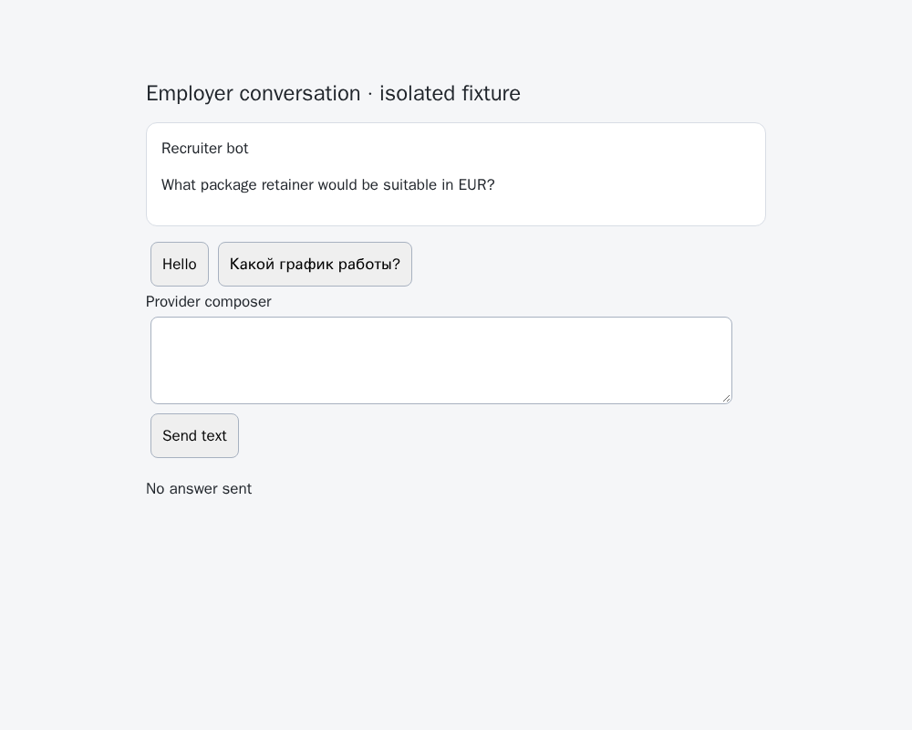
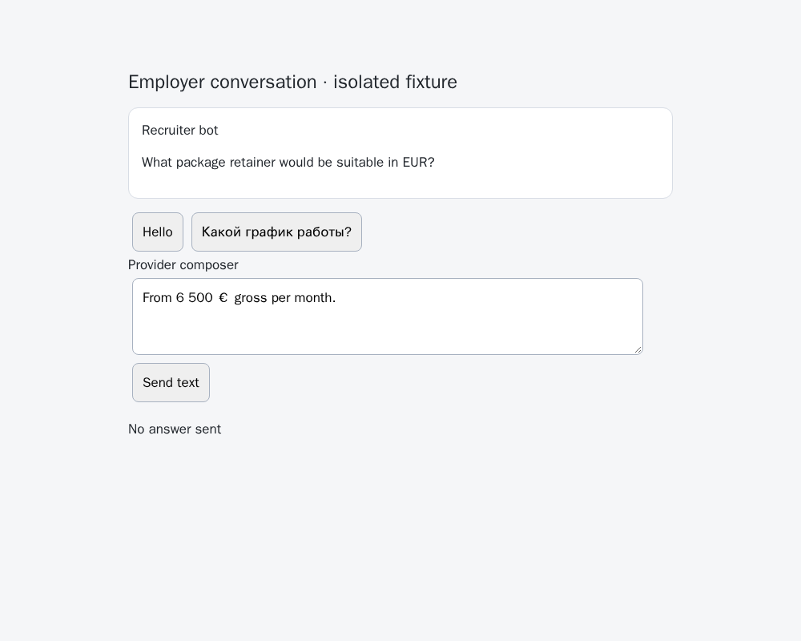

# Learned salary vocabulary

QA12 includes input vocabulary learned from the owner's saved salary answers.
The pinned [salary question reference](https://github.com/konard/hh-job-application-automation/blob/fa0991b8c2d0896fb3b4be6c69947f0590094b15/src/salary-questions.mjs)
requires three distinct examples, 90% topic purity, two salary stems in a new
question and a separately learned gross marker. Its implementation was studied
without copying or running it. This extends the separately verified
[approved output wording](salary-wording-contract.md).

Exact parent `6b4b4df6` recognizes only built-in salary terms. Three approved
monthly answers to differently worded questions about a “package retainer” cannot
answer a new question using those terms, nor carry their gross basis into a
currency clarification. Ordinary Russian expected-pay labels such as “оклад”,
“денежные пожелания”, “вознаграждение” and “з/п” are also missing. Some current-pay,
offer-acceptance and payroll-module questions incorrectly enter salary planning.

The shared planner now computes a vocabulary once per plan from normalized,
eligible saved questions. Distinct normalized questions count once; conflicts
cannot create positive evidence. Only enabled, scoped, approved monthly salary
answers support positive classification. Canonical owner corrections, rejection,
wildcard patterns, notices, hourly answers and excluded topics retain their
boundaries. An incomplete capped corpus cannot establish learned vocabulary.
At least three examples and 90% purity are required for each learned topic stem,
and a new question needs two topic stems. Explicit basis takes precedence over
a learned gross marker. Related short follow-ups inherit the same learned topic
and basis, while unrelated questions stop inheritance. Current amounts and
requested currencies use the existing shared salary planner.

Reproduction and focused validation:

```sh
node --max-old-space-size=384 --import ./experiments/issue-56/salary-vocabulary-before.mjs --test --test-concurrency=1 js/tests/salary-vocabulary-contract.test.js
node --max-old-space-size=384 --test --test-concurrency=1 js/tests/salary-vocabulary-contract.test.js js/tests/salary-wording-contract.test.js js/tests/salary-clarification-contract.test.js js/tests/salary-option-contract.test.js js/tests/question-salary.test.js js/tests/question-salary-controls.test.js js/tests/salary-both.test.js
RUN_BROWSER_E2E=1 E2E_BROWSER=chromium E2E_EXECUTABLE_PATH=/opt/google/chrome/chrome SALARY_VOCABULARY_ONLY=1 node --max-old-space-size=384 js/tests/e2e-question-controls-browser.mjs
```

Six new tests fail on the exact parent; all 39 focused tests pass after the fix.
They cover provider-independent planning, duplicate counts, 90% boundaries,
scopes, corrections, periods, current targets, context and the actual CLI,
offline UI and both Lino transports. A rule edit during typing prevents delivery
before an outbox claim. The mandatory native browser scenario observes the exact
gross EUR draft, unchanged saved rules, zero sends and preserved owner input.
Independent Playwright MCP separately confirms the production browser API and
actual native prefill. Owned fixtures close; no live provider account is claimed.

Before:



After explicit prefill:



The checked [archive](data/salary-vocabulary-contract.tar.gz) and
[manifest](data/salary-vocabulary-contract.tar.sha256.json) retain parent modules,
pinned source bytes, source hashes, raw checks and screenshots. Full QA12 and
all other unchecked original criteria remain required, including exact-source
hosted verification in [PR #57](https://github.com/link-foundation/meta-sovereign/pull/57).
