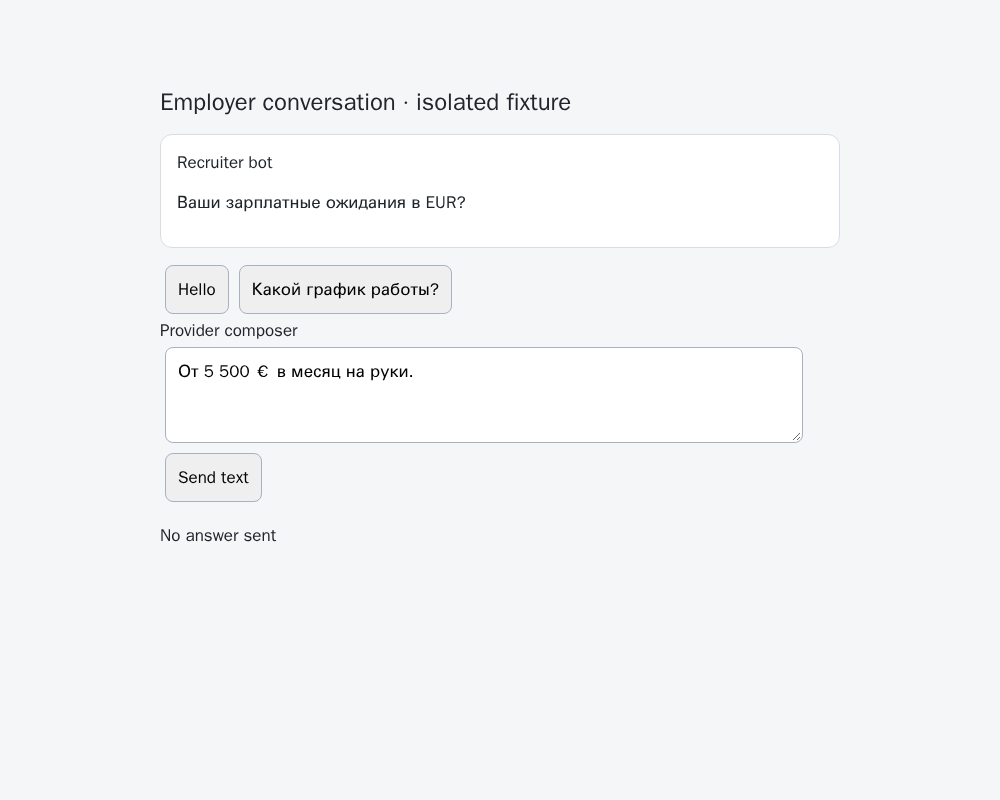
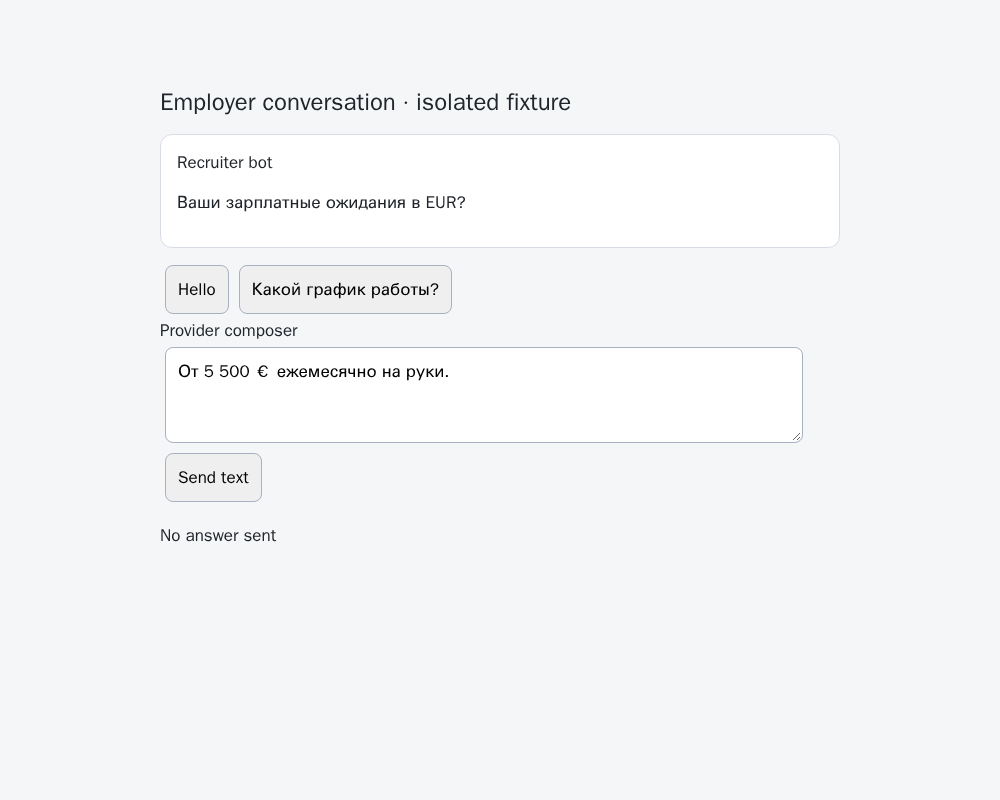

# Approved salary wording

QA12 includes learned salary-only wording and exact approved wording, as described
by the pinned [salary question contract](https://github.com/konard/hh-job-application-automation/blob/fa0991b8c2d0896fb3b4be6c69947f0590094b15/tests/salary-questions.test.mjs)
and [implementation reference](https://github.com/konard/hh-job-application-automation/blob/fa0991b8c2d0896fb3b4be6c69947f0590094b15/src/salary-questions.mjs).
These sources were studied for behavior without copying their implementation.

At exact parent `59252a5e`, the shared salary planner always replaces a salary-only
answer with its built-in sentence. For example, an approved template
`От {{salary_net_usd}} ежемесячно на руки.` produces
`От 5 500 € в месяц на руки.` when asked about EUR. The amount and currency are
correct, but the owner's wording is lost. Exact answers, frequency-selected
wording, declared equivalent answers and the final-period preference are affected.

Shared planning now preserves exact approved salary wording first. Other salary
questions use a stable selection among the most detailed compatible approved
wordings. Current configured amounts and the requested currency replace old
currency-specific placeholders. Language, hourly/monthly period, net/gross basis,
scope, canonical corrections, rejection and approval boundaries remain enforced.
Salary-only templates have a bounded vocabulary; literal personal explanations
retain the existing owner-review behavior. The existing equivalent-answer and
final-period rules apply before wording selection. Stored answers, raw counts and
observations are unchanged. Native choice fields retain their numeric planner.

Reproduce the seven failures on the published parent and run the focused checks:

```sh
node --max-old-space-size=384 --import ./experiments/issue-56/salary-wording-before.mjs --test --test-concurrency=1 js/tests/salary-wording-contract.test.js
node --max-old-space-size=384 --test --test-concurrency=1 js/tests/salary-wording-contract.test.js js/tests/salary-clarification-contract.test.js js/tests/salary-option-contract.test.js js/tests/question-salary.test.js js/tests/salary-both.test.js
RUN_BROWSER_E2E=1 E2E_BROWSER=chromium E2E_EXECUTABLE_PATH=/opt/google/chrome/chrome SALARY_WORDING_ONLY=1 node --max-old-space-size=384 js/tests/e2e-question-controls-browser.mjs
```

All seven new tests fail on the parent and all 30 focused tests pass after the
fix. Tests exercise stored rules through the actual CLI, offline preview and
both negotiated Lino HTTP formats, retaining counts and saved observations.
The mandatory native browser scenario checks actual prefill acknowledgement,
zero sends, preservation of an owner draft and unchanged saved rules. Independent
Playwright MCP separately observes the production browser API and the drained
fixture's exact native draft. These are synthetic HH fixtures; no authenticated
provider account is claimed.

Before, after explicit prefill:



After, after explicit prefill:



The checked [archive](data/salary-wording-contract.tar.gz) and
[manifest](data/salary-wording-contract.tar.sha256.json) retain exact parent
modules, source hashes, pinned reference blobs, raw verification and screenshots.
Exact-source hosted verification and the complete QA12 contract remain required.
All other unchecked original criteria remain in scope in
[PR #57](https://github.com/link-foundation/meta-sovereign/pull/57).
