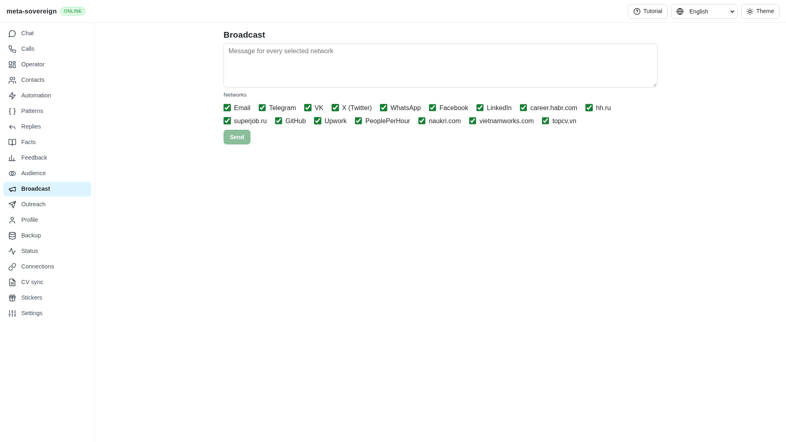
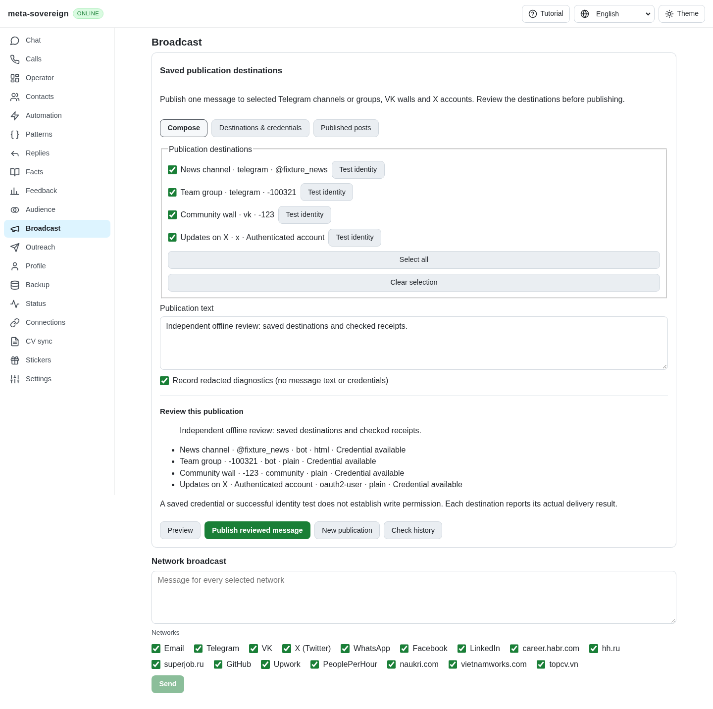
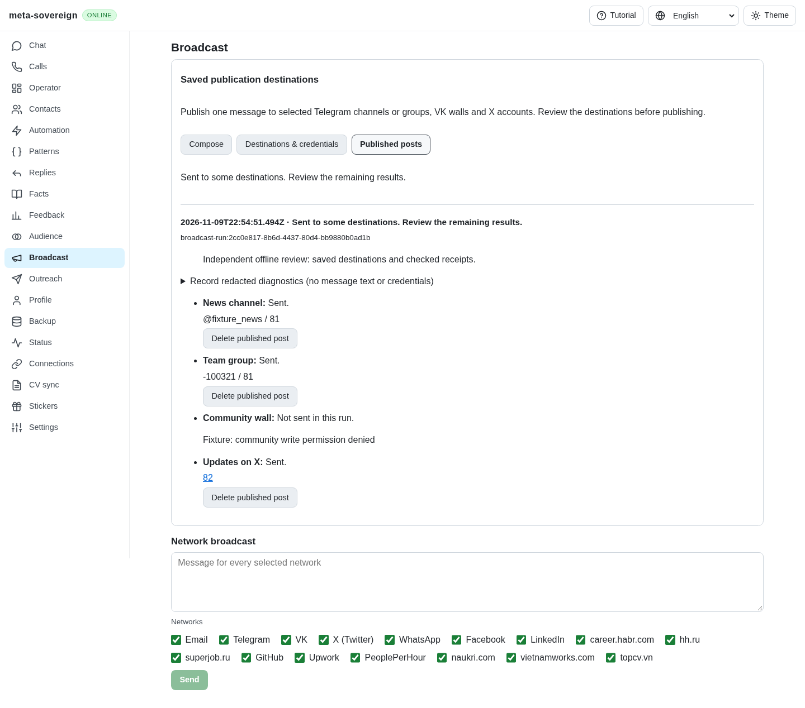
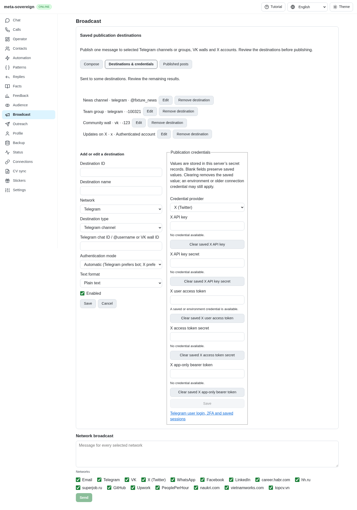
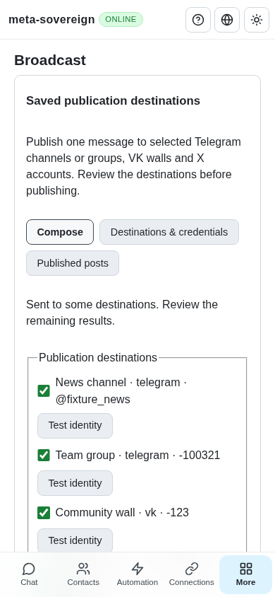

# Saved multi-destination publications

Issue 56 requires every broadcast feature through CLI, API and UI. The shared
adapters previously had checked public-post primitives, but the screen selected
networks rather than explicit public destinations. It could not configure two
Telegram destinations, select an explicit credential mode, retain a publication
record or delete by its original receipt. These were integration gaps, not proof
of missing provider write permission. The reference README, command dispatcher
and Telegram/VK/X modules were read at the pins retained in the preceding
[provider](provider-publications.md) and [X](x-publishing-auth.md) archives; their
implementation was not copied.

## Implementation and tradeoffs

Saved `broadcast-target:` records contain routing, display labels, format,
enabled state, explicit authentication modes and a version. Validation rejects
unsupported network/kind/mode combinations, mixed personal/community VK IDs,
nonboolean flags and embedded credential fields before storage. A publication
selects explicit IDs or all enabled destinations, with a 100-destination bound.

One shared service drives CLI, default text/binary Lino routes and the React
Broadcast panel. Preview retains exact text, destination snapshots and public
capabilities; private credential bindings are never returned or stored in
history. Confirmation revalidates destinations and credentials before any write.
The service also checks again at each write. Telegram automatic selection prefers
a bot; explicit user selection never switches to a newly configured bot. X
application-only credentials remain read-only. Read-only identity probes do not
claim destination permission or send test posts.

Provider credentials remain separate secret records with environment and older
connection fallback. The API returns presence booleans. Masked interactive CLI
setup and empty UI password fields preserve blank inputs; explicit clearing
removes local overrides and explains fallback. An identity change invalidates a
pending plan. Existing Telegram user login/2FA/session controls are linked from
the settings and reused rather than creating another session store.

The service records intent and a per-target sending state before HTTP, then uses
the existing durable outbox with a stable request/target key. Results retain each
known provider receipt and actual sent/failed/unknown status. A repeated request
ID returns the existing run; conflicting content or destination snapshots are
refused. Restart converts interrupted sending to unknown and pending to
not-started. Uncertainty, rate limiting and three consecutive failures stop the
batch. There is no automatic retry after an uncertain write. Cross-provider
delivery cannot be atomic; a failed receipt-store write can leave an unknown
outcome, which must be inspected at the provider.

Shutdown closes the publication service to new writes and awaits every active
publication/deletion before flushing or releasing storage. A failing-before
server regression reproduced an early flush while the publication cleanup gate
was unresolved. A held-provider test now verifies that the receipt is durable
before shutdown finishes; normal shutdown and rolling handoff share that rule.

Deletion pins the original destination, authentication mode and recorded receipt,
even after target removal. It rechecks receipt/credentials before sending and
requires positive acknowledgement. Known failure preserves a reviewable retry;
unknown or interrupted deletion blocks repetition. Provider IDs survive every
deletion result. A missing acknowledgement is never presented as deleted.

The UI persists the pending body/request ID before sending, binds the reviewed
preview to the actual confirmation challenge, preserves drafts and blocks reload
resends. Reads use the shared recovery policy; writes do not auto-retry.
Destination/credential forms disable during mutation so newer input cannot be
erased by a late response. Opt-in diagnostics retain at most 200 metadata events,
excluding content and credentials. The old network broadcast flow remains
available and its existing browser regression still passes.

## Reproduction and verification

Before: open Broadcast and try to save/select both a Telegram channel and group,
choose a VK community credential, then locate and delete a published receipt.
Only the network selection composer is available. After: use **Destinations &
credentials**, select the saved targets, preview/publish and inspect **Published
posts**. Detailed CLI/API instructions are in [Publishing](../../PUBLISHING.md).

`publication-service.test.js` covers four destinations across three providers,
bot preference, explicit user mode, all multipart IDs, stale routing/credentials,
concurrent writes, replay/conflict, durable-store failure, deletion, credential
redaction, batch stops and default-off metadata diagnostics.
`publication-controls.test.js` exercises actual isolated HTTP confirmation,
malformed object bodies, CRUD, masked credential presence, stale plans and CLI
cleanup/confirmation. `publication-web.test.js` covers pending reload state,
preview identity (including diagnostics), and interrupted writes. These tests,
the locale checks and shared browser-dialog tests pass **56 focused checks**;
the final **26-case** lifecycle/control run includes the denied-storage getter,
diagnostics comparison and all three server ownership/cleanup checks.
The denied-getter regression fails before moving default storage access inside
the guarded read, then passes: composing survives but unsafe publishing is
refused. **31** existing Telegram/account/format checks also pass.
Changed-file lint, the production build and the offline
`examples/saved-publications.mjs` pass.

`e2e-publication-controls-browser.mjs` passes in installed Chrome against a real
isolated server with offline provider responses: read-only identity, reviewed
send, actual history/receipts, confirmed deletion, destination creation, credential
replacement with empty read-back fields, VK/X mode selection, unknown delivery,
reload preservation, lost responses and mobile overflow. Only the explicitly
expected confirmation messages are accepted; unexpected browser dialogs still
fail the shared watcher. The regression is registered in existing browser CI.

Independent Playwright MCP review checks all four destination types, permission
failure beside successful receipts, empty credentials, metadata-only diagnostics
and mobile layout. Images use the actual production bundle and isolated dummy
providers, not live accounts. Browser/server fixtures close after review.

Before:

After preview:

After history and per-provider results:

After credential controls:

After mobile:

`data/saved-publications.tar.gz` retains focused logs, example/browser/build/lint
evidence and provenance with verified per-file hashes. This delivers the saved
publication integration for BC01–BC07; exhaustive reference-source auditing,
other provider/browser workflows and the wider issue remain required work.
[PR 57](https://github.com/link-foundation/meta-sovereign/pull/57) remains draft.
