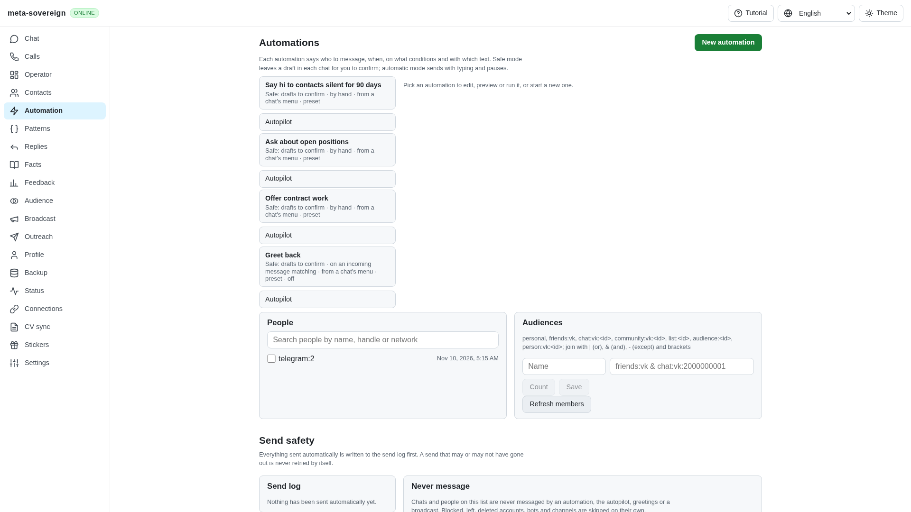
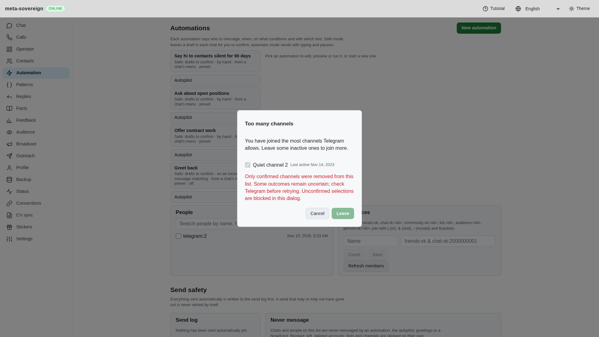
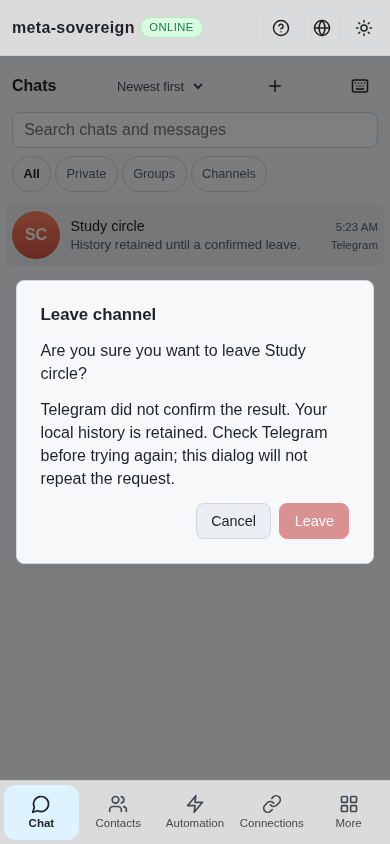

# Shared leave receipts and partial results

Issue: <https://github.com/link-foundation/meta-sovereign/issues/56>. Draft PR: <https://github.com/link-foundation/meta-sovereign/pull/57>.

FL03's existing Chat/Operator removal and inactive-channel controls now require actual Telegram acknowledgements. Together with the reviewed Follow CLI/Lino API/React workflow in [follow-telegram.md](follow-telegram.md), this completes FL03. FL04 migration is verified in [legacy-follow-sessions.md](legacy-follow-sessions.md). FL06–FL09 and every other unchecked issue-wide criterion remain required; PR 57 stays draft and unmerged.

## Reproduction and root cause

Previously a resolved leave RPC, including an empty or missing response, caused local message tombstones. A basic-group leave then deleted history without a confirmed membership change. Inactive-channel batches lost earlier successful results on a later failure, and the browser removed every selected row when `ok` was true even if `left` only acknowledged a subset. Chat removal dialogs closed before receiving any result. The installed SDK could also automatically retry uncertain shared joins and preference writes.

The offline fixture `node experiments/issue-56/shared-leave-ui.mjs` serves an isolated memory store on a free port. Open Automation, dispatch `ms-channel-limit`, select both quiet channels and choose Leave. The fixture acknowledges only the first selection. With the preceding production bundle, the entire dialog closes. With this correction, only the explicitly acknowledged row disappears; the other selection remains visible and blocked with recovery guidance. In Chat, leaving Study circle returns an unknown outcome: the chat and dialog remain visible and a second click cannot repeat the request. Press Enter in the fixture terminal to close its owned server and temporary directory.

Channel leaves require matching channel updates; basic-group leaves require the exact group's left state or this account's participant-deletion update. Basic-group destruction requires Telegram's actual boolean `true`. History cleanup requires valid affected-history counters and a terminal offset, with at most 100 requests. Existing Chat-menu history cleanup is preserved after a confirmed basic-group leave; the new Follow leave continues to request membership changes alone. A confirmed leave survives uncertain later history cleanup without removing local history or offering a repeat in that dialog. Partial inactive-channel results retain earlier confirmed IDs and stop on the first failed or unknown leave.

Shared public/private joins, leave, mute and archive now disable the installed SDK's per-call retry and flood sleeping. Structured timeout/internal/server errors remain uncertain. The common metadata trace remains off unless `MS_TELEGRAM_MEMBERSHIP_DEBUG=1`; it omits private request contents.

This slice does not claim durable replay protection for legacy controls across dismissal/reopening or complete ownership of every legacy queued write during shutdown. Follow's durable journal and owned in-flight handling are separately verified. Broader lifecycle, timeout and bounded teardown policies remain required FL08 work.

## Verification

- All 80 focused shared-removal, channel-management, receipt, Follow compatibility, UI-result and locale checks pass serially. Three missing/mismatched/destroy/partial-history regression cases fail against the preceding removal implementation. A separate finite SDK-retry probe fails when retry disabling is removed. Run `python3 experiments/issue-56/shared-leave-regression.py`; both probes restore their sources in `finally`.
- The new production Chromium regression fails against the preceding bundle because the partial-result dialog closes. It passes with the correction for partial success, partial uncertainty, missing receipts, double clicks, retained chat/history and mobile width. It is registered in the existing browser CI checks. The existing successful channel-management browser flow also passes.
- Independent MCP verified the retained disabled selection, actual alert and 390-pixel mobile dialog. Screenshots were validated as PNGs and visually inspected. The minimal account fixture reports unsupported ancillary Chat reads and an unavailable read marker in the console; these are fixture capability gaps, not evidence of live provider operations. No credentials or actual Telegram writes were used.
- Focused strict lint, formatting, production bundle, secret scan and whitespace checks are recorded in the archive. No full local suite, runtime or browser matrix was run. Exact-head GitHub CI remains required separately.

Evidence: [archive](data/shared-leave-receipts.tar.gz), [manifest](data/shared-leave-receipts.tar.sha256.json). Telegram documents the distinct return types of [channel leave](https://core.telegram.org/method/channels.leaveChannel), [basic-group leave](https://core.telegram.org/method/messages.deleteChatUser) and [basic-group destruction](https://core.telegram.org/method/messages.deleteChat), and the [own participant-deletion update](https://core.telegram.org/constructor/updateChatParticipantDelete). Pinned reference behavior was studied without executing or copying upstream implementations.
