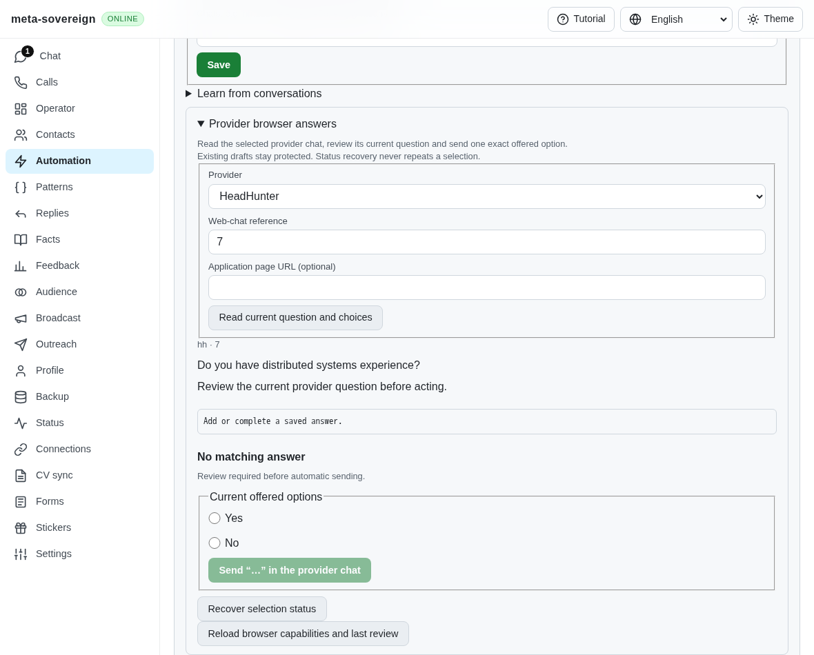
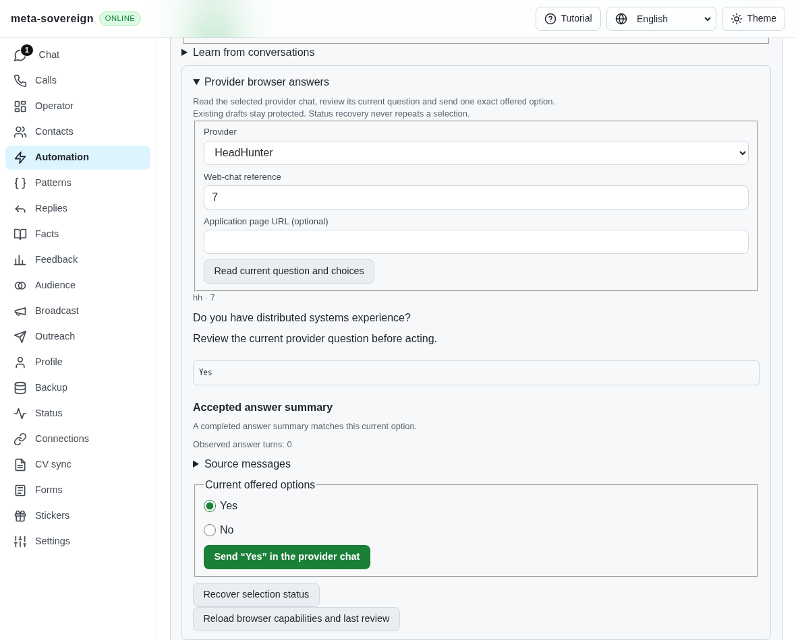
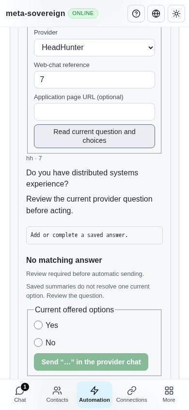

# Recover native choices from completed summaries

[PR57](https://github.com/link-foundation/meta-sovereign/pull/57) remains draft.
This completes the completed-summary recovery part of QA14; automatic provider
watchers, live provider parity and every other unchecked criterion remain open.

## Reproduction and root cause

Store an incoming completed bot summary for a question in another chat, without
an approved exact saved answer. Read that same question with native Yes/No
choices. Parent `7e0e2f4d` returns no answer and leaves both options unselected.
The planner only considered saved rules; targeted automation scans also discarded
other-chat history before planning. The independent reference behavior is pinned
at `fa0991b8c2d0896fb3b4be6c69947f0590094b15` in
[`src/chat-options.mjs`](https://github.com/konard/hh-job-application-automation/blob/fa0991b8c2d0896fb3b4be6c69947f0590094b15/src/chat-options.mjs) and its tests. No reference code was copied.

`python3 experiments/issue-56/summary-choice-before.py` temporarily restores the
actual parent planner and web bundle, proves the missing answer, captures the
before UI, and restores every file in `finally`. The initial new regression run
also records three concrete failing planner assertions. The later parent probe
uses only parent exports, avoiding a misleading missing-new-export failure.

## Result and limits

One bounded projection collects completed incoming summary pairs across chats,
including before target filtering. Exact normalized questions and one unambiguous
current provider label are required. All matching summaries must agree; unmatched
accepted answers, duplicate labels, incomplete scans or changing archives require
review. Outgoing/deleted/service/uncertain messages are excluded; later outgoing
history can identify an earlier unflagged owner message. Bounds are 10,000 valid
messages, 8 MiB estimated text and 1,000 pairs. Exceeding a bound authorizes no
summary recovery. No transcript or provider media is retained by this projection.

Approved exact options retain priority. Explicit owner corrections, rejection
policy, current-question sufficiency, significant technical subjects and matching
case settings remain in force. Summaries cannot approve learned rules, increase
owner-answer counts or authorize free-text replies, form fields or salary targets.
HTTP callers cannot invent summary evidence: previews read the store themselves.
Automatic native drafts recheck current stored evidence before delivery and share
the existing durable reservation. A changed Yes-to-No proof refuses the old draft,
while a fresh No draft sends once with a positive receipt.

CLI previews now accept offered options as text Links Notation and a strict boolean
flag. Text/binary Lino, offline previews and the shared Questions/Chat/Operator
browser controls use the same planner. Four locales distinguish accepted summary
evidence from an approved stored fact and show conflict/limited states and sources.

## Verification

- 74 focused Node checks pass, including 15 new planner/CLI/Lino/revalidation checks,
  summary learning, strict native options, existing automation and locale parity.
- 16 focused Deno checks pass. The inert-control regression now imports the small
  control-only module, avoiding the browser-only `browser-commander` dependency
  that caused exact-head Deno CI type checking to fail. This preserves the actual
  handler test rather than skipping it or weakening Deno checking.
- Three production Chromium cases pass: desktop accepted proof, phone native
  selection with one positive provider receipt and zero text sends, and conflicting
  summaries with no selected option and zero provider actions.
- Independent Playwright MCP repeats desktop, phone receipt and conflict checks,
  with zero page errors and no horizontal phone overflow. Browsers and disposable
  servers are closed afterward. These are synthetic routed provider pages, not
  proof of a signed-in live provider account.
- Scoped ESLint passes. Hosted CI covers the broader runtime/browser matrix.

Before and after:

## CI investigation retained

Exact parent Security run 42995005602 passes the earlier inert-error correction.
Checks run 42995004956 was created 2026-11-11 09:25:08 UTC for exact SHA
`7e0e2f4d9f5ff4b1a279029b31348dbe87031f0f`. Its Deno jobs report TS2307:
`browser-commander` imported by the fixture server is unavailable to Deno; Ubuntu
job 130438063259 lines 2600–2603, with equivalent Windows/macOS failures.
The isolated control module above removes that unnecessary import.
Ubuntu Node job 130438063887 lines 5943–5954 separately reports
`assignment-input` from the command stdin error handler during template-history
setup. That independently observed process-input race is corrected in the subsequent [stdin unit](ci-assignment-stdin.md);
passing summary checks do not resolve it. Complete failed job logs, metadata,
source snapshots, reproduction and screenshot hashes are retained in the
[hashed evidence bundle](data/summary-choice.tar.sha256.json).
