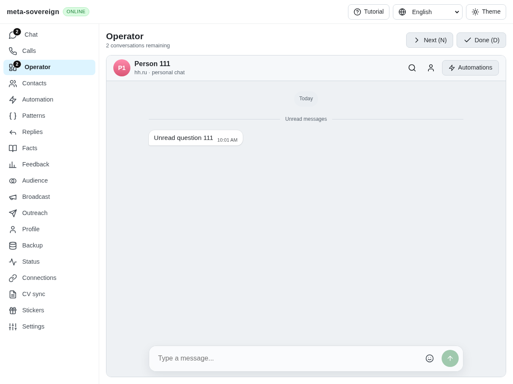

# Discovery and unavailable RTC signaling

The no-sync UI fixture repeatedly attempted `/rtc?room=default` even though `enableSync:false` had installed no signaling broker. Discovery established server identity but discarded other status information, and browser startup treated reachability as sufficient to start RTC. An independent Playwright MCP reproduction observes one real WebSocket connection attempt against the isolated server. Earlier fixtures eventually reported a handshake timeout; the current bounded reproduction records the unsupported attempt without waiting for that timeout.

Both full status and the lightweight identity probe now advertise `capabilities.webSocketSync` and `capabilities.webRtcSync` from the actual attached listeners. The probe still avoids history/statistics scans. Discovery carries capability information into browser startup. Explicitly unavailable RTC creates neither a socket nor a peer connection; servers predating these fields retain their existing behavior. Resetting a server binding also closes its RTC peer and signaling socket. Existing opt-in browser diagnostics include the discovery capabilities; no message contents or credentials are added to tracing.

All three new regressions fail before the correction: absent listener capabilities, discarded discovery information and the unsupported browser connection. They pass afterward alongside nine existing discovery cases. The actual-server regression checks enabled and disabled listeners through both Lino encodings and full/probe status. The browser-bridge regression also verifies enabled/older servers and reset cleanup. The production question browser flow now asserts that its disabled broker receives no WebSocket connection, and passes in Chromium. Focused lint, formatting and the production bundle build pass. Existing CI owns the full runtime/browser matrices and positive real RTC interoperability coverage.

Independent MCP repeats the actual Operator fixture with the corrected bundle: the unread card loads and the RTC attempt list is empty. Browser and both isolated fixture processes are closed. The screenshots preserve the actual application before/after state; the network observations, rather than a visual change, demonstrate this correction. Raw logs and transcribed MCP observations are preserved with verified hashes in `data/sync-capabilities.tar.gz`.

This fixes advertised signaling availability, not general discovery, mobile feature or storage-placement parity. The same no-account fixture still requests unsupported Telegram quick-reaction and URL-auth-domain routes; these remain recorded under the broader capability work in [PR 57](https://github.com/link-foundation/meta-sovereign/pull/57).
