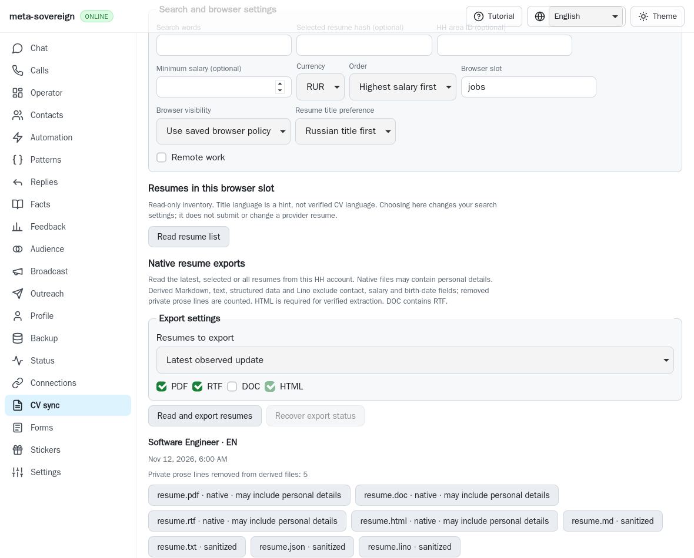
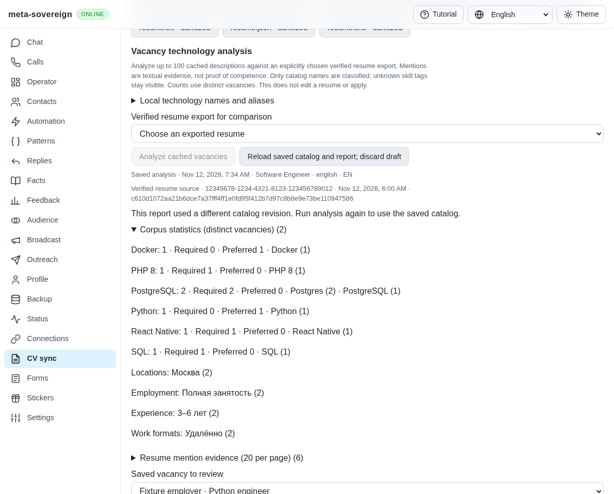
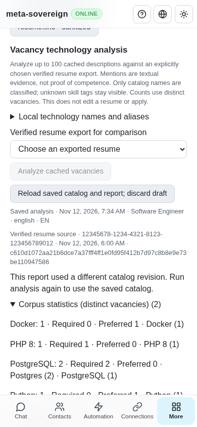

# Cached vacancy technology analysis

HH04 now has local catalog editing, required/preferred technology mentions,
distinct-vacancy statistics and comparison against an explicitly chosen verified
résumé export. CLI, text/binary Lino and the four-language CV screen use the
same service. HH19/HH20 bilingual technology review/edit plans, complete CV
editing/synchronization, authenticated live verification and every other
unchecked requirement remain unfinished in
[PR57](https://github.com/link-foundation/meta-sovereign/pull/57).

## Reproduction and resulting behavior

The published parent `72ec50bf` has cached descriptions and verified résumé
exports but no technology-analysis service or CV controls.
`technology-before.py` temporarily restores the actual parent service, bundle
and browser registry in turn, runs three focused regressions and restores each
working file in `finally`. The service and UI fail on missing analysis; the CI
contract fails on missing independent browser groups. The before screenshot
shows the actual parent screen.

Choose a verified résumé export explicitly, then **Analyze cached vacancies**.
The service verifies the exact export manifest, browser slot, file size and
digest before reading its sanitized structured CV. It retains the résumé ID,
hash, proven language, capture time and digest with the report. It reads at most
100 previously collected vacancy descriptions without opening a provider
browser, editing a CV or sending an application.

The original employer prose and visible metadata remain intact. Whole-name
matching retains field identifiers, UTF-16 offsets, observed spelling, local
context and all possible canonical candidates. Longer names consume their
span: React Native does not imply React, .NET Core does not imply .NET, and
unlisted numbered versions do not imply an unversioned product. HTML/HTML5 and
CSS/CSS3 are separate. Case-sensitive defaults avoid ordinary lowercase
“go”/“basic”; “Basic knowledge” is also excluded. NPM retains both npm and
Nginx Proxy Manager candidates and contributes no unambiguous match. An
editable catalog supports up to 256 canonical names and eight aliases per
name, including user-specific technologies. Unknown skill tags remain visible
rather than silently becoming classified skills.

Russian/English headings classify recognized mentions as required, preferred
or unspecified; responsibility/benefit headings reset classification. Inline
preference phrases override the surrounding required section. Heading prefixes
inside unrelated words do not classify them. This is bounded textual analysis,
not an assertion of competence or an interpretation of negated experience.
Only names in the saved catalog are classified. Ambiguity and unknown tags
remain visible for owner review.

Comparison uses About, each listed skill and each workplace description as
separate evidence fields. It distinguishes mentions found in CV text from
missing required/preferred names. Equivalent spelling suggestions require
existing unambiguous CV evidence; one-letter suggestions for longer unknown
skill names are hints only and never count as a match. Each technology and
each observed spelling count once per distinct vacancy. Location, employment,
experience and work-format histograms retain original employer values.

## Durability, bounds and interfaces

Catalog saves require the current revision; stale saves return HTTP 409 and
preserve the draft and report. A draft blocks analysis until an acknowledged
save. Restore defaults changes the draft only. Reads wait for a pending
durability acknowledgement; concurrent mutations reuse the workspace's existing
busy refusal. Failed catalog/report flushes restore the prior acknowledged
in-memory record. Stop and shutdown drain the existing owned-operation boundary.

An analysis report is saved only after completion and flush. Lost responses
leave the old UI report intact; explicit reload recovers through GET without
another analysis POST or provider read. Cached reports remain readable offline;
catalog editing and new analysis require a connected server. Browser-slot
changes discard old selection and ignore late replies. A changed catalog is
disclosed against an older report, rather than silently reinterpreting it.

Input snapshots/CV together are capped at 4 MiB, with 5,000 CV mentions, 2,000
mentions per vacancy and 10,000 total. Reports are capped at 12 MiB. Excess
input refuses rather than truncates or replaces a previous report. Fingerprints,
selection identity, nested arrays, evidence spans and statistic counts are
validated before rendering saved/synchronized reports, including records with
a valid fingerprint but malformed nested data.

- `vacancies-technology-catalog` reads the saved/default catalog.
- `vacancies-technology-catalog-save --file=<catalog.lino|catalog.bin|catalog.json>`
  reads a bounded file containing the current revision and edited entries.
- `vacancies-technology-analyze --export-id=<id> --resume=<hash> --revision=<catalog-revision>`
  compares the explicitly identified export; `--browser-slot=jobs` is the default.
- `vacancies-technology-analysis-stored --browser-slot=jobs` recovers the last
  report without repeating analysis.
- Matching routes are GET `technology-catalog`/`technology-analysis-stored` and
  POST `technology-catalog-save`/`technology-analyze` under `/api/vacancies/`.
  Existing trusted-mutation checks and default text/binary Lino negotiation apply.

## Verification and hosted timeout investigation

Twenty-one focused Node and twenty-one Deno checks cover extraction, distinct products
and versions, ambiguity, requirement headings, per-field evidence, frequencies,
catalog conflicts, file tampering, limits, failed durability, waiting readers,
both Lino transports, CLI files, all four localized views and exact browser
acknowledgements. Seventy-two existing vacancy, résumé, localization and CI
compatibility checks pass, together with three focused Deno CI contracts.

Four native WebKit cases exercise actual production UI/routes/service with
synthetic private exports and cached vacancies: explicit selection, saved
catalog/draft gating, stale-save recovery and a deliberately lost analysis
reply. They verify cached phone reload, keyboard access, zero horizontal
overflow, zero page errors and zero provider browser reads. Four independent
Playwright MCP cases confirm keyboard analysis, durable custom aliases,
read-only reload and desktop/phone rendering with one analysis POST, one saved
report and zero provider reads. Both browsers and the isolated server close.

The preceding exact `72ec50bf` Checks run
[43172233986](https://github.com/link-foundation/meta-sovereign/actions/runs/43172233986),
created 2026-11-12 07:01:37 UTC, failed WebKit shard 3/4, job 131029957383.
Raw job log lines 1717–1753 show successful vacancy and résumé-list groups
taking 37.5 and 70.6 seconds, followed by successful export scenarios through
07:22:10. Lines 1754–1763 show the parent runner killing the combined group
at 180,073 ms with `spawnSync ... ETIMEDOUT` during the next export scenario.
This establishes aggregate-budget exhaustion, without establishing an export
assertion failure. The four groups now have separate mandatory entries in
both engines. Existing 180-second per-entry and 35-minute per-shard deadlines,
four shards, all scenarios and failure propagation remain unchanged. A focused
contract fails against the actual parent registry. Full execution belongs in CI.

The same run's three Windows runtime failures are the two filesystem-mode
assertions corrected by `0f6692c9`; they are unrelated to technology matching.
The full run/job logs and exact-head metadata are preserved in the evidence
archive. The older WebKit profile-disclosure failure remains under separate
investigation; a cancelled shard is not a passing result. Exact new-head CI
and all unfinished issue criteria remain required.

Behavior was studied without copying code from pinned
[`konard/hh-job-application-automation@fa0991b8`](https://github.com/konard/hh-job-application-automation/tree/fa0991b8c2d0896fb3b4be6c69947f0590094b15)
2026-11-05 technology/vacancy/stack modules, tests and alias data. The
source/log/screenshot [archive](data/technology-analysis.tar.gz) retains the
reference snapshots and reproducible evidence. Run the focused tests above,
`PYTHONDONTWRITEBYTECODE=1 python3 experiments/issue-56/technology-before.py`,
or the finite native experiment with `RUN_BROWSER_E2E=1 E2E_BROWSER=webkit
node experiments/issue-56/technology-browser.mjs`. Mandatory browser CI uses
`js/tests/e2e-vacancy-technologies-browser.mjs`.

## Before and after

