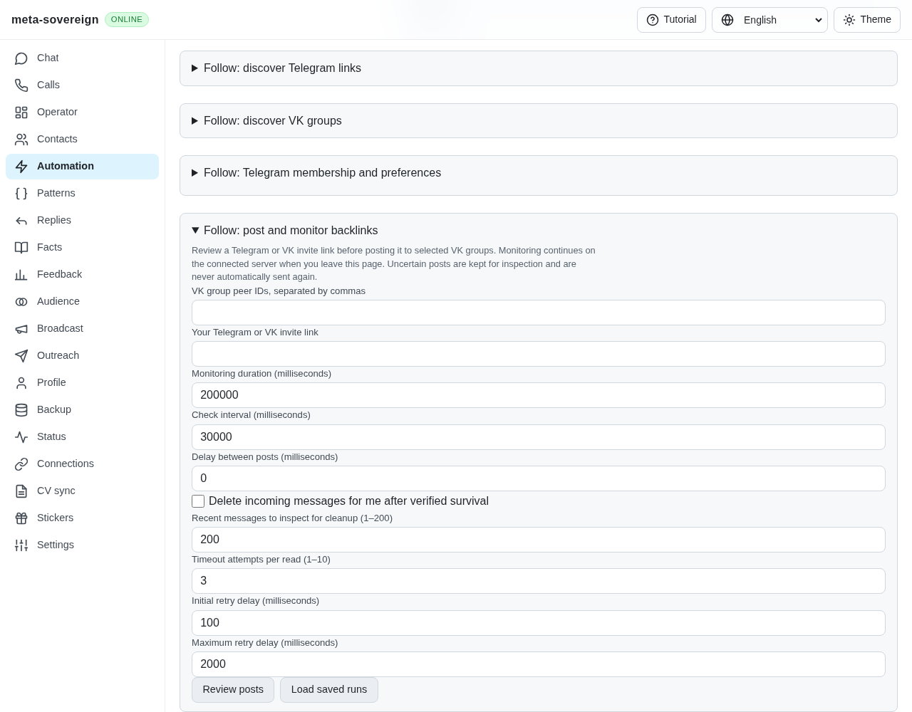
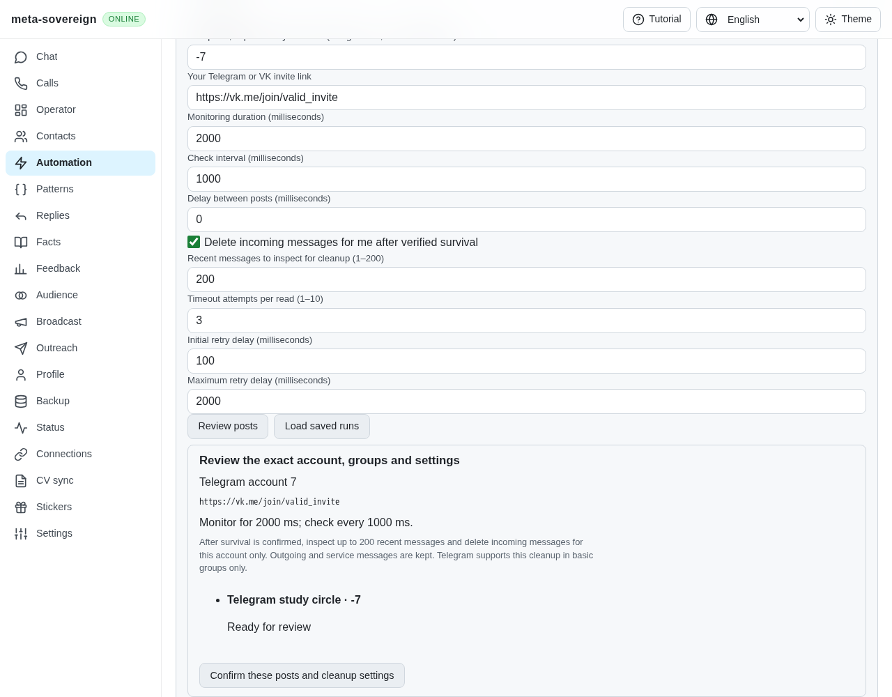
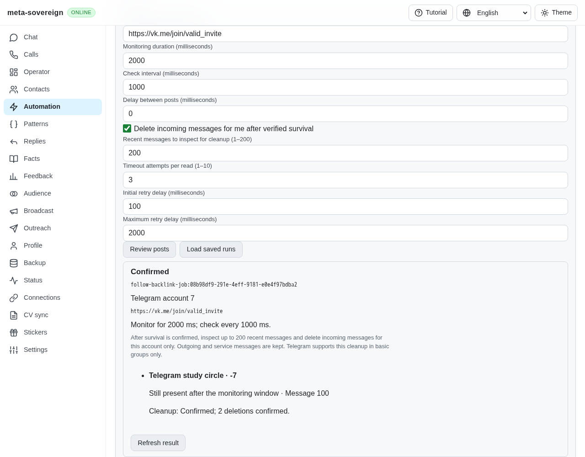
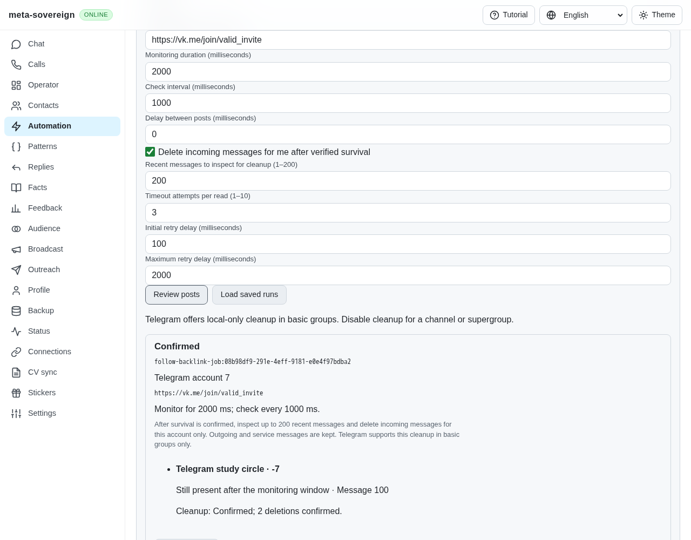
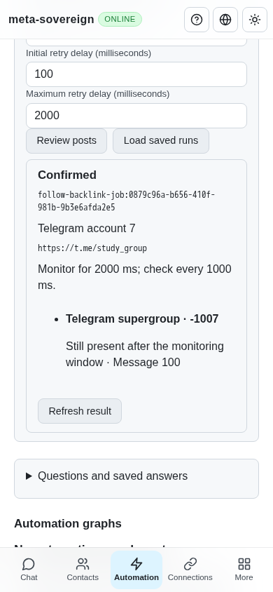

# Follow backlinks from Telegram and VK

Work for [issue 56](https://github.com/link-foundation/meta-sovereign/issues/56)
in [PR 57](https://github.com/link-foundation/meta-sovereign/pull/57).
The reviewed backlink workflow now accepts either Telegram or VK source
conversations and either provider's backlink. This is one part of FL09;
the complete automatic follow loop remains required under FL07.

| Source account | Backlink                       | Verification                                                           |
| -------------- | ------------------------------ | ---------------------------------------------------------------------- |
| VK user        | Telegram public/private invite | Existing VK production browser and focused provider checks             |
| VK user        | VK group invite                | Focused provider-pair check                                            |
| Telegram user  | Telegram public/private invite | Focused SDK/protocol checks and independent mobile browser             |
| Telegram user  | VK group invite                | Focused SDK/protocol checks and production/independent desktop browser |

Select the posting account in Automation → Follow: post and monitor backlinks.
Enter VK group peer IDs or signed Telegram group/channel IDs. Backlink type is
derived from the reviewed URL. Preview verifies the actual signed-in user,
exact destinations and write permission without posting. Existing timing,
cleanup, retry, one-use confirmation, monitoring and saved-run controls are
shared by all four combinations. All labels and recovery messages cover the
four supported locales.

## Lifecycle, receipts and capability limits

The Telegram adapter uses the existing account and request queue, disables
SDK request retries/flood sleeping, binds each adapter to the actual client
and user, and rechecks both at write boundaries and after reads. Pending
connections and queued RPCs remain owned through cancellation, queue deadlines
and account shutdown. A queue deadline cannot abandon a later send receipt.
A positively acknowledged send remains recorded if the account changes while
the response arrives. Optional `MS_FOLLOW_DEBUG=1` diagnostics contain event
metadata; default logging stays off.

Monitoring requires the original outgoing message in the exact conversation.
A service message, wrong peer, missing result vector or malformed response
cannot establish survival or removal. Only `MessageEmpty` for the requested
ID establishes Telegram removal. Telegram IDs remain strings without numeric
rounding; unsafe numeric selectors are rejected.

Telegram basic-group cleanup uses `messages.deleteMessages` with
`revoke: false`. After a valid aggregate acknowledgement, the adapter reads
back each requested ID and confirms only `MessageEmpty` results. It marks
only those incoming cached messages as deleted. Outgoing and service messages
are preserved, partial results stay unknown, and an uncertain deletion is not
replayed. Timeout-only readback retries do not repeat the deletion.

Telegram's [basic message deletion](https://core.telegram.org/method/messages.deleteMessages)
provides an optional `revoke` flag. Its
[channel deletion](https://core.telegram.org/method/channels.deleteMessages)
provides no such flag. Consequently this workflow refuses cleanup for channels
and supergroups before posting; the user can disable cleanup and post normally.
It never substitutes deletion for every participant for local-only cleanup.
The aggregate [AffectedMessages result](https://core.telegram.org/type/messages.AffectedMessages)
contains sequence counters rather than individual deletion receipts, which is
why absence readback is required.

Unknown Telegram channels require an access hash already present in the
account's peer/session cache; load the conversation in Follow first. This
avoids SDK entity helpers that may perform hidden network retries. Refusals
retain bounded RPC codes; real SDK flood/slow-mode errors retain their parsed
wait. They are not timeout retries. The account's normal persisted user/2FA
session is reused; bot accounts are refused.

## CLI and API reproduction

With a connected Telegram user account and a basic group `-7`:

```sh
meta-sovereign automations follow backlinks post --source=telegram --chats=-7 --backlink=https://vk.me/join/YOUR_INVITE
meta-sovereign automations follow backlinks post --source=telegram --chats=-7 --backlink=https://vk.me/join/YOUR_INVITE --confirm=true --delete-incoming=true
```

The first command only reviews. Default output is Lino; `--json=true` opts
into JSON. Timing, retry, history limits, saved-run listing, status, resume
and cancellation retain the options documented in [follow-backlinks.md](follow-backlinks.md).
The CLI creates the Telegram account lazily and drains it before closing.

`POST /api/automations/follow/backlinks/preview` accepts `source: "telegram"`,
`chats: ["-7"]` as string IDs and the same backlink/timing/cleanup/retry fields.
The server resolves its connected Telegram account. Text and binary Lino
reviews, confirmation and saved results share production routes. The common
remote client rejects reviews whose destination IDs contradict their source.

## Focused verification

- All 50 serial focused checks pass. They cover both source/target pairs, positive receipts,
  full-window monitoring, per-message cleanup readback, malformed responses,
  real SDK request serialization, actual SDK flood errors, uncertain-write
  replay protection, final account/cancellation boundaries, queue deadlines,
  pending connections, lazy CLI ownership, text/binary HTTP routes and locales.
- All 51 existing Telegram account/actions and locale compatibility checks pass.
- Production Chromium checks exercise both the new Telegram-source workflow
  and existing VK-source workflow. The new check waits for the new run ID
  before checking its heading, so an earlier receipt cannot satisfy recovery.
- The early draft's service-message inspection regression fails in
  `ci-logs/telegram-backlink-inspection-before.log` (`confirmed` instead of
  `paused`) and passes after exact outgoing-message validation.
- Before/after screenshots below were captured through independent Playwright
  MCP against the production bundle on isolated servers. Only external
  provider RPCs are faked. No live account receives a test post or deletion.
- Full runtime/browser matrices remain in GitHub CI. The preceding
  `333493c9` Checks failure and focused correction are recorded in
  [follow-backlinks.md](follow-backlinks.md); its other four workflows passed.

Evidence and source hashes are in [data/telegram-backlinks.tar.gz](data/telegram-backlinks.tar.gz)
and [its manifest](data/telegram-backlinks.tar.sha256.json).

Before: the posting-account selector was absent and the workflow accepted VK sources only.



After: exact Telegram account, VK backlink, basic group and cleanup review.









FL07, complete provider-pair automation, broader FL08 lifecycle/retry parity,
and every other unchecked issue-wide criterion remain unfinished. PR 57 stays
draft and unmerged until they are implemented and verified.
