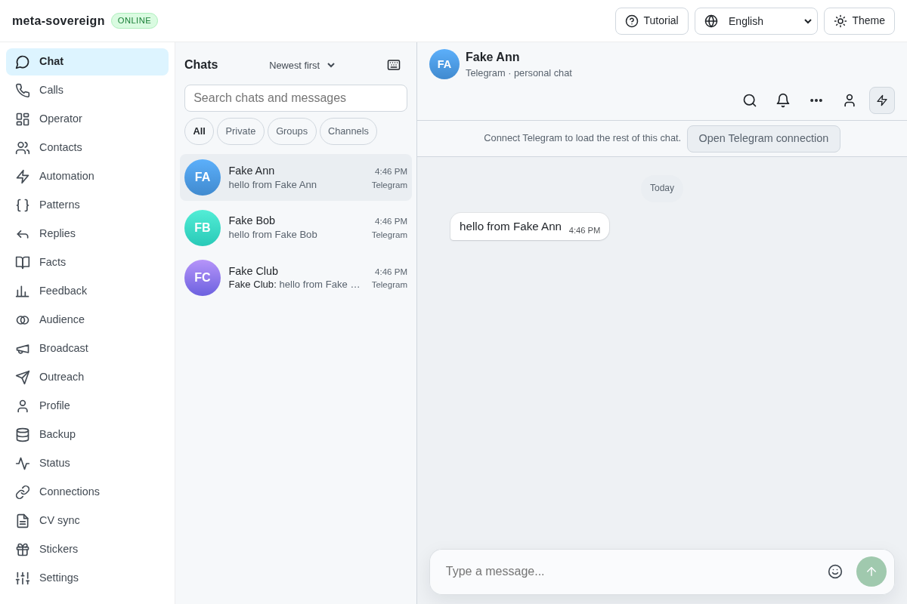

# Telegram notification capabilities

An isolated server without a Telegram account still serves cached conversations. Mounting Chat, Operator or another surface started a notification-settings POST and an account-events subscription even though those operations were unavailable. The status response only described connection state, so the client could not distinguish an absent backend from a disconnected account. Failed event subscriptions repeatedly retried the unsupported route.

The regression first runs against the previous production bundle. Its request log records one `notify-settings` request and two `accounts-events` requests, then fails. A separate API regression fails because the old response lacks explicit capability flags. These bounded reproductions and the passing results are preserved with verified hashes in `data/telegram-capabilities.tar.gz`.

Status now advertises backend availability and the notification-settings/account-events capabilities. These follow the actual backend and supported methods rather than primary-account sign-in: extra accounts can remain active when the primary account is disconnected. The browser checks capabilities before reading notification settings or opening account events. Explicitly unavailable capabilities suppress those requests; old servers without capability flags retain compatibility. A single nonoverlapping status poll detects later enable/disable changes. Transient status failures retain an existing subscription, while aborting during a preflight cannot create a late subscription. EventSource construction failures are retried on a later capability check. Capability transition diagnostics use the existing disabled-by-default browser debug switch and contain no account/message content.

Six focused regressions cover the real Lino status endpoint, changing backend methods, actual browser bridge requests, legacy compatibility, subscription transitions, abort and constructor recovery. The relevant notification/account/event/HTTP group passes 46 checks before the final constructor-recovery case; the final six-case capability target passes separately. Lint, formatting and the production build pass. The expanded existing notification browser flow fails against the old bundle and passes against the new bundle, including the existing notifications/settings behavior. This flow already runs in Chromium and WebKit CI; no local browser matrix was started.

An independent Playwright MCP check against the actual no-account server receives a `200 text/lino` status with both capabilities false and observes zero unsupported notification/account-event requests. Its only console error is the fixture's missing favicon. The browser and isolated fixture are closed afterward.

The screenshots show the same usable cached-chat context. The network assertions establish the correction; no visual redesign is claimed.

Before:

After:

This addresses one concrete capability-reporting gap in R-AA23. Full native/mobile capability reporting and the remaining provider/device requirements stay open.
