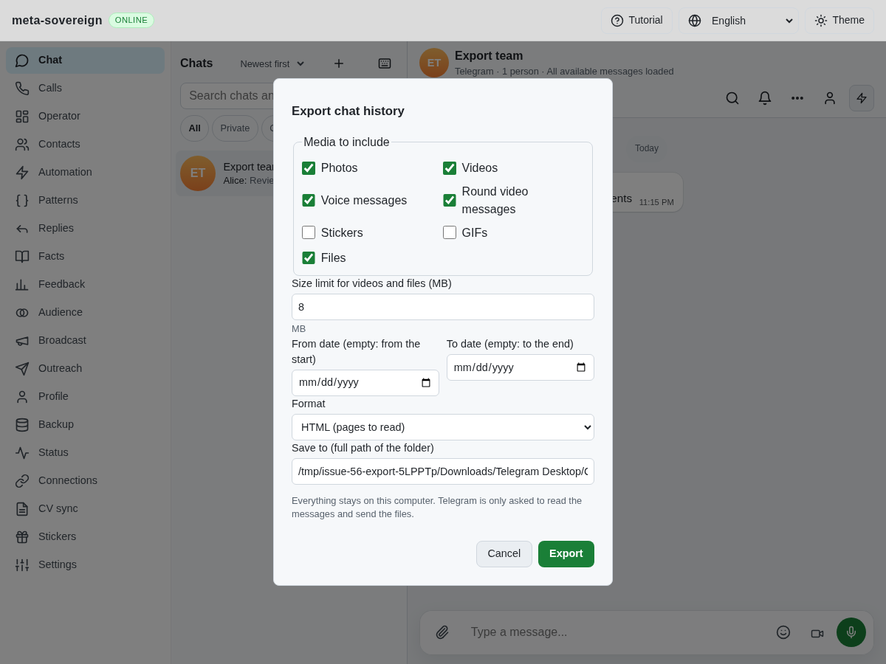
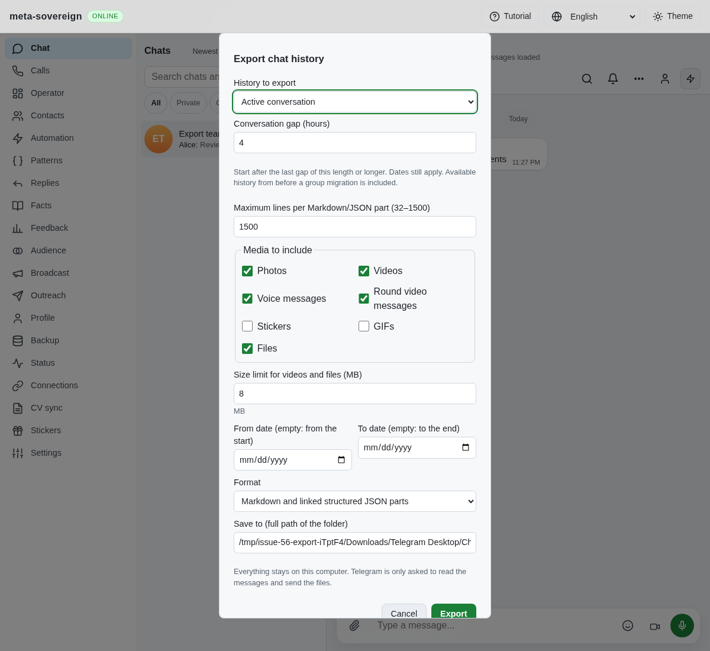
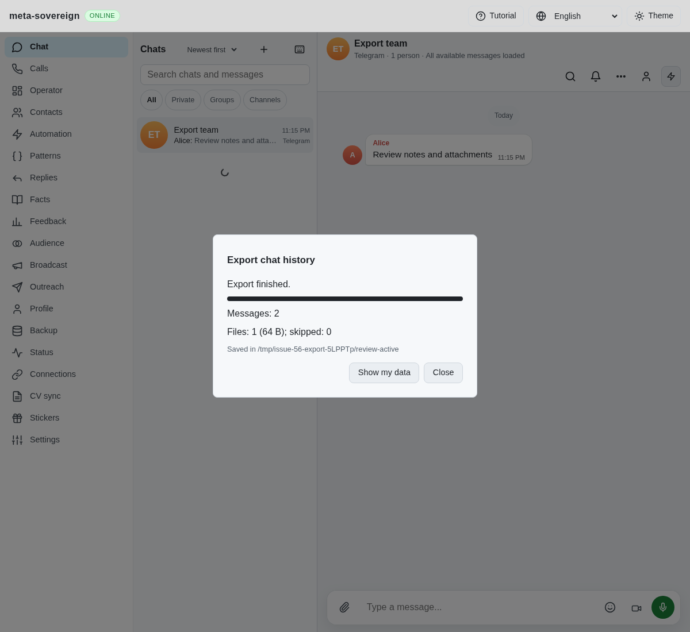
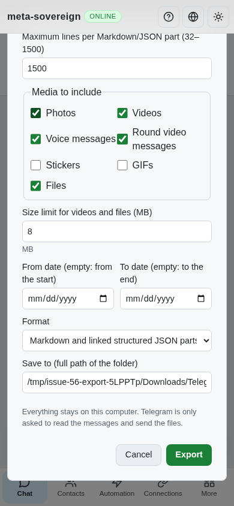
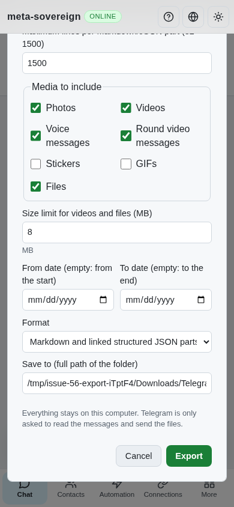

# Telegram conversation and structured history export

Issue [56](https://github.com/link-foundation/meta-sovereign/issues/56),
draft [PR 57](https://github.com/link-foundation/meta-sovereign/pull/57),
reference requirements TG01–TG02. Wider Telegram/contact and issue-wide work
remains open in the [inventory](reference-feature-inventory.md).

## Root causes and selected behavior

The existing exporter already streams HTML/JSON and actual media through the
account queue, but it reads only the current peer, accepts only numeric chat
IDs and has no latest-conversation or Markdown mode. Reusing its media,
cancellation, folder protections, progress and account ownership avoids a
second independent exporter. The shared Chat/Operator dialog preserves its
complete-history/HTML defaults; the new CLI defaults to the reference's active
conversation and Markdown. See [user controls](../../TELEGRAM-EXPORT.md).

Active discovery uses backward pages of 100, a frozen upper ID and the first
gap of at least the configured hours. It retains only peer/ID ranges, then
reuses chronological forward writing. Basic-group migration is resolved from
service actions or read-only channel metadata when the marker was deleted.
Migration cycles/depth and inaccessible history fail explicitly. Keeping the
source peer with each message also requires distinct HTML anchors for reused
IDs and peer-local reply links.

Markdown and structured parts share a physical-line budget with reserved
wrapper space. An oversized message is continued rather than violating the
1500-line cap; compact JSON keeps the full original once and explicit later
continuation references. Media paths are escaped relative links to actual
downloads; skipped/failed files keep their failure notes. Text is escaped for
literal rendering, and service-action details survive structured conversion.

Mobile review found a second defect: the existing two equal media columns
place the long Voice messages label two pixels from the next checkbox. The
shared grid now reserves a measured 12-pixel gap at 390-pixel width and allows
labels to wrap. The same dialog serves both Chat and Operator. All new text
is available in English, Russian, Hindi and Chinese.

## Reference inspection

Behavior was learned from the pinned
[telegram-bot history exporter](https://github.com/konard/telegram-bot/blob/715f937931c15810344c715e809aacf74f98912e/history-to-markdown.mjs).
The downloaded source was read outside the repository and never executed or
copied. Its active/all modes, four-hour default, media, migration and linked
parts informed the requirements. Original implementation here streams bounded
parts instead of retaining full history. Source URLs and hashes are retained
in the evidence archive. Pinned Telegram/T3 interaction guidance is recorded
in [Chat References](../../CHAT-REFERENCES.md).

Static review also found that the reference undercounts accumulated Markdown
lines and permits a single oversized record. The bounded reproducer,
workaround and proposed correction are reported in
[telegram-bot issue 15](https://github.com/konard/telegram-bot/issues/15).
The report explicitly distinguishes source inference from executing that
downloaded implementation.

## Reproduction and focused checks

Use an accessible supergroup with a migrated basic group and a deleted
migration marker. Before this slice, complete JSON export returns only the
current peer's one message. The bounded offline fixture supplies two older
messages under the old peer and now returns all three. The reusable
`experiments/issue-56/telegram-export-migration.py` swaps only the reader to
baseline `f42c4c46`, runs that regression, and restores it in `finally`.
`telegram-export-migration-before.log` fails `1 !== 3`; the after run passes.

The dedicated `telegram-export-window.test.js` has **12 passing cases**:
exact identities and invalid controls, a four-hour boundary across a 100-item
page with a concurrent arrival, migration/source IDs, deleted-marker metadata,
access refusal/partial files, HTML anchor collisions, cancellation, oversized
Markdown/JSON line bounds, dates/real media, default-off metadata diagnostics,
shared form controls and CLI cleanup ownership. **12 relevant existing export
cases** also pass; the larger existing pagination case was left to CI.

The production Chrome export flow passes existing path refusals,
cancellation/partial JSON, six-message complete export/media/reveal, active
Markdown selection, 32-line parts, mobile geometry and explicit media-failure
counts/notes. The existing browser CI matrix now includes `export` for both
engines. Full runtime/build/browser matrices were not duplicated locally.
Changed-code lint, production bundle build and formatting pass.

`telegram-export-mobile.py` holds the source/form fixed and swaps only the
stylesheet to the same baseline. Before, the strict geometry check fails at a
two-pixel gap; afterward the production Chrome flow passes. Independent
Playwright MCP uses `telegram-export-ui.mjs` with an isolated offline server,
the actual production bundle and a tiny three-message history. It selects the
active pair and writes one actual 64-byte media file. At 390×844 the measured
content width is 390, the media gap is 12 and the action is visible. The browser
and fixture were closed. Minimal fixture routes do not implement unrelated
Telegram methods; their refusal logs are retained rather than described as a
zero-console-error run.

## Visual evidence

Before and after the export controls:

Mobile spacing before and after:

## Retained evidence

`data/telegram-export.tar.gz` contains focused logs, baseline comparisons,
MCP metadata, original experiment scripts, reviewed fixture output and source
hashes; its adjacent manifest verifies every archived file. Screenshots are
committed separately above. Provider fixtures never contact Telegram or mutate
contacts. Live-account permissions and full platform matrices remain subject
to actual provider access and CI; other TG03–TG10 criteria remain unfinished.
