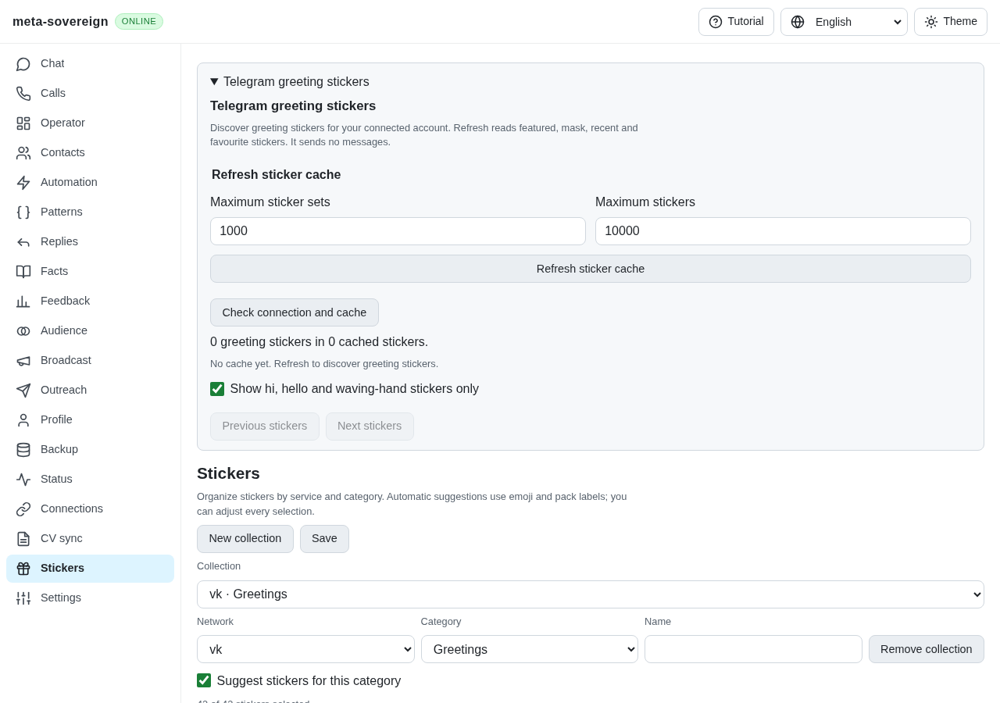
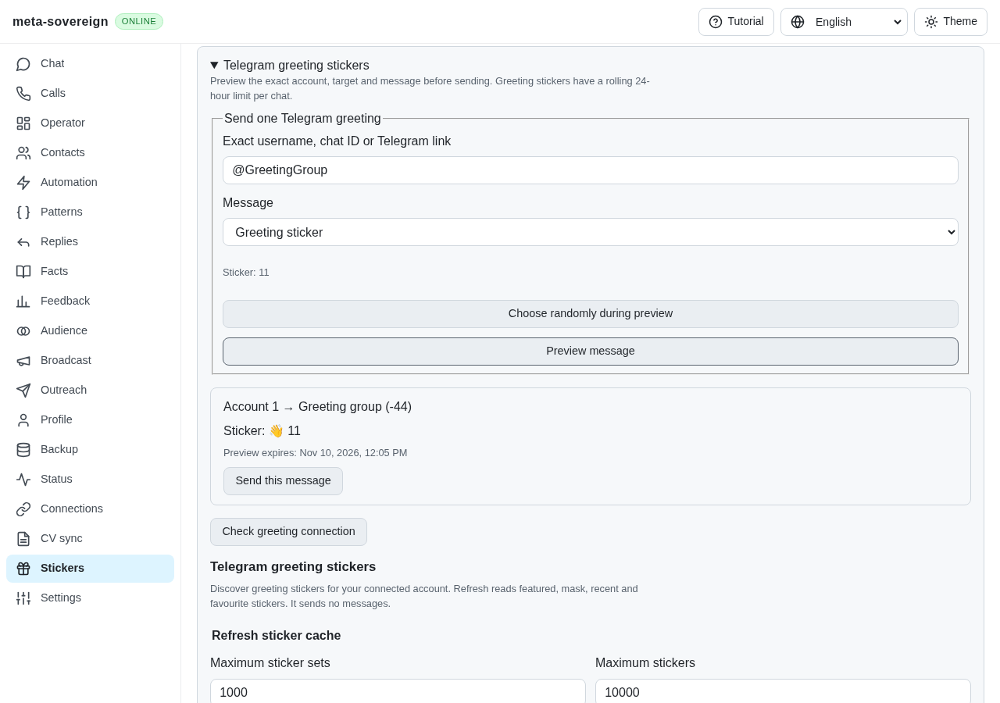
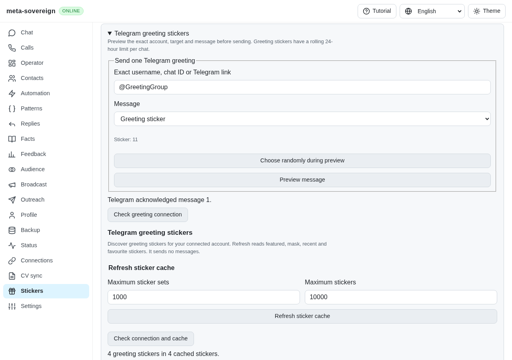
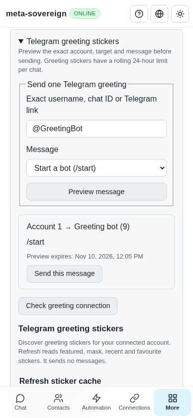

# Telegram bot and group greeting audit (TG07–TG10)

Work remains in progress in [PR #57](https://github.com/link-foundation/meta-sovereign/pull/57).
Bot startup and chosen-target greeting delivery now share reviewed account plans
through the CLI, default Lino routes and common React controls (TG07/TG08).
Participant planning and paced group delivery (TG09/TG10) are verified in the
follow-up [group greeting evidence](telegram-group-greetings.md).

The secret-free logs, installed-SDK probe and source hashes are preserved in
[the evidence archive](data/telegram-greetings.tar.gz), with verified per-file
hashes in [its manifest](data/telegram-greetings.tar.sha256.json).

## Sticker delivery receipts

The existing sticker sender accepted any resolved `messages.SendMedia` call,
including `null`, `true` or an empty `Updates` result. This could record a
greeting as delivered without a Telegram message receipt.

The minimal regression first failed with `Missing expected rejection` for a
resolved empty response. It now passes: the sender requires either a positive
short sent-message ID, an `UpdateMessageID` matching the request's random ID, or
an outgoing message naming the requested peer. Malformed, unrelated and incoming
updates produce `send-unknown`; callers must not retry these automatically.
Scheduled-message results must also match the scheduling kind. The returned
result retains the confirmed message ID. A later local update-projection failure
does not undo Telegram's acknowledgement and has identifier-free debug logging.

Focused verification (35 passing checks, concurrency one, ten-second test timeout):

```sh
node --test --test-concurrency=1 --test-timeout=10000 \
  js/tests/telegram-message-receipt.test.js \
  js/tests/telegram-stickers.test.js \
  js/tests/telegram-send-as.test.js \
  js/tests/telegram-sticker-box.test.js \
  js/tests/telegram-sticker-search.test.js
```

Strict ESLint and Prettier pass for the affected source, tests and fixture helper.
Existing sticker/GIF tests now return actual matching receipt fixtures instead
of success-shaped empty responses. The regression also covers projection failure,
wrong random IDs, invalid message IDs, peer-kind collisions and missing receipts.

## Cached greeting sticker discovery

`telegram-greeting-stickers --refresh=true` explicitly reads old featured sets,
installed mask sets, recent stickers and favourites. It resolves set documents,
deduplicates IDs and identifies alternatives containing hi, hello or the waving
hand emoji. Running without refresh only reads the account's existing cache.
The CLI supports bounded set/document counts, filtering and result pages.
`SIGINT` and `SIGTERM` cancel the run, await owned work and close storage afterward.
Incomplete refreshes return a nonzero exit code and retain their coverage report.

The `greeting-stickers-refresh`, `greeting-stickers-status` and
`greeting-stickers-cancel` account routes work over readable and binary Lino.
They advertise the actual `greetingStickersRefresh` user-account capability.
Status returns summaries without access hashes or file references. Cache records
retain validated sendable documents, including binary references serialized as
base64, under the connected account ID. Cache age is explicit after ten minutes.
Failed or cancelled refreshes preserve the prior cache; partial reads merge usable
documents. A changed account cannot publish the former account's refresh.
Pagination, document/set counts and retained account caches are bounded. Shutdown
also waits for connections that have not yet produced a refresh job. A failed
initial persistence releases the busy state without making a provider request.

Selecting a cached greeting restores its document into the existing sender. An
expired file reference rereads its original set/recent/favourite source once,
retains the updated reference and still requires a positive message receipt.

The reference's mask read incorrectly treats `messages.AllStickers` as a document
list. Telegram documents a vector of sets: [method](https://core.telegram.org/method/messages.getMaskStickers),
[constructor](https://core.telegram.org/constructor/messages.allStickers).
`experiments/issue-56/telegram-mask-shape.mjs` verifies this without a connection
using installed teleproto 1.232.1, layer 232: one returned set produces zero
documents under the old fallback. The upstream report is
[konard/telegram-bot#16](https://github.com/konard/telegram-bot/issues/16).
No reference code is executed or copied.

Focused catalog verification adds 19 passing checks across
`telegram-greeting-stickers.test.js`, `telegram-greeting-stickers-cli.test.js`
and `telegram-greeting-stickers-api.test.js`. The API test uses the production
server, both Lino encodings and origin checks with SDK fakes. No live Telegram
requests or full local runtime/browser matrix is used. The subsequent send slice
below completes chosen-target delivery and bot startup; the linked group follow-up
completes participant planning and paced private sends.

The combined catalog and existing capability/account-action checks pass all
40 cases with concurrency one and a ten-second per-test timeout. Strict lint
passes for changed JavaScript, and the production web bundle builds successfully.

## Common catalog controls

The Stickers screen now exposes explicit refresh limits, cache age, greeting
filtering, pages and per-source coverage. Opening the panel reads the cache;
it does not start discovery or send anything. Running refreshes can be stopped.
Cancelled, failed and incomplete reads remain distinct, with the previous cache
available. The component exposes greeting-only selection callbacks, now used by
the reviewed single-target sender below and the linked group planner.
Account changes remount the component. Unsupported accounts lose the
cached presentation and refresh controls, while a connection check can recover.
Late unmounted reads cannot replace a newer presentation or release its busy lock.
Cache dates follow the selected interface language. All four locales include
the new controls and recovery messages.

The model, existing Greetings and translation checks pass 44 focused cases.
The new production Chromium flow first fails on the preceding bundle because
`[data-catalog-panel] summary` is absent. After the change it passes against the
actual server and default readable Lino transport: 105 bounded fixture documents,
100-item pages, non-greeting filtering, invalid limits, partial cache merging,
cancellation during an active request, failed-source coverage, reload recovery,
unsupported-account gating and a 390-pixel viewport. No `SendMedia` call occurs.
The filter check awaits its completed read, since a failed read must preserve
the last successful filter. The deliberately held request is released in cleanup
even if an assertion fails. The test is registered in existing browser CI;
the full Chromium/WebKit matrix remains CI work.

```sh
node --test --test-concurrency=1 --test-timeout=10000 \
  js/tests/telegram-greeting-catalog-model.test.js \
  js/tests/i18n.test.js js/tests/greetings-web.test.js
RUN_BROWSER_E2E=1 npm run test:e2e:telegram-greeting-catalog
```

Independent Playwright MCP uses `experiments/issue-56/telegram-greeting-ui.mjs`,
an isolated production server and bounded SDK fixture. It confirms four usable
documents, complete coverage, explicit refresh and mobile layout without external
Telegram calls. External VK thumbnail requests receive a tiny fixture image.
The browser and fixture server are closed afterward. The tiles show document
emoji/identity summaries; they do not claim to display the actual sticker artwork.

Before, no account discovery controls:


After, explicit cache refresh and source coverage:


Mobile controls and results:


## Reviewed bot startup and chosen-target sends

The previous catalog had no chosen-target send controls. The shared Stickers panel
now previews the connected account, exact typed Telegram destination and either
`/start` or a frozen cached greeting document. Previewing only reads. Explicit
confirmation consumes the five-minute plan once; changes to the target invalidate
the local preview. Bot startup requires an actual bot. Greeting targets include
users, basic groups and channels without conflating their overlapping numeric IDs.

```sh
# These commands only preview. Use a real configured account and chosen target.
meta-sovereign telegram-bot-start --chat=@chosen_bot
meta-sovereign telegram-greeting-stickers --refresh=true
meta-sovereign telegram-greet --chat=@chosen_public_chat
# Explicit --confirm=true previews and sends that same reviewed plan once.
```

The `greeting-send-preview`, `greeting-send-apply` and `greeting-send-cancel`
routes use the actual user-account capability and support both Lino encodings.
The CLI, route and UI call the same account implementation. The sender rechecks
account identity, destination kind, input peer and cancellation immediately before
each provider write, including expired-reference renewal. A replaced active client
cannot send using the old session. Cancellation and shutdown own pending reads
and await any write already in flight. No write is automatically replayed.

A durable intent is saved before the outbox write. Concurrent plans, a restart,
missing acknowledgements and unfinished writes cannot bypass an unresolved outcome.
Only a positive Telegram message receipt records success. An explicit RPC refusal
is a failed send; a read timeout before the RPC is a definite non-send; an ambiguous
write or missing receipt remains uncertain. A local projection failure after an
acknowledgement preserves success. The shared Outbox can resolve an uncertain
outcome after the user checks Telegram. A successful greeting blocks another to
the same account/destination for a rolling 24 hours, including across midnight.
Bot startup has separate intents and does not use this greeting cooldown.

Verification uses bounded SDK fixtures, never a live Telegram write:

- The two sender-guard regressions fail before the fix and pass after it: a
  denied guard previously still sent, and a refreshed peer was ignored.
- 53 focused backend/CLI/API/receipt/capability/catalog checks pass serially with
  ten-second test timeouts. They cover immutable plans, account/peer changes,
  receipt loss, persistence failures, cross-factory concurrency and shutdown.
- 45 shared send-model/Greetings/translation checks pass. Another 57 existing
  account/action/sticker/send-as checks pass unchanged.
- Strict changed-code lint, formatting and the production web bundle pass.
- The registered production Chromium test fails against the preceding bundle
  because send controls are absent, then passes with reviewed group/user/bot
  targets, acknowledgements, cooldown, uncertainty, recovery and a 390-pixel view.
- Independent Playwright MCP verifies preview, explicit acknowledged send and
  bot preview in an isolated production server. Browser and fixture are closed.

```sh
node --test --test-concurrency=1 --test-timeout=10000 \
  js/tests/telegram-greeting-send.test.js \
  js/tests/telegram-greeting-send-cli.test.js \
  js/tests/telegram-greeting-send-api.test.js \
  js/tests/telegram-sticker-send-guard.test.js
RUN_BROWSER_E2E=1 npm run test:e2e:telegram-greeting-send
```

Before, cached catalog without send controls:



After, exact destination and document awaiting confirmation:



Only a positive receipt displays acknowledged delivery:



Mobile bot preview retains the exact account and destination:



TG09 participant eligibility and TG10 group limits, pacing and acknowledged
progress are verified in [the group follow-up](telegram-group-greetings.md).
The complete runtime/browser matrix remains CI work.
