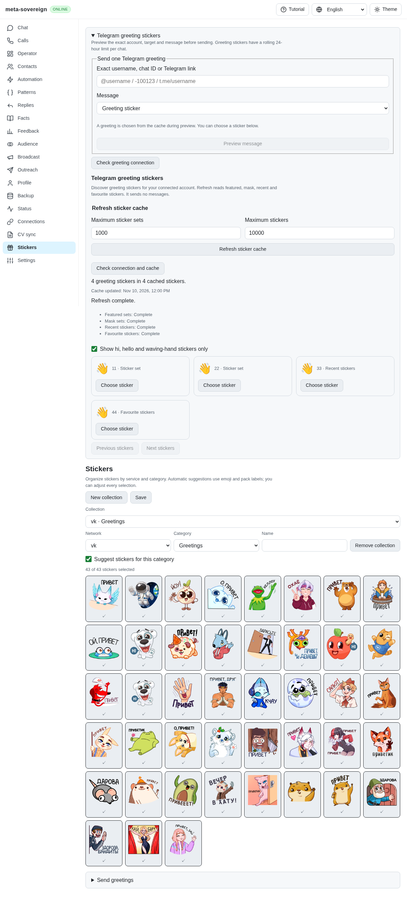
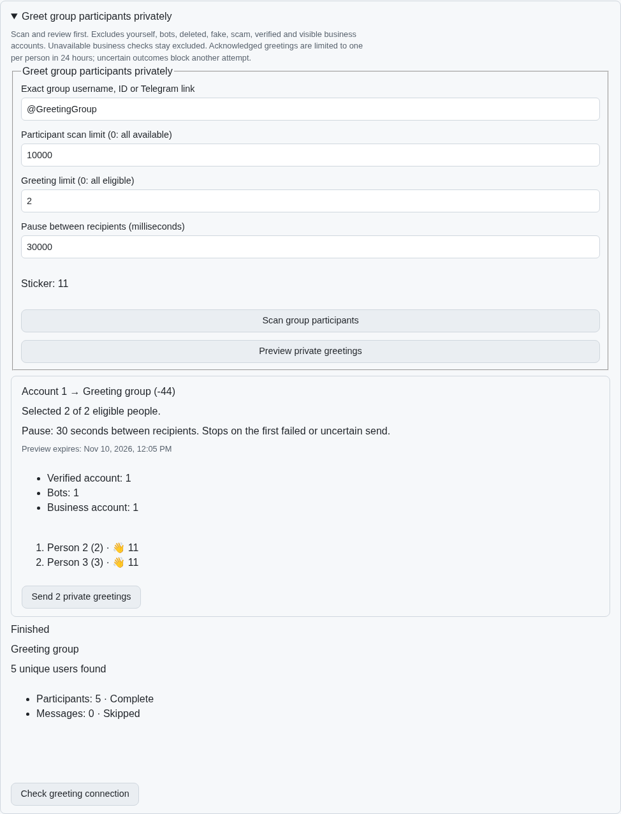
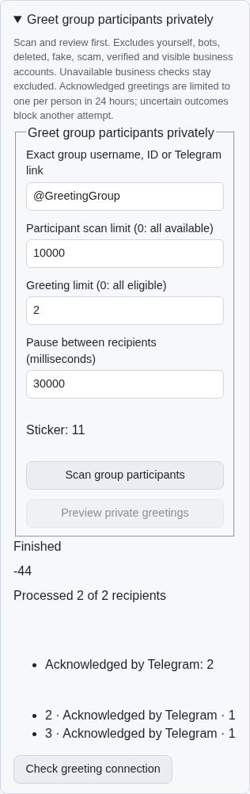
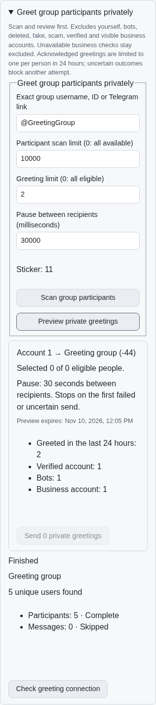

# Reviewed private group greetings (TG09/TG10)

TG09/TG10 now share participant scanning, read-only previews and explicitly
confirmed private greetings through CLI, default readable/binary Lino routes
and the common React Stickers screen. Work on the other issue-wide criteria
continues in [PR #57](https://github.com/link-foundation/meta-sovereign/pull/57).

## Selection and review

The group selector requires an exact username, signed ID or Telegram link.
Only accessible basic groups and megagroups qualify; broadcast channels,
people, inaccessible peers and mismatched numeric identities are rejected.
The scan reads participants only. Capped or forbidden participant sources
retain partial coverage; history authors are not substituted for membership.

Self, bots, deleted, fake, scam, support, verified and visible business accounts
are excluded. Telegram exposes business configuration in `UserFull`, rather
than a universal boolean on `User`. The planner reads `users.getFullUser` and
checks visible work hours, location, greeting/away messages and introduction,
plus business bot flags. Missing, failed or mismatched full-profile reads stay
ineligible. This does not claim visibility into business configuration Telegram
does not expose. Primary schema references: [userFull](https://core.telegram.org/constructor/userFull),
[getFullUser](https://core.telegram.org/method/users.getFullUser) and
[channel](https://core.telegram.org/constructor/channel). The installed teleproto
1.232.1 schema confirms these fields and megagroup/broadcast flags.

The preview freezes the account, typed group, participant IDs, a separate
cached sticker selection for every recipient and the limit/pause options.
The default backend/CLI limit is zero (all eligible users); the UI starts at 20. The default pause is 30 seconds. Plans expire after five minutes, are
single-use, retain at most three previews and are invalidated by a new scan.
The response shows exclusions, coverage and the first 100 reviewed recipients
without phone numbers, access hashes or binary file references. Editing UI
inputs or the selected sticker invalidates the displayed preview.

```sh
# Reads participants and prints the exact selection; sends nothing.
meta-sovereign telegram-greet-group --chat=@ExactGroup --limit=2 --sticker=11

# Separately scans, previews and explicitly confirms this invocation's plan.
meta-sovereign telegram-greet-group --chat=@ExactGroup --limit=2 --sticker=11 --confirm=true
```

The corresponding routes are `chat-users-greetings-start`,
`chat-users-greetings-preview` and `chat-users-greetings-apply`. Existing
`chat-users-status` and `chat-users-cancel` provide shared bounded progress and
cancellation. Origin validation precedes account calls; apply requires the
literal boolean `confirm: true`. Capabilities reflect implemented user-account
methods. Bot-only and unsupported accounts do not expose usable controls.

## Delivery and lifetime

Each sticker goes to the reviewed person's private peer. Before each write,
including a renewed file-reference attempt, the sender rechecks the connected
account/client, group identity, recipient identity and current eligibility.
Individual and group greetings share durable intent/outbox records and a rolling
24-hour interval across midnight and process restarts. An unresolved write
blocks another plan for that person until its outbox is resolved. A missing
receipt or transport uncertainty is not retried. The batch stops on the first
failed or uncertain attempt. Explicit RPC refusals remain definite failures.

Only a positive matching Telegram message receipt increments the sent count.
The outbox stores the acknowledgement before a `telegram-greeting-result`
record is saved. Failed/unknown/skipped attempts have their own counts and
codes. Cancellation interrupts the pacing wait, prevents further recipients
and waits for an already active receipt. A lost HTTP apply response consumes
the browser's plan and is never replayed; polling can reconcile its exact plan
ID with the server job. Draft inputs survive connection/capability recovery.

The shared scan/contact runtime previously owned only an already launched job.
To reproduce its shutdown race, hold the importer or username resolution,
start a scan, then stop/cancel before releasing the held read. Shutdown returned
early and cancellation allowed a late scan to launch. The reusable
`experiments/issue-56/replay-users-startup-before.py` runs the regressions against
`fccb2648` and restores the source in `finally`: both lifecycle tests fail before
the fix. Owned startup work now closes permanently with the account, checks
cancellation before publishing/launching and releases failed startup locks.
The existing CLI test constructs a fresh account for each invocation, matching
real application lifetime.

## Verification

All local checks are focused and serial. No live Telegram writes or full local
runtime/browser matrix is used.

- 70 focused backend, CLI, production Lino API, model and existing scan/contact,
  single-greeting and capability checks pass.
- 43 model, existing Greetings UI and four-locale checks pass.
- 38 existing account/action and send-as integration checks pass.
- Strict changed-source ESLint (zero warnings), Prettier and the small existing
  web bundling script pass.
- The production Chromium regression first fails against the preceding bundle
  because the group controls are absent. It passes after implementation: opening
  is read-only, scans and previews send nothing, edits invalidate previews,
  exact private recipients receive acknowledged stickers, 24-hour exclusions
  appear, missing acknowledgements stop without retry, unsupported kinds hide
  controls, recovery retains inputs and the 390-pixel viewport fits. The scan
  and preview buttons retain the shared 12-pixel control gap. Screenshots use
  a taller capture viewport to keep fixed navigation outside the element crop.
- Independent Playwright MCP verifies the actual production UI with the bounded
  SDK fixture, including verified/bot/business exclusions, per-person sticker
  IDs, explicit confirmation, acknowledged counts, cooldown and mobile layout.
  Browser and isolated fixture are closed afterward. The MCP console contains
  only the existing missing favicon and unavailable external VK sticker images;
  automated verification uses deterministic image responses.

The reusable fixture is `experiments/issue-56/telegram-group-greeting-ui.mjs`.
The new browser scenario is registered in the existing browser CI list and
package scripts. Full runtime and browser matrices remain CI work.
Credential-free logs and source/image hashes are preserved in
[the evidence archive](data/telegram-group-greetings.tar.gz), with a verified
[manifest](data/telegram-group-greetings.tar.sha256.json).

Before, the group workflow was absent:



After, an exact frozen preview requires explicit confirmation:



The mobile result retains actual acknowledgement counts:



An immediate rescan excludes both previously acknowledged recipients:


