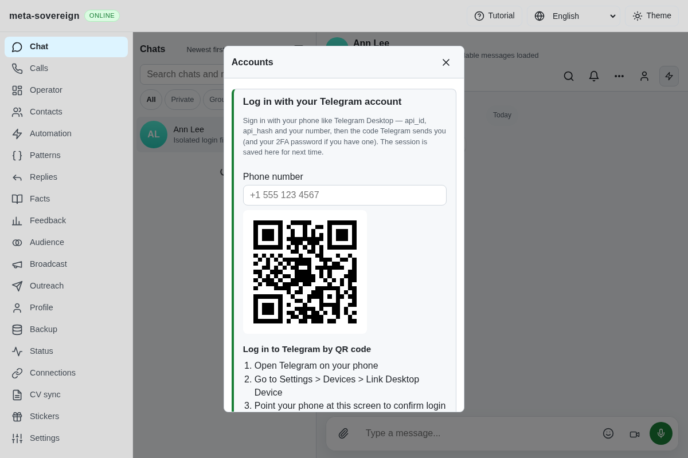
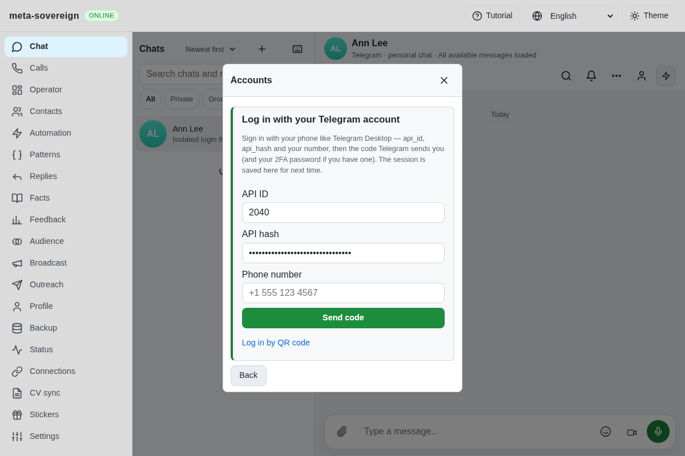
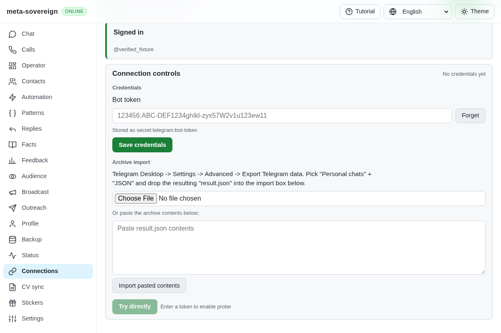
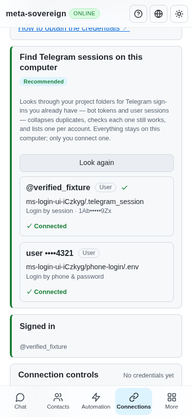

# Telegram login ownership and shutdown

TG06 requires persistent user sessions, phone/2FA, migration and clean timeout
shutdown. The lifecycle audit found that phone completion dropped its route
controller without closing the client, session identification connected outside
its cleanup scope, and cancellation could publish a late successful result.
Rejecting the unused phone-password deferred also produced an unhandled rejection.
The same late-result race existed in QR export. The first five focused regressions
all fail against the preceding implementation, including a cancelled QR login
changing back to `done`.

Short-lived authorization clients now own a single idempotent cleanup operation,
prefer the SDK's `destroy()` and fall back to `disconnect()` for older clients.
The installed Teleproto 1.232.1 implementation additionally closes its network
manager and clears update/lifecycle handlers in `destroy()`. This preserves the
saved authorization; it does not call `logOut()` or delete the session. Successful
phone and QR controllers report `done` only after cleanup. Cancellation and
expiry clear credentials and prevent pending connection, account, token or
password callbacks from restoring success.

Identification has a 12-second deadline. Interactive authorization has a
five-minute lifetime and a 60-second bound on each submitted step. Every rejected
code/password gets a fresh deferred prompt, matching the SDK's retry contract;
an old rejected value cannot loop through subsequent prompts. Wrong-step and
missing phone-flow input are rejected. Pending route controllers are bounded to
eight, expire after five minutes, and are removed before cancellation cleanup.
Shutdown waits for controllers, factories and expiry cleanups already in progress
before store release. Route ownership is checked again before saving a result.

`MS_TELEGRAM_LOGIN_DEBUG=1` enables phase-only events through the configured server
logger. The library also accepts `debug`/`log`. Defaults are silent and the test
asserts that records contain only event/phase, with no credentials or user input.

Validation: **34 focused Node tests pass**, concurrency one, covering the five
original failures, hung identification, idle expiry, code/2FA retries, awaiting
destruction, registry capacity and shutdown races, actual HTTP cancellation and
secret persistence, existing QR migration/renewal and extra-account behavior.
Changed files pass strict focused ESLint. Tests use finite fakes and isolated
temporary servers/stores; no real account is contacted. Evidence and installed
SDK/source hashes are in `data/telegram-login.tar.gz`, independently checked by
the adjacent SHA-256 manifest. CI remains responsible for other runtimes.

The terminal now shares that lifecycle through `telegram-login` and
`telegram-session-import`. Inputs are masked, secret arguments are rejected,
SIGINT/SIGTERM and the five-minute lifetime cancel pending prompts, and client
cleanup precedes store closure. A failing-before prompt regression catches
Ctrl+C's generic abort outcome; the fix also settles EOF and restores raw mode.
Legacy-file reads are bounded and read-only. The account is verified before
credentials replace an existing session; failed verification preserves it.
The installed SDK independently loads and resaves synthetic old GramJS IPv4
and string-address sessions offline. All **15 CLI, route and SDK checks pass**,
including retry, cancellation, invalid files and private-output assertions.
See [terminal usage](../../TELEGRAM-LOGIN.md).

The production browser regression also fails before the UI correction: start
QR sign-in, switch to phone while the request is pending, then release the QR
response. The page incorrectly shows a QR panel in phone mode. A shared login
owner now invalidates prior mode/scan responses, cancels late controller IDs
even after unmount, and retains cancellation ownership through 2FA. Finder
rescans cancel pending inline sign-ins. Accepted steps clear entered codes and
passwords; completion clears the credential form. Successful controllers are
released before navigation so saved authorization is preserved.

The complete focused group passes **48 checks**, concurrency one. Production
Chrome verifies the failing-before race, mode/unmount cancellation, wrong/right
code and password retries, actual extra-account persistence, read-only legacy
finder import, rescan cleanup and inline 2FA. The existing QR renewal/success
browser flow also passes. Both flows are now registered in the existing
Chromium/WebKit CI matrix; other engines are left to CI. Independent MCP uses
actual routes for primary login, legacy import and inline 2FA. Desktop/mobile
screenshots show confirmed state, zero remaining private inputs and a 390-pixel
document fitting its viewport. Direct Connections navigation has no application
errors or failed API responses; the fixture favicon is missing. An earlier
cached-chat navigation exposes additional unsupported optional-provider reads,
recorded separately as open issue-wide capability work. All browsers, servers
and temporary credentials are closed after verification.

Before (late QR replaces the chosen phone flow):

After (phone flow and inputs remain available):

Independent verification:

TG06's CLI/API/UI login, persistence, legacy migration and bounded shutdown
criteria are now implemented and covered by these isolated regressions.
TG07–TG10 and the other issue-wide requirements remain open;
[PR 57](https://github.com/link-foundation/meta-sovereign/pull/57) stays draft and
unmerged.
