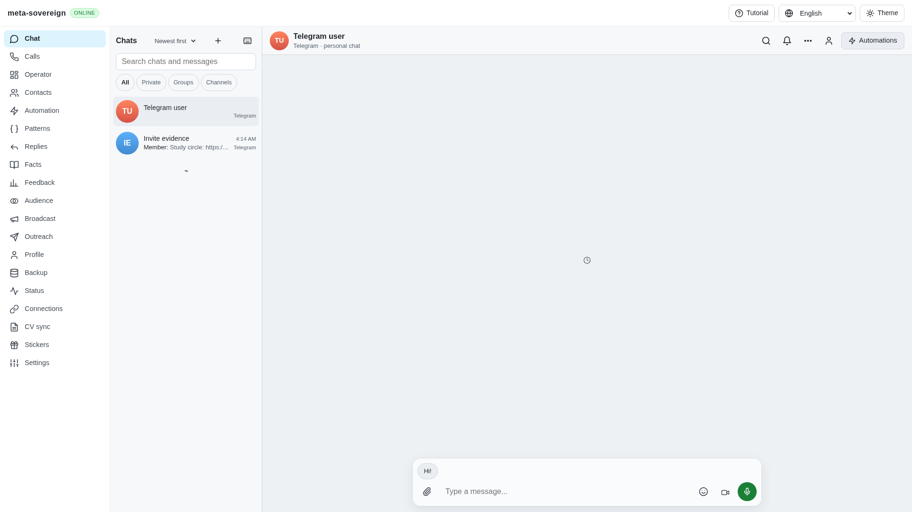
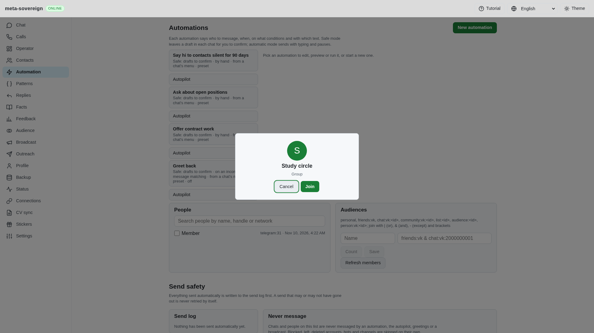
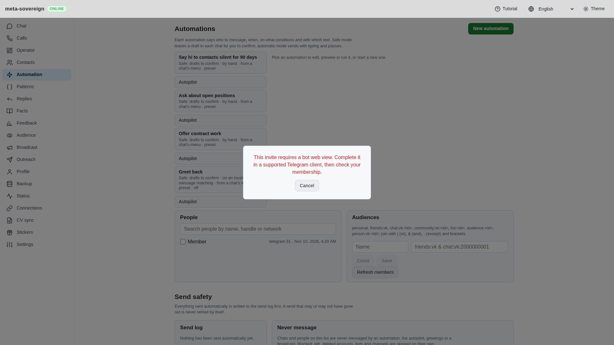
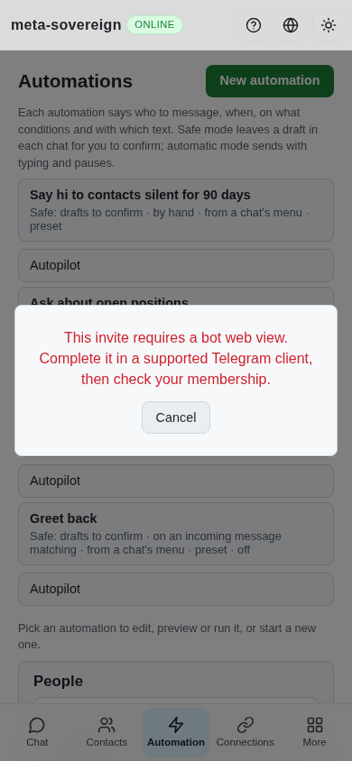

# Telegram membership and preference acknowledgements

Issue: <https://github.com/link-foundation/meta-sovereign/issues/56>. Draft implementation: <https://github.com/link-foundation/meta-sovereign/pull/57>.

This corrects shared Telegram actions required by FL03/FL05. Their complete Follow CLI/API/UI workflow, listing and reviewed leave operations remain unfinished. This evidence does not complete FL03–FL09 or the wider issue.

## Reproduction and root causes

The isolated fixture in `experiments/issue-56/telegram-membership-ui.mjs` runs the production server over a memory store and offline provider-shaped RPC replies. Before the correction, opening its invite treated `ChatInvitePeek` as existing membership, closed the preview and navigated to an unjoined chat. The subsequent loading placeholder in the before image comes from the fixture's absent history reader; the incorrect navigation happens before that read.

The old join unwrapping selected `answer.updates` even when a direct `Updates` response used that field for its update array, losing its chats. Missing responses, empty objects, left chats and bot web-view responses still returned success. Recommended public joins never inspected their response or applied its updates. Mute passed an `InputPeer` where Telegram requires `InputNotifyPeer`; mute/archive projected success without checking the acknowledgement.

The pinned Follow reference (`af8fbb80cec26a7b5b205c93314372d1d92cec1f`) and its recent PRs 9, 10, 12, 14 and 16 were read without executing upstream code. Telegram's [invite documentation](https://core.telegram.org/api/invites) distinguishes temporary peek access and pending approval from membership. The installed teleproto 1.232.1 and repository layer-232 schema establish the current join-result wrapper and notify-peer types; older direct Updates remain supported.

## Result

Peek access retains a read-only join preview. Unknown member counts are omitted. Join success requires an eligible returned group/channel and, for public recommendations, the exact requested chat. Direct and wrapped Updates reach the common live handler. A bot web view requires completion in a supported Telegram client; it never claims membership. Missing or lost responses remain uncertain. Explicit approval requests retain their existing pending state.

Mute uses `InputNotifyPeer` and requires Bool true; archive requires a recognized Updates response before either changes the local list. Unconfirmed responses preserve the list. Invite and recommendation dialogs retain localized guidance, block repeated writes in the current uncertain dialog, guard double clicks and ignore navigation after unmount. These legacy actions do not yet provide durable Follow operation deduplication across fresh previews.

Set `MS_TELEGRAM_MEMBERSHIP_DEBUG=1` to emit bounded operation/result metadata through the existing logger. It defaults off and excludes invite hashes, account credentials and provider diagnostic text.

## Verification

- All six original receipt regressions fail against f01a91a4; `telegram-membership-before.log` preserves their assertions. Eight new cases now pass, including lost-response/pending-approval handling and missing check responses.
- Sixty focused checks pass: membership receipts, existing invite/dialog/recommendation compatibility and four-language dictionary checks.
- The production Chromium membership flow passes with actual adapter actions and default Lino routes: peek preview, explicit join, web-view/unknown/pending outcomes, double clicks and 390-pixel mobile layout. It is registered in the CI browser catalog.
- Existing production invite-link and pinned-list browser flows pass separately in Chromium. Full runtime/browser matrices remain in CI.
- Strict lint, formatting, secret scan, regenerated production bundle and whitespace checks pass. The first browser probe dispatched its event before the host mounted; its preserved startup log is fixture evidence, not a product regression. The fixture now waits for the mounted Automation view.
- Independent Playwright MCP reproduced the old navigation, verified the corrected preview and web-view result, and measured mobile document/viewport width as 390/390. The before fixture's unsupported background reads and the first after fixture's unsupported calls read are retained in console logs; the reusable fixture now supplies the calls reader. No live Telegram calls were made. Owned browsers and servers were closed.

The evidence archive is [data/telegram-membership.tar.gz](data/telegram-membership.tar.gz), with its member hashes in [data/telegram-membership.tar.sha256.json](data/telegram-membership.tar.sha256.json).

## Visual evidence

Before: peek access navigates to an unjoined chat.

After: the user can review and explicitly join; an unavailable count is omitted.

After a web-view result: no membership claim or automatic retry.

