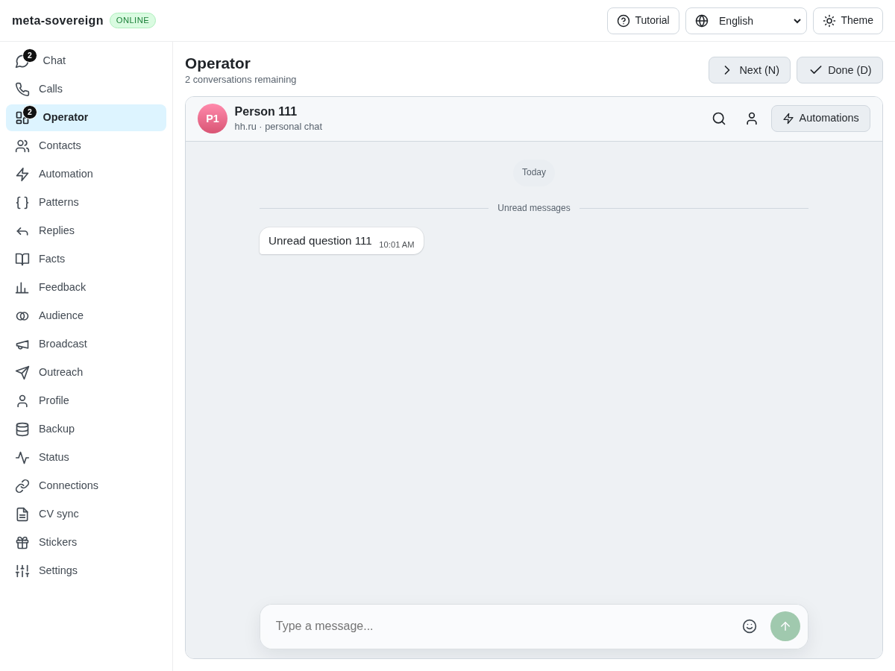

# Optional Telegram reads in cached Chat and Operator

An Operator card containing only cached HH messages started `quick-reaction` and `url-auth-domains` POSTs against an isolated server with `telegramAccount:false`. Both returned 404. The shared reaction and login-link controls mounted independently of the message provider, while their browser API methods posted without checking backend availability. The earlier notification capability fix did not cover these operations.

Telegram status now advertises `quickReaction`, `quickReactionSet` and `urlAuthDomains` independently, based on the actual method and a user-account backend. Bot-only or absent credentials cannot support these user operations. Notification reads and these optional calls share one descriptor-based preflight in `telegram-call-api.js`. Explicit false suppresses the operation and returns an unsuccessful, unsupported result. Unreachable status remains an offline/unknown result, and older servers without flags retain their behavior. A getter does not grant the separate setter capability. Existing disabled-by-default browser diagnostics record the unavailable feature and state without request contents.

`telegram-optional-capabilities.test.js` checks the real status endpoint in both Lino encodings, independent method changes, user/bot/absent account kinds and actual browser bridge requests. The initial status regressions fail before implementation. The first bridge attempt also exposed a missing identity field in its new HTTP fixture; that fixture was corrected before the passing run. The expanded existing `e2e-notify-browser.mjs` provides the direct production regression: the old bundle fails with both unsupported POSTs, and the rebuilt bundle passes while preserving its notification/settings scenarios. Forty-one focused capability, sticker and bot-login checks pass. Changed-code lint, formatting and the production build pass.

Independent Playwright MCP verifies the real no-account Operator fixture. First it loads the production bundle from `9835c606`: both optional POSTs return 404. It then reloads the rebuilt bundle against the same server and unread HH card: the request list for notification settings, account events, quick reaction and login domains is empty. The tutorial is closed for both screenshots; neither image claims a visual redesign. The only remaining browser console error is the fixture's favicon. All browser and fixture processes are closed. Raw logs and MCP observations have verified hashes in `data/telegram-optional-capabilities.tar.gz`.

This closes the two concrete startup requests recorded in [signaling capabilities](sync-capabilities.md). Full device/provider capability coverage and issue 56 remain unfinished in [PR 57](https://github.com/link-foundation/meta-sovereign/pull/57).
