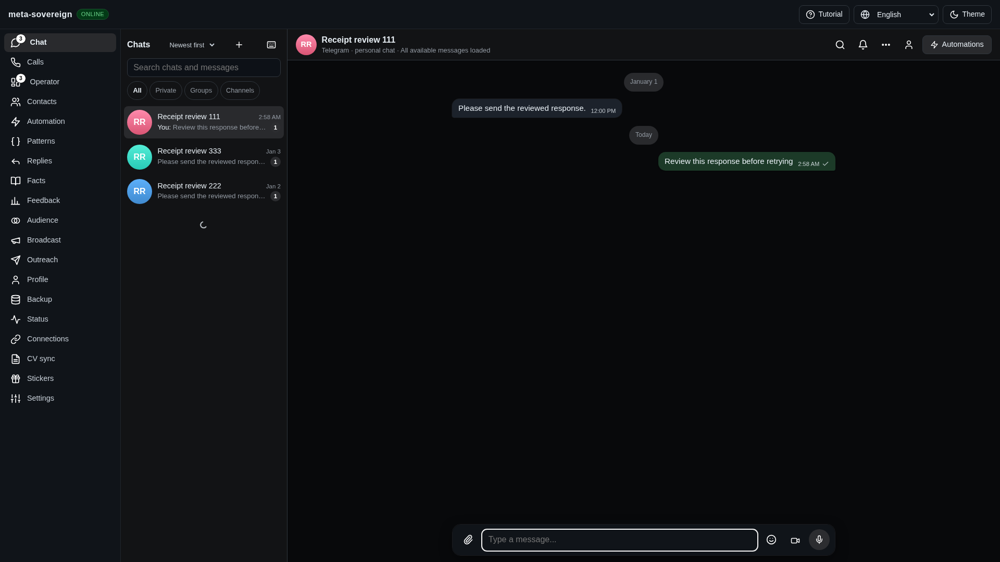
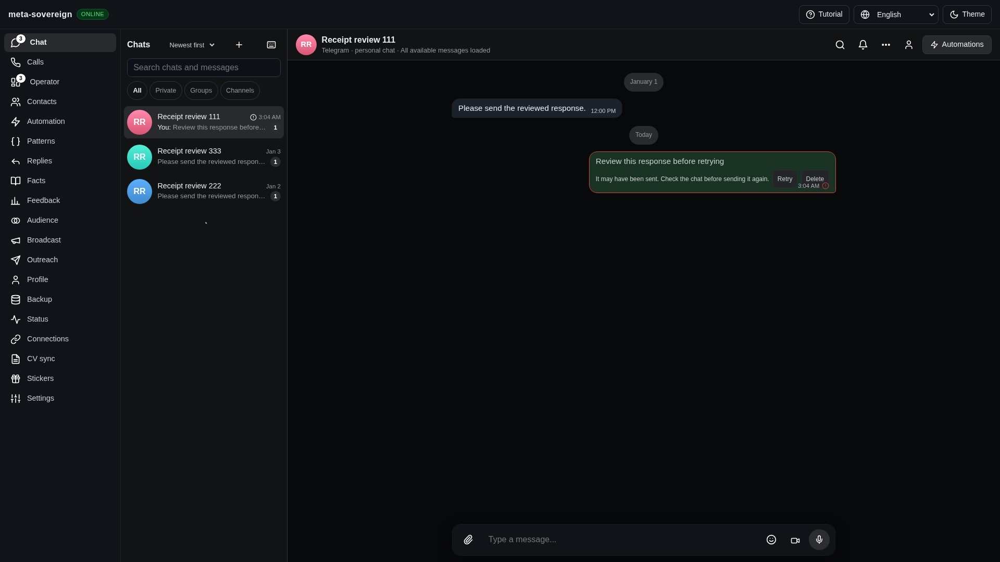
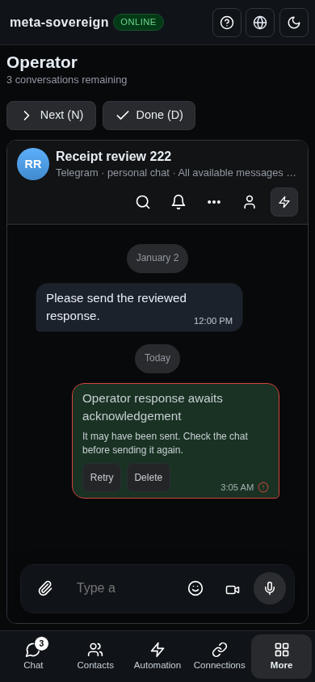

# Telegram text delivery receipts

The shared text sender now requires a positive Telegram message receipt before
returning success to Chat, Operator, comments or automated sends. This closes a
delivery-state defect within issue 56; the other open criteria in
[PR #57](https://github.com/link-foundation/meta-sovereign/pull/57) remain required.

To reproduce, make an SDK-shaped `messages.SendMessage` resolve with empty
`Updates`, then send from either composer. Previously, the sender accepted the
resolved promise, could return a null message ID when the SDK's private response
parser was absent, and replaced the pending bubble with a sent checkmark.
`RANDOM_ID_DUPLICATE` also returned successful delivery without an ID.

The sender reuses the request/typed-peer receipt validator introduced for
stickers. A short sent receipt needs a positive signed 32-bit message ID;
`updateMessageID` must match this request's random ID; an outgoing message must
match the typed peer and scheduled/non-scheduled update kind. A library-only
client must return a valid server message ID. Primary protocol references:
[messages.sendMessage](https://core.telegram.org/method/messages.sendMessage),
[updateMessageID](https://core.telegram.org/constructor/updateMessageID) and
[updateShortSentMessage](https://core.telegram.org/constructor/updateShortSentMessage).
The implementation is original; shared behavior follows the pinned pending-ID,
ordering and recovery references in [Chat References](../../CHAT-REFERENCES.md).

Missing/malformed/unrelated acknowledgements and duplicate-ID replies now return
`send-unknown`, preserve ambiguity through the account error mapper, prevent
browser fallback and stop remaining multipart sends. If an earlier part was
accepted before a later refusal, the whole draft remains partial/uncertain and
requires checking the chat. A refusal before the first accepted part keeps its
actionable code. Catch-up still runs after a duplicate-ID response. Local update
observer failures after a write also preserve uncertainty. Optional debug events
contain part counts and a duplicate flag, without message bodies or credentials.

The browser outbox retains the text and never automatically retries this state,
including after reload. Shared bubbles now use the existing localized failure
messages for known codes; both timestamp and directory accessibility labels
explain uncertain delivery instead of claiming it was not sent. Retry remains
an explicit user action after checking the chat. Existing automatic network
retries retain stable draft/random IDs; this change does not claim a durable
exactly-once guarantee for every provider or a receipt for a partially sent draft.

Verification uses bounded offline fixtures and real production routes with the
default Lino transport. Seven of eight sender regressions fail against `f5091260`;
the shared four-language bubble/directory regression also fails before the fix.
All 50 focused sender/receipt/account/comments/realtime checks and 22 UI checks
pass, with strict zero-warning lint, formatting and the web bundle check.
The registered Chromium regression fails before and passes after: Chat and
Operator uncertainty, retained text through refresh, mobile display and an
acknowledged-send control. Full runtime/browser matrices remain in CI.

Independent Playwright MCP used the reusable isolated fixture in
`experiments/issue-56/telegram-text-receipts-ui.mjs`. Before the fix, empty Updates
produced `msg:telegram:111:null`, a checkmark and no pending bubble. Afterward,
Chat and Operator retained the localized warning through reload, the 390px
Operator page fit without horizontal overflow, and a matching receipt produced
canonical message 25. The fixture saw exactly three intentional RPCs: two
uncertain responses and one acknowledged response. Browser and server were
closed. Unsupported ancillary read warnings belong to this deliberately limited
fixture; no live account or external write was used.

Before (false sent checkmark):

After (retained text and localized uncertainty):

Reproduction modes `test`, `ui-test`, `browser` and `ui` are in
`experiments/issue-56/replay-text-receipts-before.py`; source restoration runs in
`finally`. Logs, fixture observations and source/image hashes are preserved in
`data/telegram-text-receipts.tar.gz` and its verified SHA-256 manifest.
