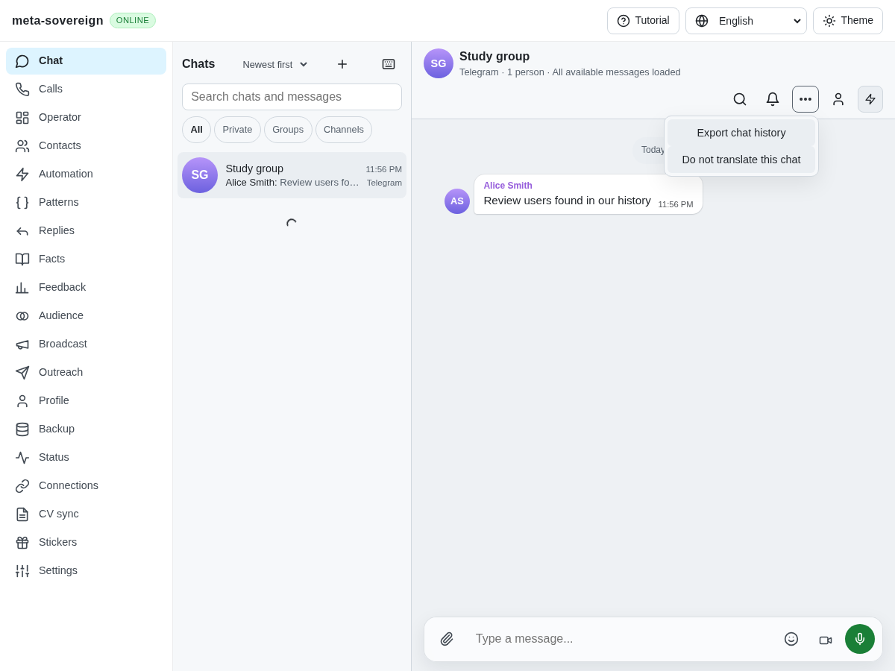
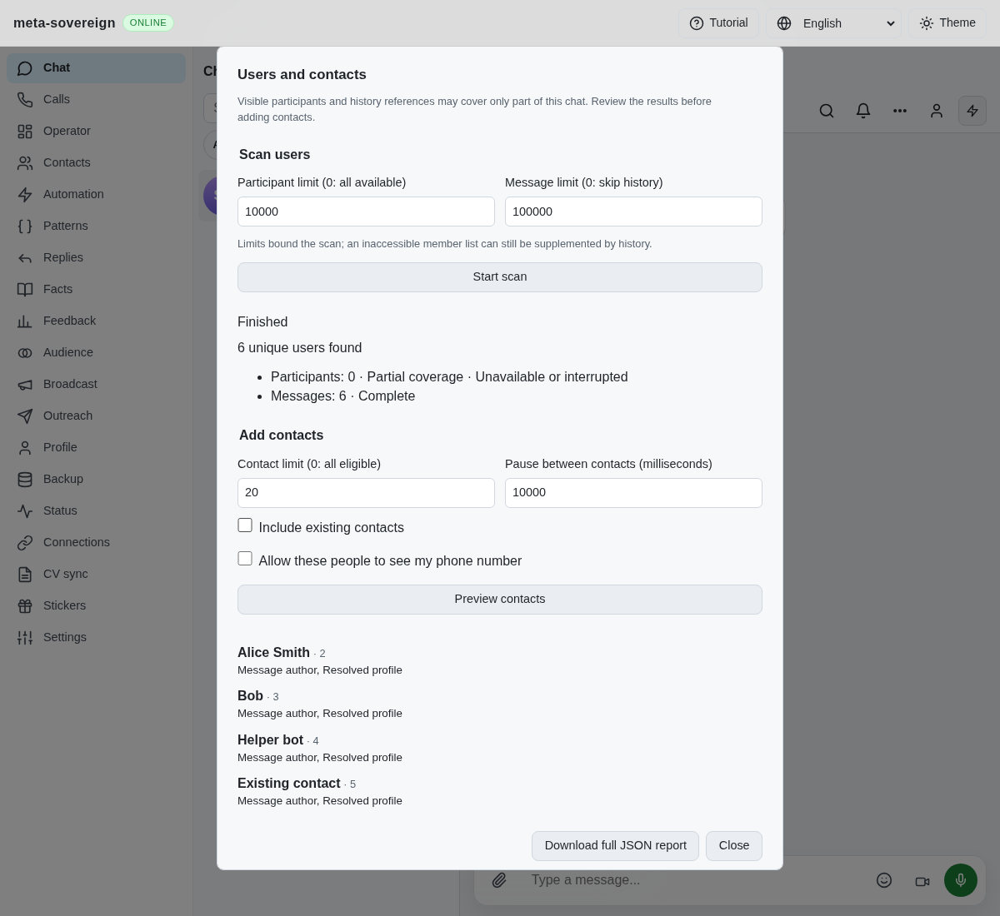
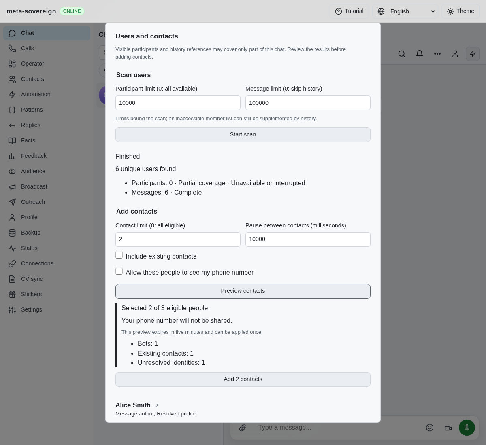
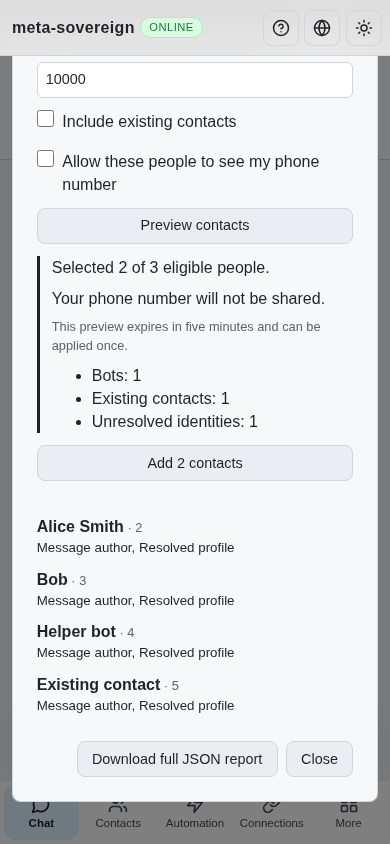

# Telegram user provenance and reviewed contact import

Issue [56](https://github.com/link-foundation/meta-sovereign/issues/56),
draft [PR 57](https://github.com/link-foundation/meta-sovereign/pull/57),
reference requirements TG03–TG05. TG06–TG10 and the other issue-wide criteria
remain unfinished in the [inventory](reference-feature-inventory.md).

## Behavior and reference review

The previous account surface supported an individual contact action, but had
no provenance-aware scan or reviewed batch. The shared CLI/default Lino
API/Chat/Operator workflow now merges participants and history references,
reports incomplete access, previews exclusions and applies an account-bound,
expiring, one-use selection. Phone sharing is separately opt-in; no recipient
phone number is required. [The controls](../../TELEGRAM-USERS.md) describe limits,
coverage, cancellation, stored reports and recovery.

The pinned reference's full `chat-users.mjs` and
`add-chat-users-to-contacts.mjs` were inspected at
[`715f9379`](https://github.com/konard/telegram-bot/tree/715f937931c15810344c715e809aacf74f98912e).
Their provenance sources, exclusions, dry-run default, ten-second pause,
no-phone AddContact and bounded flood retry informed this original
implementation. External reference code was never executed or copied.
The account queue, existing outbox and shared export menu are reused.

Fresh eligibility checks and explicit provider receipts determine outcomes.
Per-account/user intent records stop an uncertain operation being replayed
through another preview, changed phone-sharing option or recreated account.
Definite RPC refusals remain failed. Existing confirmed outbox resolution is
required to recover an unknown outcome; a new scan alone cannot bypass it.
Stopping an account waits for active contact receipts before disconnecting.

## Reproductions and checks

An existing defect accepted an empty object as a successful individual
AddContact/DeleteContacts response. The focused regression returns `{}`:
the baseline reports success, while the corrected action reports
`send-unknown`. `telegram-chat-users-before.log` retains the failing baseline.
Valid Updates responses remain covered by existing peer-action tests.

Review also caught a draft-only SDK mismatch: Teleproto's `RequestIter` is an
async iterable, whose iterator supplies `next`; the iterable itself has no
`next`. A finite subclass of the installed SDK, without networking, fails the
draft scan and passes after opening `[Symbol.asyncIterator]()`. The separate
typed-ID check verifies canonical BigInt peer inputs. It does not claim that
the current SDK interprets every numeric string as a phone number.

The 20 new focused tests and 43 relevant existing checks pass (63 total),
covering every provenance source, inaccessible participants with usable history,
capacity/limit bounds, immutable plans, account/eligibility changes, no-phone
privacy, missing receipts, durable uncertainty, explicit re-adds, one flood
retry, cancellation, storage failures, pagination, CLI ownership and capability
gating. Changed-code lint, formatting and the production web bundle pass.
Full runtime, packaging and browser matrices are left to CI.

The production Chrome flow uses a real isolated server, the default Lino
transport and fake provider responses. It scans seven users, verifies
exclusions and preview-only behavior, invalidates edited plans, downloads the
complete provenance report, confirms one private addition and stops a later
batch on a missing receipt. Its 390-pixel layout keeps the actions reachable.
The isolated browser and server close after the flow. The same regression is
registered in CI's browser list for both engines.

Independent Playwright MCP uses `telegram-users-ui.mjs` and the actual bundle.
The fixture refuses participant access, supplies a small complete history and
retains one unresolved user. Both coverage states remain visible; the preview
selects two eligible people with phone sharing off. A 390×844 viewport measures
390 pixels of content width, with the close and Add controls reachable. This
manual flow does not apply contacts; the production browser test covers writes.
Unrelated unsupported fixture routes emit refusals, so the manual run is not
described as console-clean. Its browser and fixture are closed.

## Visual evidence

Before, the shared export menu has no users/contact workflow:

After, partial participant coverage and history-derived users are explicit:

The reviewed selection keeps phone sharing off:

The same controls fit a narrow viewport:

## Retained evidence and open limits

`data/telegram-users.tar.gz` contains bounded focused logs, intentional baseline
failures, MCP observations, original experiment sources, reference metadata and
source hashes. The adjacent manifest verifies every archived byte. Screenshots
are committed separately. Fixtures do not contact Telegram or modify real
contacts; actual provider access remains a live-account constraint.

The export commit `124a2234` passed four auxiliary workflows but its Checks run
failed Windows Deno initial rolling-host readiness and a WebKit assertion.
Those exact-head failures are separately preserved and remain under
investigation. Passing focused contact checks does not resolve them or finish
the wider issue. PR 57 remains draft and unmerged.
