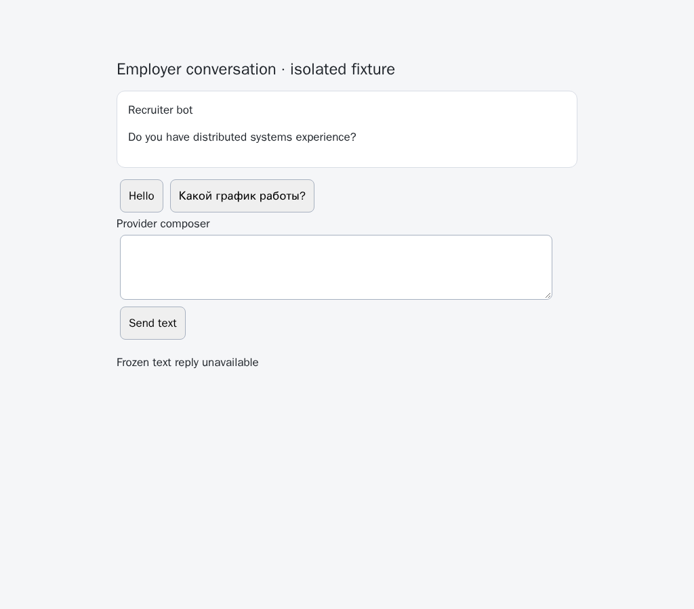
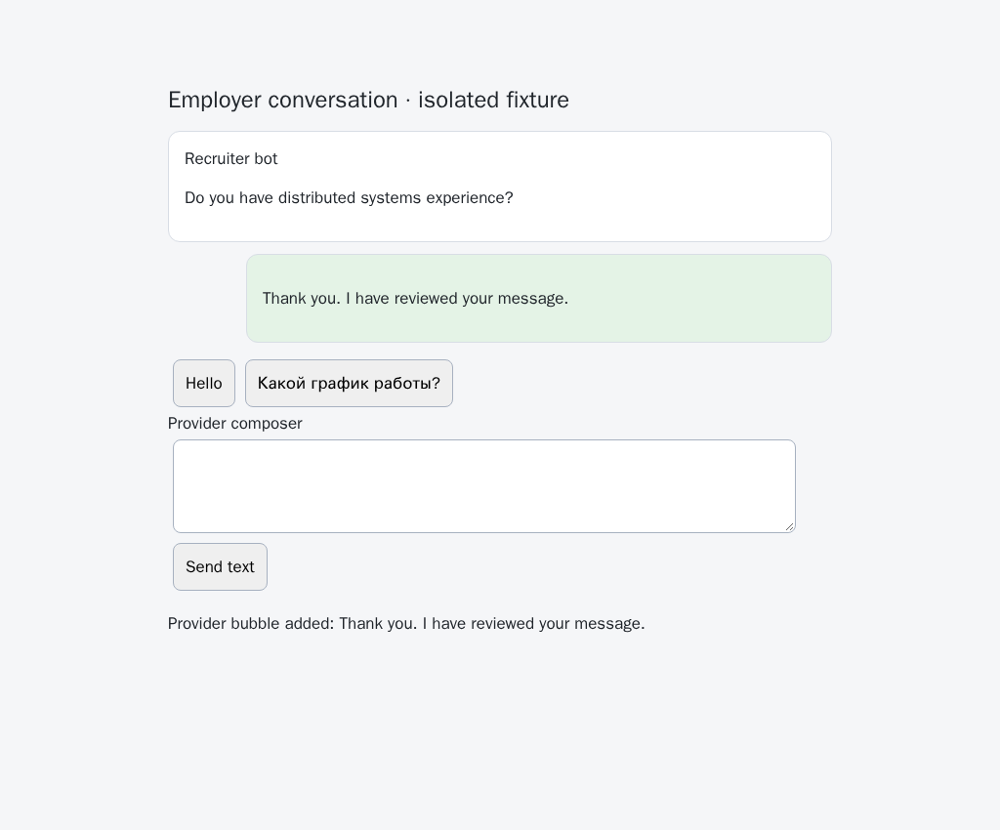
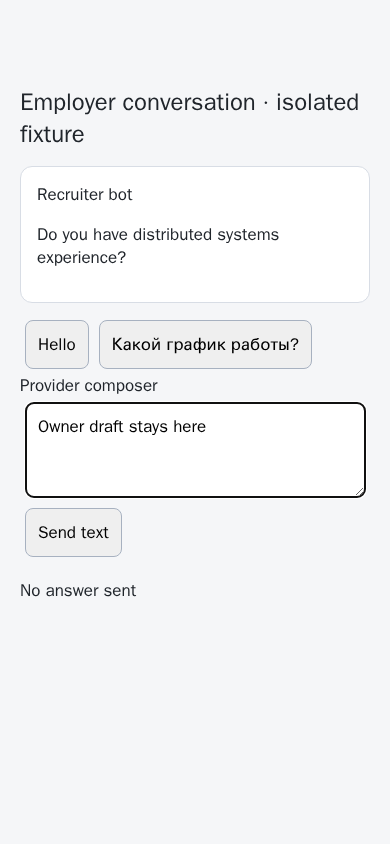
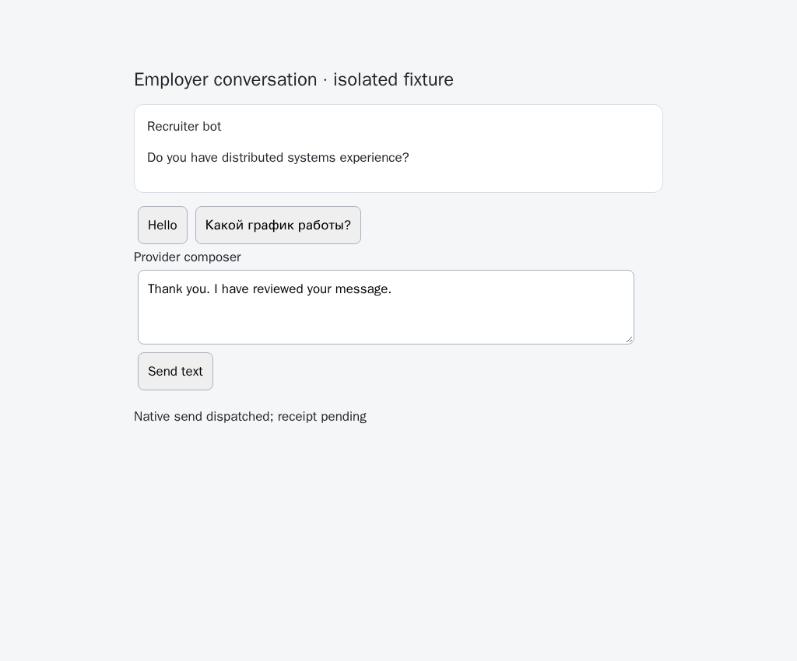

# Guarded native HH text delivery

Implementation prerequisite for [PR 57](https://github.com/link-foundation/meta-sovereign/pull/57), issue 56 C9/D. Background acknowledgement/rejection orchestration and every unchecked requirement remain unfinished.

## Reproduction

On parent `1a35532cb2c87593cb887ebaec0e4e45f221d72b`, the browser sender has no explicit frozen-turn text operation. Ordinary HH text sending is deliberately unavailable, so the existing answer watch cannot deliver a guarded acknowledgement or rejection. `text-reply-before.py` restores the five actual parent modules, runs the new public-admission regression and records the browser's unavailable state, then restores all working files in `finally`. The admission assertion fails because `replyText` is undefined; the browser records zero sends. The subsequent evidence-collector-only commit leaves these production modules unchanged.

```sh
PYTHONDONTWRITEBYTECODE=1 python3 experiments/issue-56/text-reply-before.py
NODE_OPTIONS=--max-old-space-size=384 node --test --test-concurrency=1 --test-timeout=30000 js/tests/browser-text-admission.test.js js/tests/browser-text-reply.test.js js/tests/browser-choices.test.js js/tests/ci-contracts.test.js
```

## Delivery contract

`replyText({source:'hh', chat, expected, text})` on the browser/default sender accepts an explicit incoming question and its entire bounded pending turn, with no strict options. Text is nonempty and at most 12,000 characters. The frozen request is copied before queue admission. The answer watch exposes the same operation against its already owned document, with a current-plan verification callback. Neither entry point authorizes a background decision or makes ordinary HH `send` available.

The production document/frame verifier runs before accessing provider controls. The page operation requires an empty writable composer, one visible enabled native send button and no recognized closed-chat notice. It rejects whitespace drafts, disabled/read-only controls, ambiguous or missing buttons and native answer choices. It does not fall back to Enter or another delivery transport. Closed-state selectors/phrases come from the pinned HH reference; live service compatibility remains unverified.

The shared native pointer guard rechecks the whole pending turn, question, control identity, composer ownership and text, closed/writable state and owner activity at each dispatch stage. User edits revoke ownership even if restored to the original text. A replaced button retaining the temporary selector is blocked. Cleanup removes copied temporary markers and listeners too. Only unchanged text still owned by the application can be cleared after a definitely blocked dispatch; new owner drafts survive.

One distinct new outgoing, non-service message after the frozen question proves delivery. Incoming, historical, duplicate and absent bubbles remain unknown. A click, cleared composer or delayed exception cannot establish success. Text receipts additionally require the guarded native click to have occurred. A shared page-local reservation prevents a cleared draft or switching between text/native choices from retrying an uncertain attempt. Choice inspection also retains an application's uncertain text draft when native controls appear. Shutdown cancels queued admission and drains issued operations.

These reservations are bounded to 32 entries and belong to the current document. Persistent attempts across restarts, inactive-window/reading-anchor restoration, complete-history eligibility decisions, actual acknowledgement/rejection policy and common CLI/Lino/UI/unread orchestration remain required. Incomplete provider history must not be represented as complete by the future caller.

## Verification and review evidence

Twenty-eight focused Node checks, 36 native text cases, 56 existing choice/visibility compatibility cases and five independent Playwright MCP cases pass. The routed HH fixtures execute production sender, document/frame verification, native dispatch and receipt code through real browser-commander. They use synthetic conversations and never contact an account.

Initial verification caught two draft defects: the copied intent omitted `strictOptions:false`, and cleanup left a marker on a cloned replacement button. Those are corrected. A later cross-origin fixture supplied a string where the shared fixture expected an array; this is corrected without changing production frame admission. The mode-switch fixture also needed to remove the native-choice container's class after removing its controls. The failed logs are retained. Unknown receipts, closed chats and owner-draft refusals remain explicit outcomes, with send counters checked.

Self-review adds an intermediate-draft regression: after an unknown text attempt, mounting native options and inspecting them cleared the still-owned text. The new assertion fails before the ownership correction. Unconfirmed allowed attempts now retain their draft; the three mode-switch cases and twenty existing provider-choice cases verify this correction without another full browser matrix.

The native-choice group already consumes about 79 seconds locally. The additional text controls and late-change guards therefore have separate mandatory Chromium/WebKit groups, each retaining the existing 180-second subprocess budget. The final groups take about 141 and 106 seconds respectively on this machine. The CI registration regression fails against the parent's manifest before both groups are added. No existing scenario, engine, release-job deadline or security rule is removed.

```sh
RUN_BROWSER_E2E=1 E2E_EXECUTABLE_PATH=/opt/google/chrome/chrome NODE_OPTIONS=--max-old-space-size=384 node js/tests/e2e-question-text-replies-browser.mjs
RUN_BROWSER_E2E=1 E2E_EXECUTABLE_PATH=/opt/google/chrome/chrome NODE_OPTIONS=--max-old-space-size=384 node js/tests/e2e-question-text-guards-browser.mjs
NODE_OPTIONS=--max-old-space-size=384 node experiments/issue-56/text-reply-mcp.mjs
```

The independent Playwright MCP probe bundles the production text path and uses fixture-only token/pause adapters. It checks positive delivery, phone owner-draft preservation, an uncertain send with no duplicate, closed-chat refusal and a late changed request. Screenshots below are synthetic evidence, not live-provider verification.

Before, actual parent with no guarded text operation:



After, independently verified native outgoing receipt:



Phone owner draft remains untouched:



No receipt: retain the draft and uncertain attempt, with no second send:



The [evidence archive](data/text-reply.tar.gz) contains actual parent sources, implementation snapshots, focused logs, CI registration evidence and screenshot hashes. The separate APT evidence-collector correction passes the hosted [security run 43065220187](https://github.com/link-foundation/meta-sovereign/actions/runs/43065220187) at `ff7a9d711fcde7f556a9105350282aed6a731220`; Python's raw gate reports one inspected report and zero audited false positives at line 12197. Exact new-head hosted verification of this text unit remains required.

The preceding [Checks run 43062262248](https://github.com/link-foundation/meta-sovereign/actions/runs/43062262248) at `1a35532cb2c87593cb887ebaec0e4e45f221d72b` also exposes the recurring macOS startup failure. Its preserved job log lines 2063–2077 record the 10,001 ms readiness failure, 4,198 ms CLI imports and 3,666 ms release preparation; lines 2874–2887 retain the missing control socket. Chromium and WebKit jobs are cancelled at 17:11:47 UTC, after the collector follow-up push at 17:08:31; these cancellations do not establish a browser assertion failure. That run's CodeQL finding is corrected by the follow-up, while the startup root cause remains unfinished. Full raw logs and timestamp/SHA metadata are preserved. PR 57 stays draft and unmerged.
