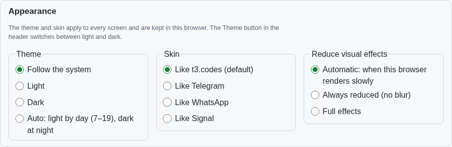
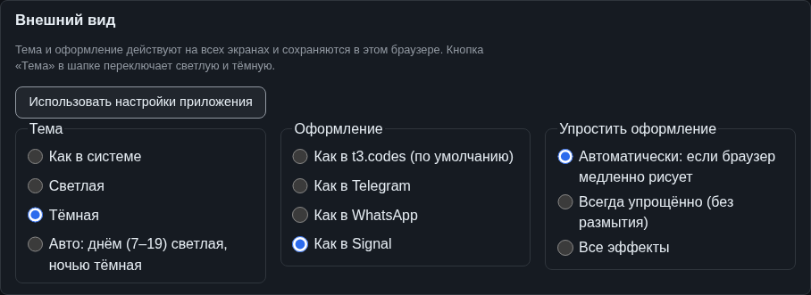
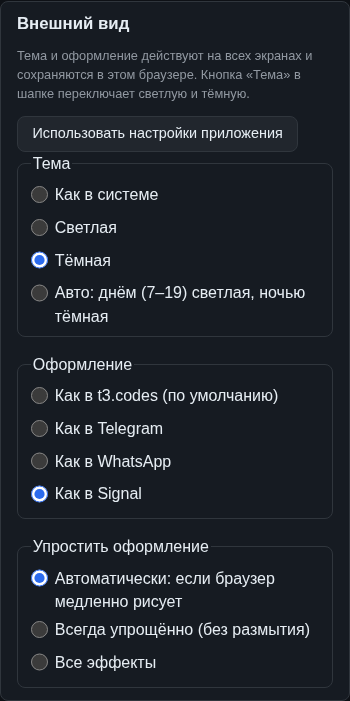

# Shared desktop appearance defaults

PR: https://github.com/link-foundation/meta-sovereign/pull/57

A desktop or server owner can set interface defaults in readable Lino startup
files and override them for a launch. The shared UI applies these values when a
browser has no explicit choice. Changing a skin no longer silently saves an
inherited theme as an explicit choice. **Use app defaults** clears theme and skin
choices; the language selector's default entry clears its language override.
These actions affect the current browser and never rewrite startup files.

For example, put this record in the user's `config.lino`, the working folder's
`.meta-sovereign/config.lino`, or the file selected with `--app-config`:

```lino
configuration:
  server configuration_server

configuration_server:
  theme dark
  skin signal
  language ru
```

Global fields yield to local fields, then explicit launch options. This command
uses the same defaults as Electron:

```sh
meta-sovereign serve --theme=auto --skin=telegram --language=en
```

Themes are `system`, `light`, `dark`, and `auto` (light 07:00–19:00 local time).
Skins are `t3`, `telegram`, `whatsapp`, and `signal`. Languages are `system`,
`en`, `ru`, `zh`, and `hi`. A system language uses the browser's preference.
Missing fields retain existing detection. Unknown fields/values are refused
without echoing private file contents or paths. Startup validation precedes
runtime/store opening. Defaults are presentation values only; credentials and
other configuration never appear in the read-only `GET /api/ui/defaults` reply.
The endpoint supports both text and binary Lino and refuses writes.

An existing browser choice takes precedence over all these defaults, including
when a response arrives after the owner makes a new choice. Connection changes
abort obsolete reads; their late replies cannot replace fresh defaults. Cleanup
aborts in-flight work and removes even a subscription registered after cleanup.
Known defaults remain useful during a connection interruption. Reads share the
existing recovery mechanism and do not write browser or server storage.

## Reproduction and verification

On published parent `10a9f1e1`, configure these values and open Settings in a
fresh browser. It still uses the browser language and system theme; the reset
control is absent. Five focused regressions fail against that exact source.
The native parent run captures the missing control (`0 !== 1`); independent
Playwright MCP waits for the actual Russian/dark/Signal state and times out.
The corrected code passes 48 focused tests with one worker, including layered
and explicit precedence, invalid-input refusal, both actual Lino transports,
read-only behavior, owner choices, superseded responses and late cleanup.

The mandatory desktop appearance browser group retains its existing locale,
light/dark/system and OS-change assertions. It also verifies a delayed real API
response, owner choices before that response, reload, reset, timed day/night
changes, four language choices, and a 390-pixel layout with zero runner calls or
page exceptions. The focused Chromium group passes in 33.116 seconds. Full
Chromium/WebKit and packaged-platform matrices remain hosted CI work.

Native verification caught an implementation draft where two independent
locale hooks controlled the root and shell. A delayed default changed the HTML
language despite the owner's explicit selection. The corrected shell shares one
locale owner, and the regression now passes. An immediate width assertion also
caught the interval before React committed its viewport change. The final check
waits for the actual fitting layout within the existing deadline; no overflow
exception or CSS hiding was introduced. Both draft failures remain archived.

Independent MCP verifies configured defaults, explicit choices after reload,
reset after reload, all four languages, phone layout and zero page exceptions.
Both parent and corrected synthetic servers report closed application resources;
all browser contexts close. No live provider, owner profile or running personal
application server is used.

| Published parent                                                                  | Corrected shared UI                                                                    |
| --------------------------------------------------------------------------------- | -------------------------------------------------------------------------------------- |
|  |  |



[Source and log archive](data/ui-defaults.tar.gz) and its independently checked
[SHA-256 manifest](data/ui-defaults.tar.sha256.json) retain the original source,
parent failures, draft failures, successful checks and screenshots. This change
supplies the previously missing presentation configuration path for VD06/VD07;
it does not establish automatic runner dependency installation or complete the
remaining bot configuration contract. The inventory remains **86 verified / 32
unfinished**, pending full criterion audit and exact-source hosted checks. PR57
stays draft and unmerged.
