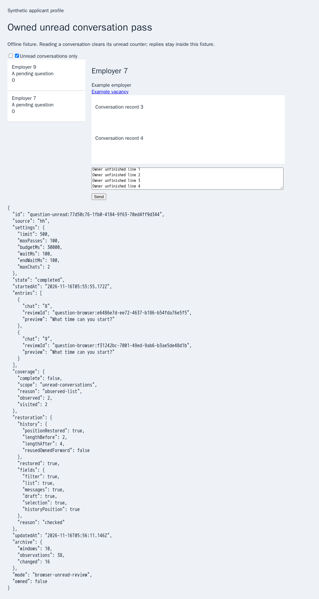
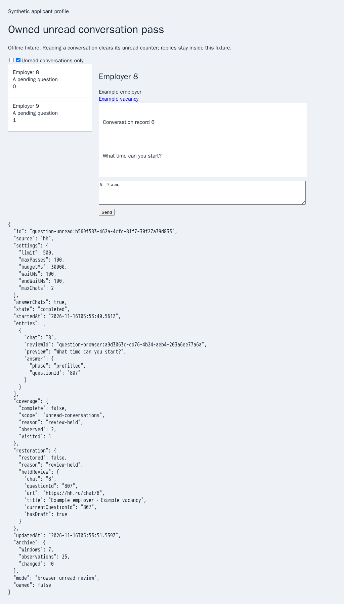
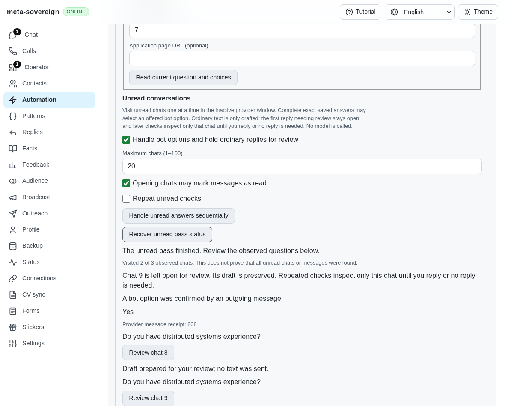
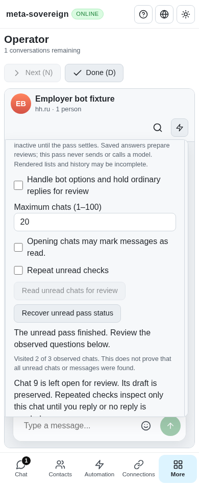

# Sequential unread answers and a held ordinary review

Pinned forms-and-chats C15 requires unread chats to be handled in order. The
standalone strict-choice workflow can select a bot option with complete saved
evidence. Application-owned checking uses the [manual-choice policy](application-chat-choices.md).
The first ordinary reply
or unresolved question must stay open for owner review, and later polling
cycles must inspect that chat alone until an owner reply or a closed/no-reply
state releases it. Ordinary text must never be sent automatically.

The actual parent `83fea0ee` only supports read-only traversal and separate
notice-policy replies. The new regression fails because it returns no answer
receipts or held-review state. Its native before capture visits both synthetic
unread chats and returns to the initial owner draft without preparing an answer.

The explicit `answerChats: true` mode now uses the existing borrowed visit,
acknowledged history capture, queue and final dispatch verifier. It selects only
complete exact or accepted-summary plans through the shared durable outbox.
Missing/delayed options remain pending. Ordinary saved answers are prefilled
for review; unresolved questions and owner drafts are held without replacement.
A distinct receipt says the review chat remains open, records its current
question, provider URL and employer/vacancy title, and never claims restoration.
Polling carries that held chat into subsequent children without scanning the
unread list or visiting another chat. An outgoing owner reply or no-reply state
releases the hold. Recovery reads saved state and never repeats selection.

CLI `answers browser unread --source hh --confirm --answer-chats` and optional
existing polling flags share the production service with text/binary Lino and
localized Questions, Chat and Operator controls. Notice-policy delivery is a
separate explicit mode. Admission refuses unsupported or conflicting intent.
Selection refusal and uncertainty pause traversal. Stop drains an issued action
and preserves its actual receipt.

Schema 22 initializes legacy pass/polling records to review-only intent without
resuming work or modifying old receipts. Malformed intent refuses migration;
explicit new intent is preserved. The native sync schema was still 19 while
JavaScript was already 21, so the native declaration now matches 22 and a focused
registry guard prevents recurrence. Native tests derive valid schema values from
the declaration while retaining mismatched-schema refusal. Rust compilation and
full runtime/browser matrices remain hosted checks.

Focused checks cover explicit admission, sequential strict-choice then ordinary
hold, delayed options, unresolved text, owner drafts, closed/outgoing turns,
uncertain receipt recovery, changed policy, forged receipt identities, polling
scope, foreground CLI, both Lino encodings, Stop draining and migration. One
isolated native Chromium scenario verifies the real service, first review draft,
untouched next unread chat, held-only next pass and owner-answer release. The
production shared UI has an automated native check and independent Playwright
MCP checks on Questions, Chat and phone-sized Operator. All fixtures are
synthetic; no authenticated provider account is used.

All 17 focused checks pass under Node and Deno. The native service probe passes
its three cases, the production control check passes, and both CI registration
checks pass. Independent MCP inspection records four interaction cases and
four translated held receipts (English, Russian, Hindi and Chinese), without
page exceptions or recovery replay. Changed-file lint, formatting, secret
scanning and the unchanged 6.5% duplication gate pass. The owned fixture server
and browser are closed after inspection.

The browser scenarios are registered once in their own mandatory
`question-unread-answers` group with native focus checks and unchanged job and
runner budgets. Hosted verification for the exact published commit is required.
[Configured-model drafts](unread-model.md) now have separate focused evidence.
Independent application/chat slots, remaining
pinned application workflows and authenticated provider parity are still
unfinished. No inventory row is accepted by this prerequisite alone; all 60
unchecked rows retain their full scope in
[PR #57](https://github.com/link-foundation/meta-sovereign/pull/57).

Evidence: [archive](data/unread-answers.tar.gz) and
[hash manifest](data/unread-answers.tar.sha256.json).
