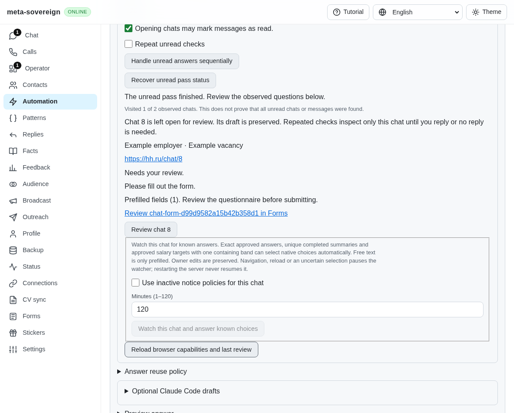
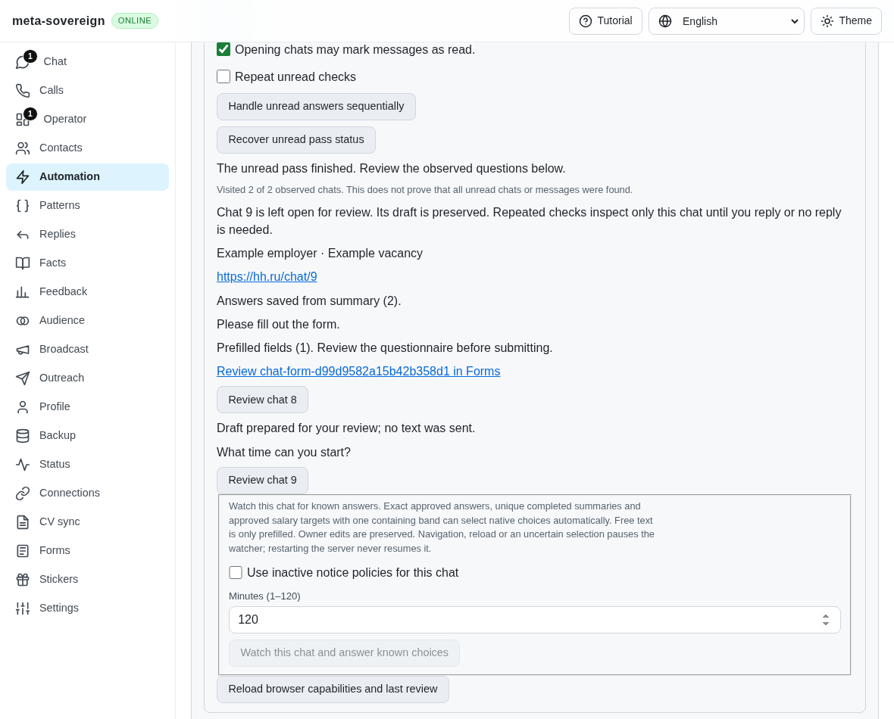

# Continue after a questionnaire and an approved no-reply notice

The unread pass on `6a719b77` opened a linked questionnaire after a recruiter summary and an approved `[без ответа]` notice. It then stayed in the first chat and discarded the summary facts. The form handoff considered only built-in completion phrases, so the approved saved notice left the turn unresolved. A successful prefill could also advance if a new question arrived after its last field write. [Pinned C10, C13 and C15](https://github.com/konard/hh-job-application-automation/blob/fa0991b8c2d0896fb3b4be6c69947f0590094b15/docs/requirements/forms-and-chats.md#L224-L229)

Run the isolated Chromium fixture with a completed summary, an approved no-reply notice and a standalone questionnaire in unread chat 8.

```sh
export E2E_EXECUTABLE_PATH=/opt/google/chrome/chrome
node --max-old-space-size=384 --import ./experiments/issue-56/unread-form-approved-notice-parent.mjs \
  experiments/issue-56/verify-unread-linked-forms.mjs --after-approved-notice --before
node --max-old-space-size=384 experiments/issue-56/verify-unread-linked-forms.mjs --after-approved-notice
```

The fixed pass retains two unapproved facts with the original summary's message ID, prefills one field in the separate Forms slot and continues to held chat 9. It preserves the owner-entered form text and the draft in chat 9. The fixture records zero chat sends and zero submissions. An unapproved notice keeps the first chat in review. A revoked approval or a changed incoming question during prefill retains the Forms receipt and holds the current chat.

The pass matches each approved no-reply decision to the exact pending message ID. After Forms returns a positive receipt, it reads the borrowed chat again and rechecks any approval used to advance. An unrelated link or unanswered request still requires review. [Focused tests](../../../js/tests/question-unread-forms.test.js) · [Registered native regression](../../../js/tests/e2e-question-unread-forms-browser.mjs)

The parent fails three focused regressions. Node and Deno each pass 56 checks on the fixed behavior. The CI contract checks that each scenario runs in one bounded group. Native Chromium passed seven Forms cases in 153 seconds and four unread-history cases in 140 seconds. The CI limit is 180 seconds per group.

Independent Playwright at 390 × 844 confirmed the two saved facts, the prefill receipt and the held draft. The page had no horizontal overflow or JavaScript exceptions. The standalone fixture returned 404 for its default favicon.





[Phone viewport](../../screenshots/issue-56-unread-form-approved-notice-phone.png) · [Prefilled questionnaire](../../screenshots/issue-56-unread-form-approved-notice-questionnaire.png) · [Logs](data/unread-form-approved-notice.tar.gz) · [SHA-256 manifest](data/unread-form-approved-notice.tar.sha256.json)

The checks use routed HeadHunter and Forms fixtures. Authenticated provider coverage remains open under HH10 and QA24.
