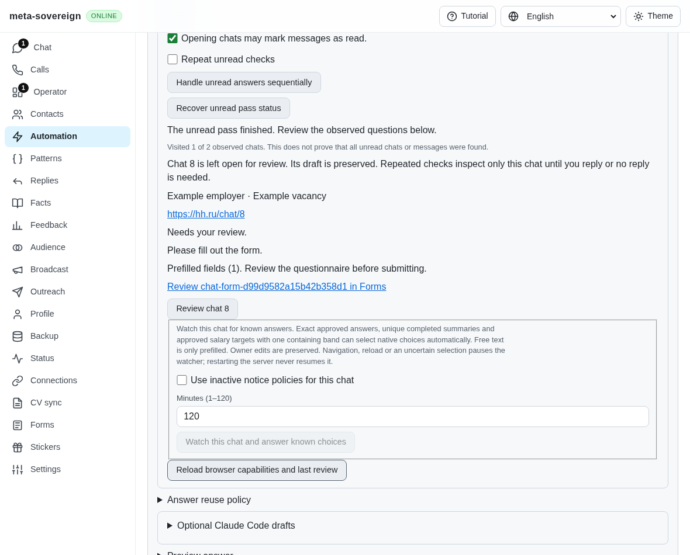
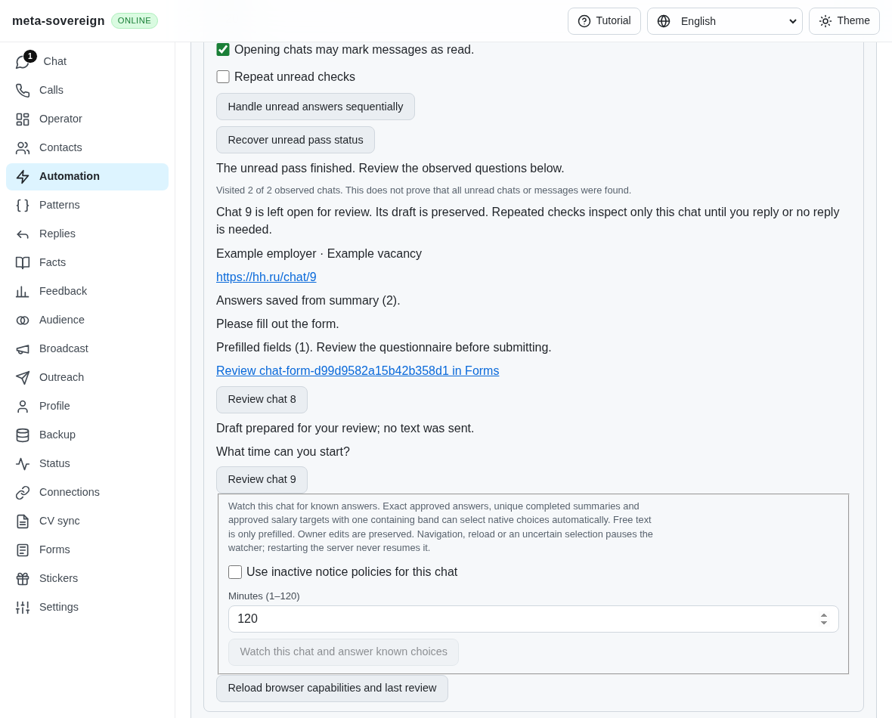

# Continue after a questionnaire and completed recruiter handover

Published commit `a03c2551` accepted a questionnaire link and reported a successful Forms prefill. When an earlier bubble was a completed recruiter summary, the pass still held chat 8, skipped chat 9 and saved zero facts. The questionnaire scanner already excluded URLs quoted in completed summaries. The continuation rule counted the summary as a second pending task, while summary learning looked only at the last bubble. [Pinned C10, C13 and C15](https://github.com/konard/hh-job-application-automation/blob/fa0991b8c2d0896fb3b4be6c69947f0590094b15/docs/requirements/forms-and-chats.md#L224-L229)

In Automation, enable sequential unread answers and linked questionnaire preparation. Use this isolated fixture to reproduce the combined turn with a full Chromium binary.

```sh
E2E_EXECUTABLE_PATH=/opt/google/chrome/chrome \
  node --max-old-space-size=384 experiments/issue-56/verify-unread-linked-forms.mjs --after-summary
```

Use `--before` with the parent and the same fixture to capture its held chat 8 and the separate Forms receipt. The new pass requires the questionnaire to be the only pending task. Explicit plain wrap-ups may accompany it. For a completed summary, the current native turn must still agree with its captured version and each summary bubble must match an acknowledged archive record. The pass retains proposals with their original message IDs and leaves them unapproved. After a positive Forms handoff it proceeds to the next chat. An unanswered request or another link retains the current chat. Missing or stale summary evidence holds before Forms opens. An unavailable Forms slot leaves the chat held and retains already acknowledged proposals.

The native regression observes two provider GETs, one new field value, an untouched owner value, two unapproved facts, zero submissions, zero chat sends and the next held draft. The fixture is registered with the ordinary linked form, employer rating and summary scenarios in Chromium. [Focused regressions](../../../js/tests/question-unread-forms.test.js) · [Native browser scenario](../../../js/tests/helpers/e2e-unread-linked-forms.mjs)

The parent fails three focused cases covering advancement and missing evidence. The updated tests also cover a changed summary and a refused Forms slot. Node and Deno each passed 35 checks. Chromium passed seven cases before the grouped process was interrupted, and the isolated rerun passed the remaining summary case. Independent Playwright MCP recorded the Forms receipt and held chat 9 at desktop and 390-pixel phone widths, with zero chat sends, page exceptions or horizontal overflow. The standalone test host returned a favicon 404.





[Phone viewport](../../screenshots/issue-56-unread-form-handover-phone.png) · [Logs](data/unread-form-handover.tar.gz) · [SHA-256 manifest](data/unread-form-handover.tar.sha256.json)

The case uses routed HeadHunter and Google Forms fixtures. Authenticated HeadHunter, live verification across the four questionnaire families and the remaining HH10 and QA24 work stay open.
