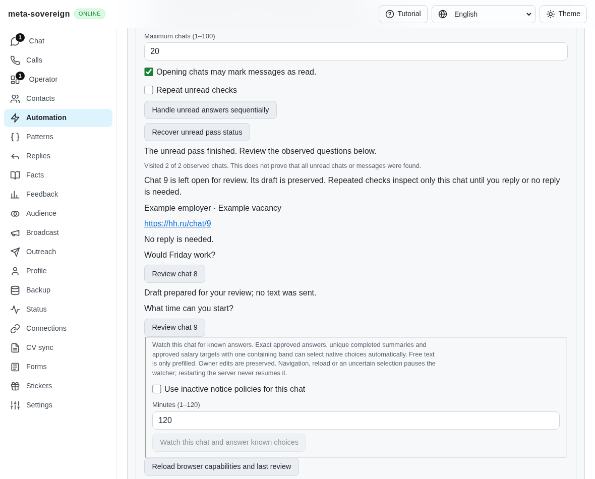
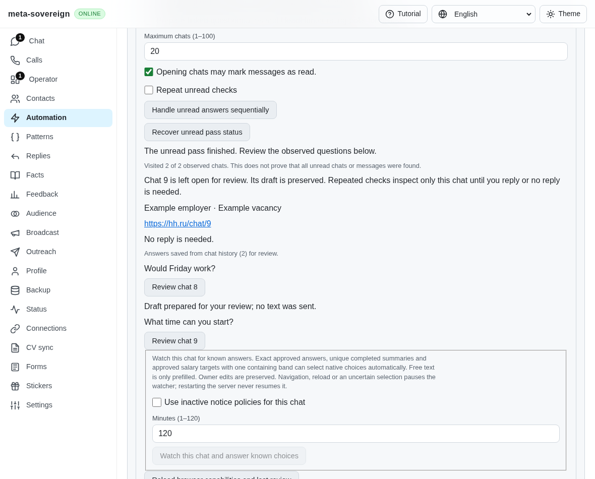

# Learn owner replies during sequential HeadHunter review

The published parent `8ef31f3d` captured older messages but never applied the existing question and notice learner during the unread visit. The parent fixture moved past a chat with two verified earlier replies and saved neither reply. [Pinned C6, C12 and C15](https://github.com/konard/hh-job-application-automation/blob/fa0991b8c2d0896fb3b4be6c69947f0590094b15/docs/requirements/forms-and-chats.md#L220) · [PR #57](https://github.com/link-foundation/meta-sovereign/pull/57).

Open Automation, Chat or Operator. Under **Provider browser answers**, enable **Handle bot options and hold ordinary replies for review**, acknowledge native read-state changes, and select **Handle unread answers sequentially**. In the isolated fixture, chat 8 contains a previously answered question, a passive notice with a confirmed acknowledgement, and a counterquestion. The pass saves the first two as unapproved proposals with their outgoing message IDs, then holds chat 9 with the next draft. The fixture records zero sends.

The learner uses the native chronological order and the acknowledged store records for that visit. It requires verified dates and a positive native outgoing state. Application records and uncertain replies break a turn. A partly verified response cannot supply a truncated answer. Related verified notice replies can extend a review-only pattern across separate chats. The exact replies are acknowledged before any generalized pattern is saved. A changed source or failed save holds the current review. A retry preserves the existing answers and frequencies.

The parent’s stricter clause matcher also exposed a regression in learned Russian notices. Their shared full stop was lost during pattern generation, so the generated pattern crossed a sentence boundary. Synthesis now retains a full stop when both source examples align there. Question templates continue to treat unmatched boundaries as a reason for review. [Notice pattern regression](../../../js/tests/notice-pattern-learning.test.js).

Review-only passes still capture history for explicit later learning. Historical coverage remains partial when the provider start was not observed. The learned-answer count reports saved variants from the visible visit and remains separate from the coverage receipt.

## Reproduction and verification

```sh
npm run build:web
RUN_BROWSER_E2E=1 E2E_EXECUTABLE_PATH=/opt/google/chrome/chrome \
  E2E_SCREENSHOTS=docs/screenshots npm run test:e2e:question-unread-history
```

The before image used the published parent with the routed regression fixture and `E2E_UNREAD_HISTORY_BEFORE=1`. The after test checks both exact source IDs, approval and count, the continued queue and its held draft, with zero provider sends. Node and Deno each passed 93 focused checks. The dedicated browser registration check also passed. The cached WebKit 2370 executable passed the native focus-refusal case. Hosted CI uses the dependency-pinned browser revision. [Browser regression](../../../js/tests/helpers/e2e-unread-history-learning.mjs) · [Focused regressions](../../../js/tests/question-unread-history-learning.test.js).

Independent Playwright MCP rendered the receipt at 390 × 844 without horizontal overflow and observed the next held draft. The fixture console had a missing favicon. [Phone screenshot](../../screenshots/issue-56-unread-history-mobile.png) · [Verification logs](data/unread-history-learning.tar.gz) · [Checksums](data/unread-history-learning.tar.sha256.json).





Authenticated HeadHunter acceptance and the remaining HH10 checks are open. [Acceptance inventory](reference-feature-inventory.md).
