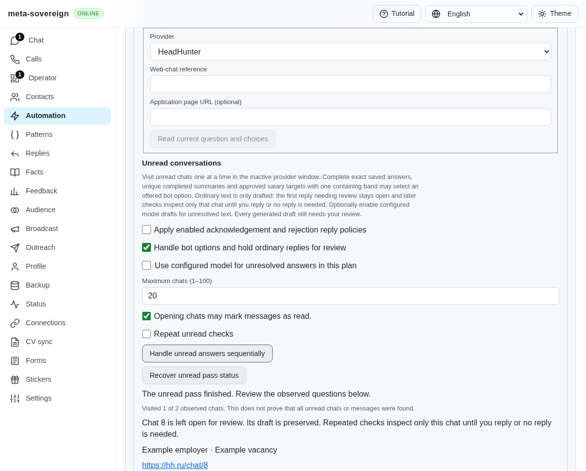
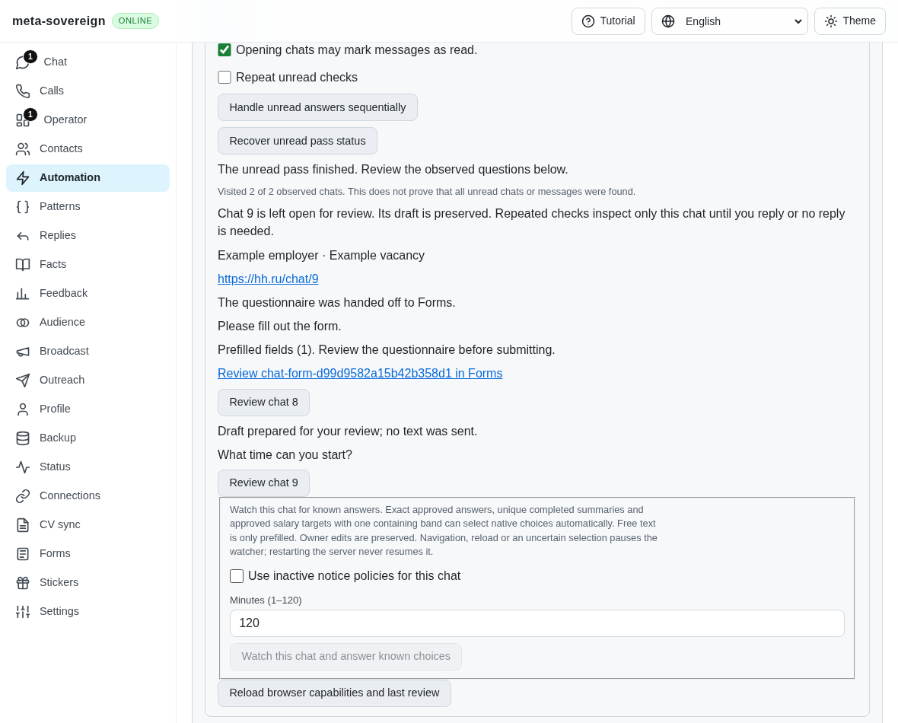

# Questionnaires linked in unread HeadHunter chats

The published parent `639827d6` stopped at the first chat in a two-chat fixture when the employer asked for a questionnaire through a Google Forms sharing link. It left chat 8 open, visited one of two observed chats, and opened zero Forms slots. The linked questionnaire remained empty. [Pinned C10 and C15](https://github.com/konard/hh-job-application-automation/blob/fa0991b8c2d0896fb3b4be6c69947f0590094b15/docs/requirements/forms-and-chats.md#L224) · [PR #57](https://github.com/link-foundation/meta-sovereign/pull/57).

Enable sequential unread answers and **Prepare linked questionnaires and HeadHunter rating polls for review** in Automation, Chat or Operator. An application batch can request the same behavior in its separate chat worker. The CLI options are `--answer-chats=true --prefill-forms=true` for the unread pass and `--process-chats=true --chat-prefill-forms=true` for an application batch. Both Lino encodings carry the opt-in, the exact linked destination and the Forms receipt.

The pass uses the pending messages from the currently owned HeadHunter view. One supported respondent link can acquire a Forms slot. The reader checks the respondent path, redirect identity and origin of frames containing fields before planning. The standard Forms planner writes only eligible empty fields and keeps the slot available for owner review. A repeated observation recovers the existing request, and a full slot pool leaves the chat for review so a later pass can try again. An additional unanswered request or an uncertain handoff keeps the native chat open. A questionnaire-only request with a confirmed handoff lets the pass continue to the first chat that still needs a reply.

## Reproduction and verification

Run the standalone fixture against the parent bundle with `--before`, or against the updated bundle without it. Use an installed full Chromium binary for native tab focus.

```sh
E2E_EXECUTABLE_PATH=/opt/google/chrome/chrome \
  node --max-old-space-size=384 experiments/issue-56/verify-unread-linked-forms.mjs
```

Four focused regressions fail with the parent's unread implementation. The branch passes 51 checks each in Node and Deno. They cover both Lino encodings, the registered CLI, batch options, four supported link providers, changed messages and destinations, concurrent recovery, slot exhaustion and the existing Forms prefill lifecycle. [Regression tests](../../../js/tests/question-unread-forms.test.js).

The production Chromium scenario follows the exact Google sharing link, reads back one new answer, preserves an existing answer, visits chat 9 and leaves its draft ready for review. It observes two GETs to the questionnaire, zero chat sends and zero form submissions, then opens the retained review through the receipt link. The scenario is registered in the hosted unread answers group. [Browser scenario](../../../js/tests/helpers/e2e-unread-linked-forms.mjs).

The first phone pass exhausted the shared 30-second budget during the second chat. A timed trace recorded chat-list loading and history reads along with about ten seconds for the new Forms window. Opted-in passes now default to 60 seconds and respect an explicit caller cap. Independent Playwright MCP at 390 × 844 verified the one-field receipt, the held draft on chat 9, and the active Forms review with no horizontal overflow. The fixture observed both chat visits and zero sends. The browser console reported a missing fixture favicon.





[Phone layout](../../screenshots/issue-56-unread-forms-mobile.png) · [Routed questionnaire and preserved owner text](../../screenshots/issue-56-unread-forms-questionnaire.png).

The browser evidence uses a routed HeadHunter and Google Forms fixture. Authenticated HeadHunter and live respondent verification for all four provider families remain open, as do the other HH10 and QA24 requirements.
