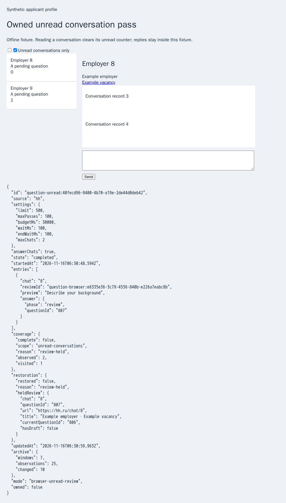
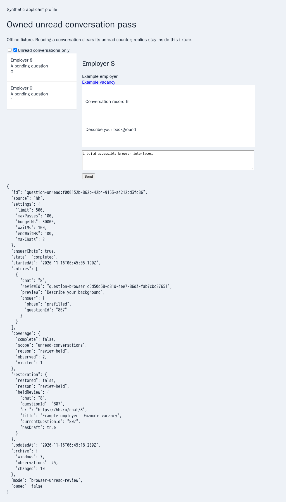
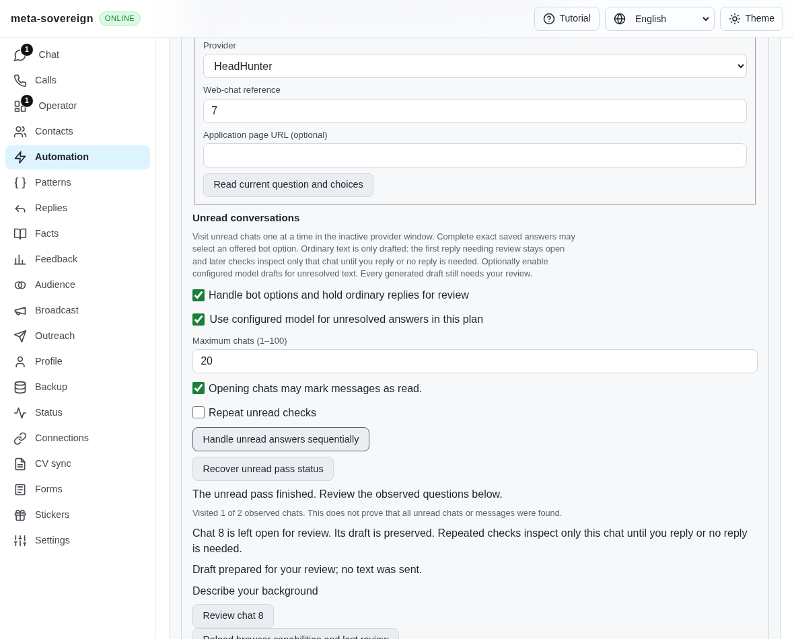
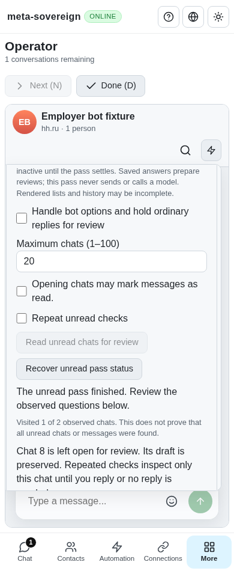

# Configured model drafts in sequential unread review

Pinned forms-and-chats C3/C15 require ordinary unread replies to use the selected
CV, profile, approved answers and acknowledged conversation history when the
owner explicitly enables the configured model. The first ordinary reply stays
open for review. Strict bot options, owner drafts and ordinary text delivery keep
their existing rules.

The actual published parent `210ef3b0` discards `modelDraft` in both finite passes
and polling children. Its native before capture holds the unresolved chat with
an empty editor and makes zero model calls. The first new regression fails
against that parent because it expects a confirmed review draft.

The shared unread service now admits explicit model intent only with answer
mode. It reuses the configured drafting service, abort signal and evidence
validation. Native history comes only from the acknowledged bounded window for
the exact source, conversation, latest question and timestamp. Missing facts
remain visible clarification requests. A deterministic saved-answer baseline and
the model context fingerprint are checked again at the native write boundary;
changed CV, profile, rules, policy, settings or history refuse the old draft
without regeneration. Stop cancels and drains an in-flight request.

CLI `answers browser unread --source hh --confirm --answer-chats --model-draft`
starts the configured runner through the existing local runtime lifecycle.
Selected profile and other planning overrides now reach unread passes as they
already reach current-chat inspection. Text/binary Lino and English, Russian,
Hindi and Chinese Questions, Chat and Operator controls share the same intent.
The per-pass model control defaults off. Polling carries explicit intent into
owned children; saved review recovery never restarts generation or delivery.
The existing persisted planning field needs no schema change.

Eleven model-focused tests plus ten existing unread-answer checks pass under
Node and Deno. They cover stored context, missing facts, strict options, owner
drafts, disabled/refused/unavailable models, six queued invalidations, Stop,
recovery, polling, CLI and both Lino encodings. One isolated native Chromium
probe verifies the real editor, one model call, the held first chat, an untouched
next unread chat and zero sends. The production shared control probe also
passes. Both scenarios are registered once in the existing mandatory browser
group, retaining browser and job budgets; WebKit checks native focus refusal.

Independent Playwright MCP inspection verifies Questions execution, Chat
recovery, phone-sized Operator recovery and all four translated default-off
controls. It records one model call, one prefill, zero sends, zero read actions,
zero pending actions and no page exceptions. The browser and private fixture
server are closed after inspection. Every provider and model is synthetic;
authenticated provider parity and actual configured-model quality are not
established by these fixtures.

Changed-file lint, formatting, secret scanning, CI registration and the unchanged
6.5% duplication gate are required evidence checks. Hosted verification for the
exact new published commit remains required. Independent application/chat
slots, the remaining pinned application workflows and all 60 unchecked inventory
rows remain unfinished in
[PR #57](https://github.com/link-foundation/meta-sovereign/pull/57).

Evidence: [archive](data/unread-model.tar.gz) and
[hash manifest](data/unread-model.tar.sha256.json).
