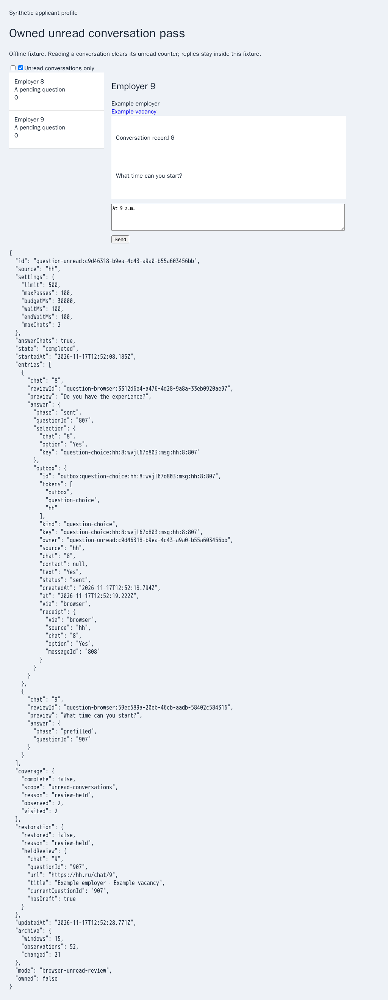

# Native options in an unread answer pass

The pinned HH [chat contract](https://github.com/konard/hh-job-application-automation/blob/fa0991b8c2d0896fb3b4be6c69947f0590094b15/README.md)
requires unread passes to select supported bot answers and hold the first ordinary
reply for review. Existing unread bot tests used a mocked selection handle; the
native unread scenarios covered ordinary review holds. This addition exercises
the existing production choice adapter through actual routed provider DOM.

The isolated Chromium pass opens chat 8, reads its experience question, selects
the exact approved `Yes` option and requires outgoing receipt `808`. It continues
to chat 9 and prepares `At 9 a.m.` without sending it. The test requires one native
choice, zero text sends and the held-review identity of chat 9. A second pass
preserves that draft, reports `owner-draft`, and neither revisits another chat nor
selects another choice. The service, page contexts and browser close on completion.

The new scenario passed in 35.6 seconds. The three existing ordinary native
scenarios also passed after their shared fixture lifetime was extracted; their
assertions remain unchanged. These are isolated native checks, with no live
provider account. No production behavior changed and no inventory criterion is
accepted by this coverage addition.

```sh
RUN_BROWSER_E2E=1 E2E_EXECUTABLE_PATH=/usr/bin/google-chrome \
  UNREAD_BOT_SCREENSHOTS=docs/screenshots/issue-56-unread-bot-choices \
  node --max-old-space-size=384 \
  experiments/issue-56/unread-bot-choices.mjs --choices-only
```

The mandatory `question-unread-choices` group has its own unchanged 180-second
deadline and Chromium/WebKit registrations. It is appended to the registry so
existing groups retain their shard assignments. WebKit must explicitly refuse
unsupported background focus with zero choices and zero text sends. Its hosted
result remains pending. A focused CI contract check verifies both registrations,
the awaited helper, the native-focus requirement and the finite group deadline.



The hash-verified [archive](data/unread-native-options.tar.gz) and
[manifest](data/unread-native-options.tar.sha256.json) retain sources, raw checks
and the screenshot. Complete QA14 mapping and current-source hosted verification
remain required in [PR #57](https://github.com/link-foundation/meta-sovereign/pull/57).
