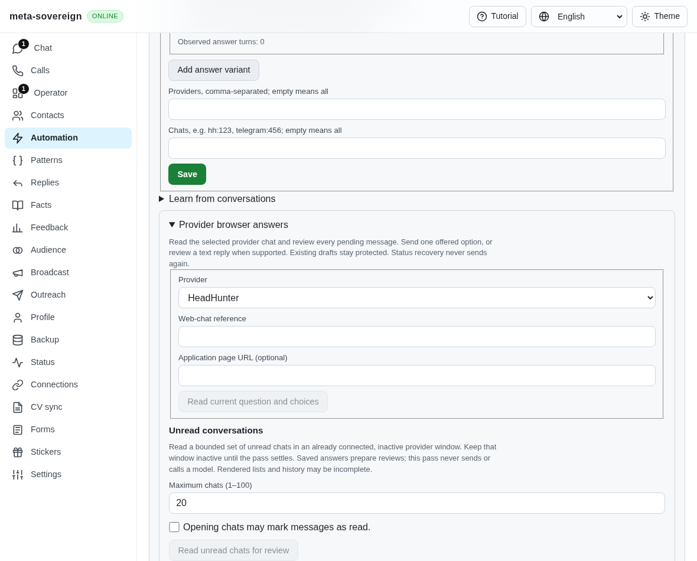
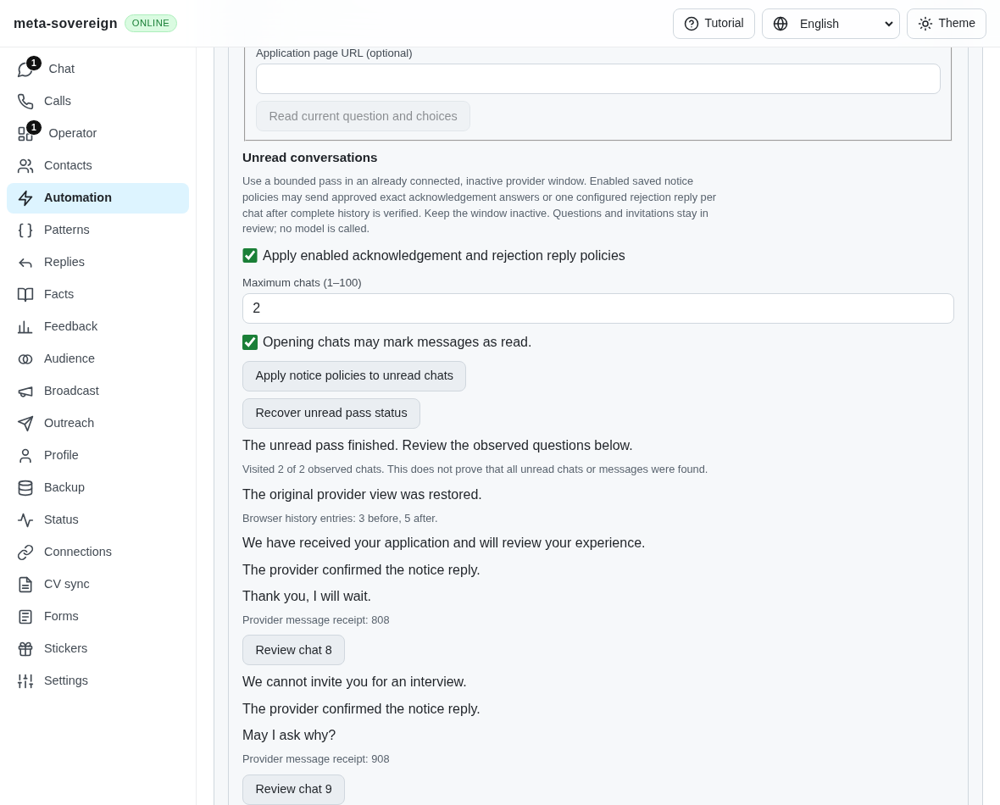
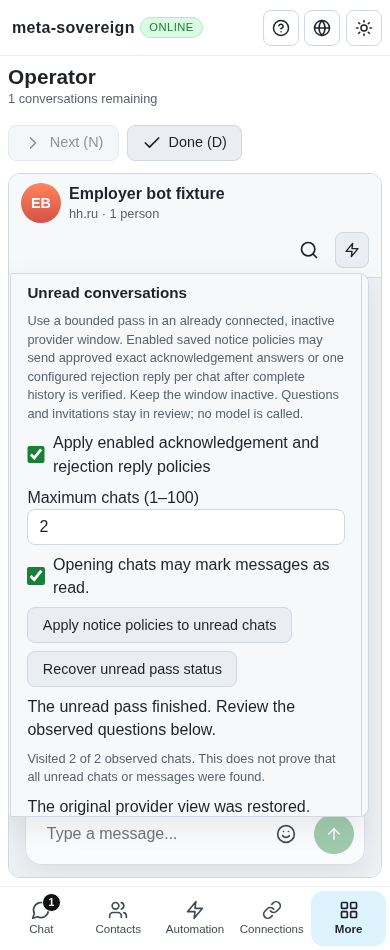

# Explicit notices during finite unread passes

The public unread pass previously exposed only frozen reviews, even when an owner had saved an acknowledgement or rejection reply policy. Opening the current-chat watcher inside a visit would reenter the scanner's own provider queue. The new `noticeReplies: true` admission uses the borrowed native handle from that existing visit and the shared notice planner and delivery reservations. The default pass remains a read-only review. Polling, backoff, lifetime controls and revealing a reply in an originally empty chat remain required work.

CLI admission is `answers browser unread --source hh --confirm --notice-replies=true` with the existing finite bounds and caller-generated pass ID. The same option is available through both Lino formats and the shared Questions, Chat and Operator controls. Supported unread notice providers are advertised separately from read-only traversal. Unsupported or malformed admission fails before acquiring a browser. The checkbox starts unchecked, and all four languages distinguish review, explicit notice delivery, active work and a paused uncertain reply.

Each visit freezes the latest stable pending turn and plans against the complete observed, restored history and current saved policy. Owner drafts, incomplete history, invitations and unresolved questions stay reviewable. Acknowledgements use exact approved saved answers; configured rejection replies share a once-per-chat reservation. No model runs. The chat decision, planned selection, question reservation and rejection reservation are flushed before issuing a reply. Policy or knowledge changes while queued prevent sending. A missing positive provider receipt pauses the pass and keeps the reservation; subsequent recovery and restart never replay it.

Status validates the source, chat, full reply text and actual message identity. Read-only outbox reconciliation recovers a lost post-send pass update. Positive delivery remains positive if returning owner activity later prevents restoring the original view. That restoration failure stays visible independently. Stop and server shutdown drain an already issued receipt before releasing the borrowed visit. A later explicit pass reuses shared reservations, including across Questions, Chat and Operator.

`PYTHONDONTWRITEBYTECODE=1 python3 experiments/issue-56/unread-notice-before.py` substitutes the actual `ebd6f80d2cf787a6b49fc4bdc33ddbfdb41faa53` service and web bundle. Its new admission regression fails and its native screenshot shows the missing notice checkbox. Both sources are restored in `finally`. Run `PYTHONDONTWRITEBYTECODE=1 python3 experiments/issue-56/verify-unread-notices.py` for 42 focused checks in each of Node and Deno, one mandatory browser registry check per runtime, strict scoped lint, formatting, secret scanning and the unchanged 6.5% duplication gate. Cases include default review, both Lino formats, durable ordering, changed queued policies, failed reservation flush, malformed receipts, unknown holds, restart recovery, lost post-send persistence, Stop and one rejection across changed later drafts.

The finite native probe, `NODE_OPTIONS=--max-old-space-size=384 node experiments/issue-56/unread-notice-browser.mjs`, runs the production service, web bundle, default sender and browser-commander over synthetic provider HTML. Four Chromium cases cover the default read-only pass, two actual outgoing replies after a lost HTTP start response, exact original draft/view restoration, reload recovery, Chat and phone-sized Operator without additional sends. The existing five-case read-only native group also passes. Native focus remains a declared prerequisite; unsupported engines refuse effects explicitly. These fixtures establish no authenticated provider parity.

The independent Playwright MCP fixture verifies six cases: positive delivery and reload recovery, unknown hold without replay, positive delivery with failed owner restoration, Stop draining an issued receipt, Chat and phone-sized Operator. Its counted sender boundary ends with six scans, five sends, zero pending operations, prefills, rereads or page errors. Two earlier MCP attempts reached the final surfaces but returned a tool-level `Route already handled` error when injecting a failed start response. Those runs are retained as failures. The passing MCP probe uses ordinary confirmation/reload; actual lost-response recovery is verified by the separate production native probe.

Shared private fixture startup, unread recovery, lost-response injection, surface geometry and scoped validation helpers replace repeated setup without expanding local test coverage. All five workflows for the actual parent, created at 2026-11-12 01:18:36 UTC, pass, including [Checks](https://github.com/link-foundation/meta-sovereign/actions/runs/43133613972). This unit requires its own exact-head hosted verification. Full runtime and browser matrices remain on GitHub CI.

The [evidence archive](data/unread-notices.tar.gz) and [SHA-256 manifest](data/unread-notices.tar.sha256.json) retain actual-parent sources, intermediate failures, final checks, screenshots and source snapshots. Recreate them with `PYTHONDONTWRITEBYTECODE=1 python3 experiments/issue-56/collect-unread-notices.py`. PR [57](https://github.com/link-foundation/meta-sovereign/pull/57) remains draft and unmerged. QA17, HH09, HH10, polling/backoff/lifetime, original-empty-chat reveal, authenticated provider checks and every other unchecked criterion remain unfinished.
