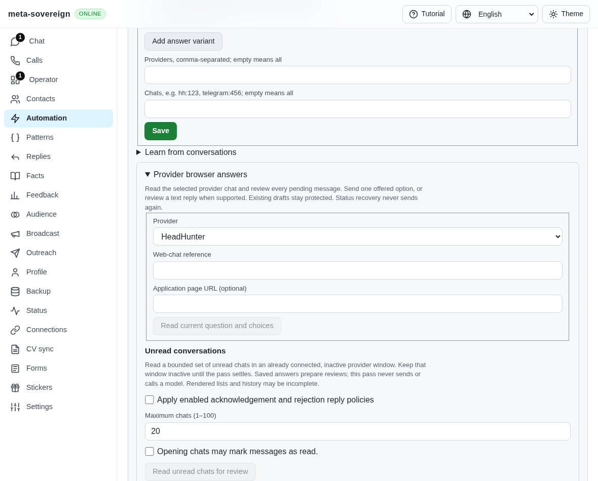
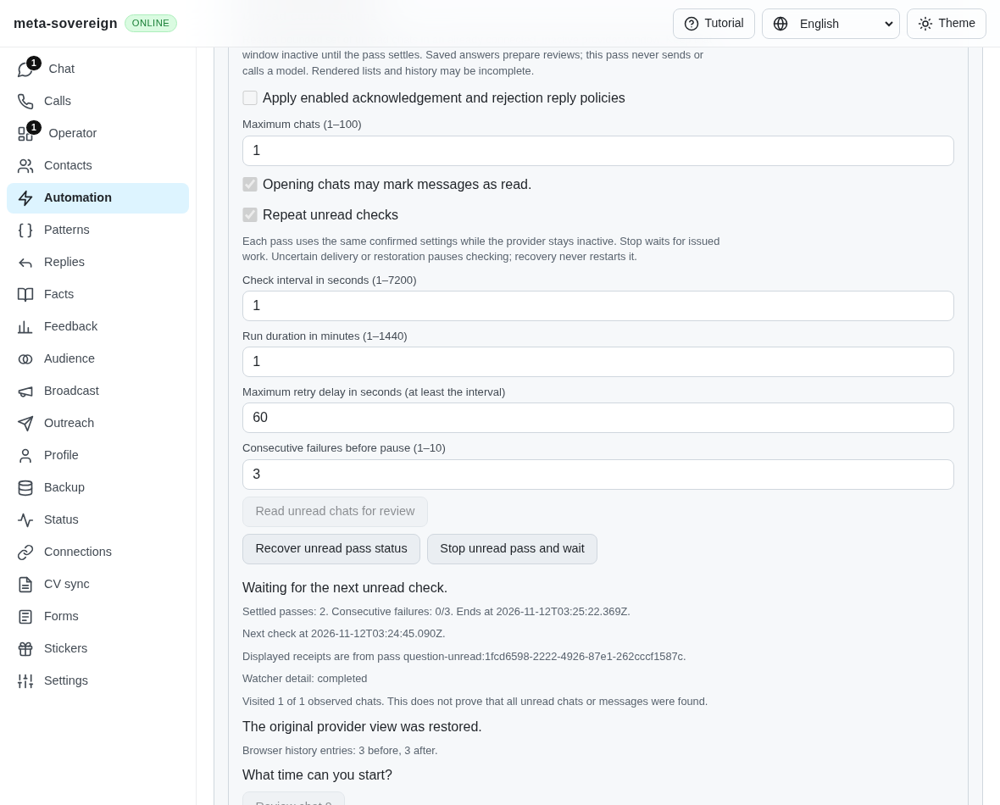
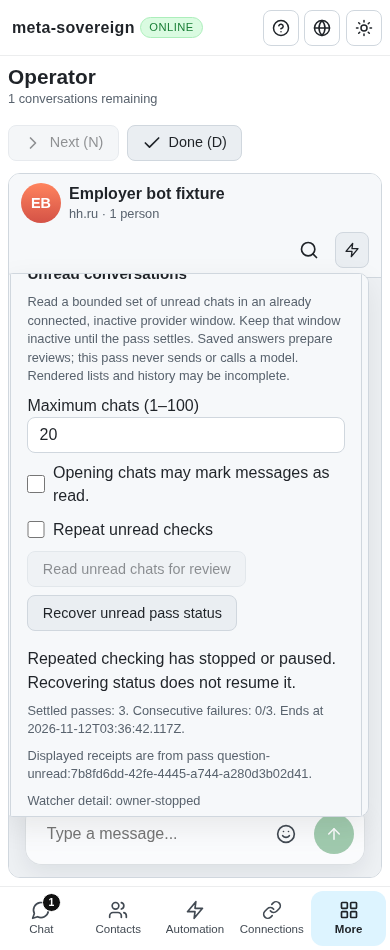

# Repeated unread checking with a durable owner

Pinned HH behavior calls for unread-list checks every ten seconds while the provider window stays inactive, one chat at a time, with a configurable two-hour lifetime and the original view restored. The earlier finite API and controls required starting each pass separately. The actual ec871d26 facade fails the new polling regression; its production bundle has no repeated-check control, captured in the before image.

## Implementation and public controls

`unread-start` accepts an optional `polling` object. Omitting it preserves one finite pass. Defaults are `intervalMs: 10000`, `durationMs: 7200000`, `retryMaxMs: 60000`, `maxFailures: 3`. Intervals are bounded to 1–7200 seconds, duration to 1 second–24 hours and failures to 1–10. The retry cap must be at least the interval. The CLI exposes `--poll-interval-ms`, `--poll-duration-ms`, `--poll-retry-max-ms` and `--poll-failures`; supplying any enables polling. Questions, Chat and Operator share the same explicit controls and four translations. Their duration input uses whole minutes. Mark-read confirmation and any notice-delivery opt-in remain separate.

The parent owns its provider between passes and durably journals a fresh child ID before each existing finite pass. Each child retains the original history, draft, selection, filter, focus, complete-history and outbox protections. Parent status reads the current journaled child or the last settled child; the receipt ID is displayed. Saved IDs only recover status, including after restart; they never resume polling or replay browser actions. Storage stays bounded per parent; independently saved child records retain earlier evidence.

An active owner window causes waiting without native chat navigation. Only definite admission contention or an empty, restored timed-out pass receives bounded exponential backoff. Consecutive failures pause at the configured limit. Other failures, unknown delivery and unverified restoration pause without retry. Stop, expiry and server shutdown interrupt waits and await issued children, including an action that settles after the configured lifetime. A lost child admission response is recovered and drained by its journaled ID before the parent pauses. No model is invoked by unread review.

## Verification

- The actual-parent focused regression fails before the facade change. The old production bundle fails the new control assertion; the before screenshot is retained.
- 39 focused Node and 39 Deno cases cover finite compatibility, two-pass ownership, typed settings, provider exclusion, Stop and expiry draining, read-only restart recovery, receipt identity, unknown notice delivery, capped backoff, child start-response loss and unexpected status errors. The CLI and both negotiated Lino clients exercise the production service.
- The mandatory browser registry passes in Node and Deno. The new standalone browser group covers all existing hosted runtime lanes; unsupported native focus must pause without opening a chat.
- Full native Chrome plus production UI passes five scenarios: two sequential native chats, owner-return waiting, Stop and reload recovery, shared Chat and phone-sized Operator. Original URL, draft, selection and scroll survive. Native sends remain zero.
- Independent Playwright MCP passes five cases using a separately counted private sender fixture: confirmation, lost response, three repeated reads, Stop, shared Chat/Operator recovery. Final counts are scans 3; pending, sends, prefills and current-chat reads 0; page errors 0. This verifies UI/transport ownership, not authenticated provider delivery.

Strict scoped lint, formatting, secret scanning and the unchanged duplication threshold pass. A compatibility rerun of the prior reply-visibility MCP scenario initially timed out with two scans and one send; a fresh browser session passed all five cases with two confirmed sends. Both results are preserved; the transient failure is not explained by this change. Source snapshots, logs, receipt counts and screenshot hashes are retained in `data/unread-polling.tar.gz` with its manifest. Current-commit hosted CI remains required.

## Visual evidence

Before (no repeat control):

After (two native passes, owned view restored, waiting):

Shared phone-sized Operator recovery:

## Remaining issue criteria

This implements explicit repeated unread checking over the supported native HH traversal and confirmed saved notice policies. QA17, HH09 and HH10 stay unchecked: complete provider messaging/read-state parity, authenticated provider verification, selective unread behavior and all other open inventory criteria remain required. Broader automation schedules and source discovery are separate unfinished requirements. PR 57 remains draft and unmerged.
