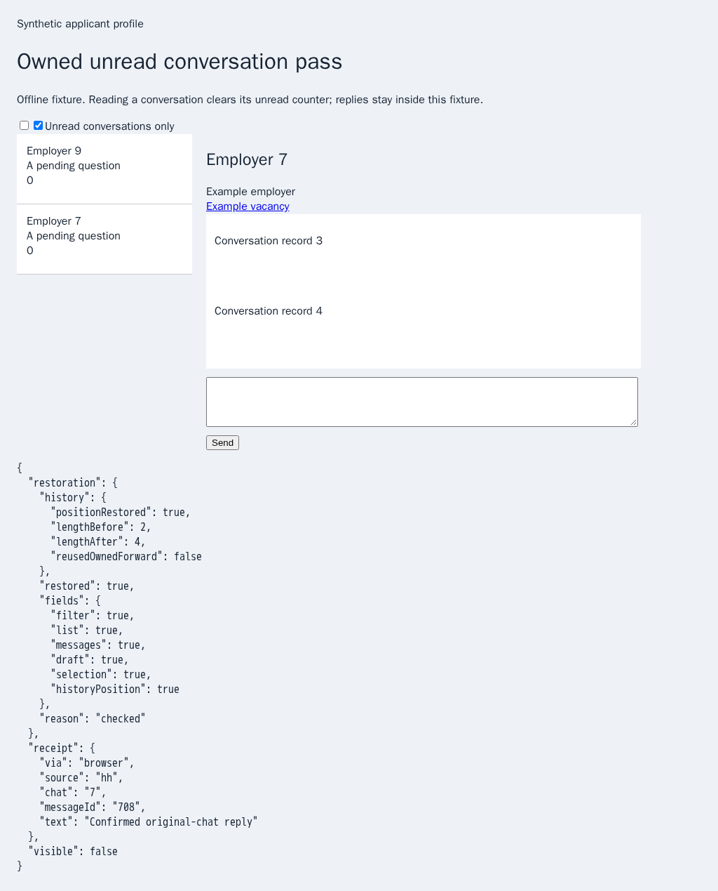
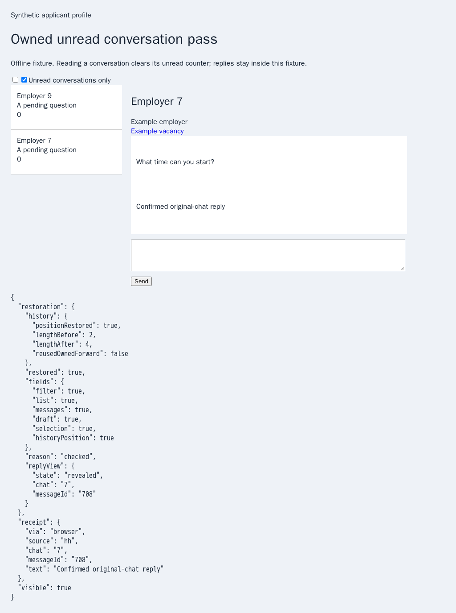
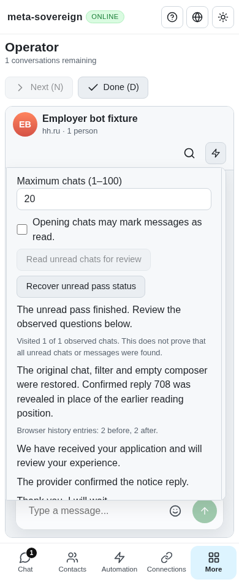

# Revealing a confirmed reply in the original empty chat

The actual parent `123947451a46c18dcc94f1d424c9f66dc13f8a7b` restores the old reading anchor after confirming an outgoing reply. Its native probe records message `708` as sent while that bubble is outside the message pane. The correction retains only full positive receipts for the original chat. After restoring its route, filter, list and composer, it reveals the exact outgoing message if both the saved and current composer are empty and the inactive ownership lease still holds.

The existing bounded virtual-history tail and reply reveal handle ordinary and reversed panes. Matching requires a unique provider message ID, outgoing direction, exact full text and visible geometry. A missing or changed bubble restores the earlier owned anchor. A returning owner or draft takes priority. Stop skips the new reveal. No view failure changes a confirmed send into a failure or issues another reply.

The public restoration receipt distinguishes `revealed`, `unavailable`, `owner-draft` and `owner-active`. The service and both Lino clients reject claims not bound to the same chat's actual positive notice receipt. CLI and shared four-language Questions, Chat and Operator controls retain the result through read-only recovery. Historical wording reports what was revealed during the pass, without claiming the provider remains in that state after recovery.

Native cross-surface verification also exposed per-chat storage for a provider-wide pass ID. Recovery now uses a provider key across all three surfaces. Existing per-surface IDs remain recoverable and migrate after a successful read; ordinary per-chat answer reviews keep their current storage.

Run `PYTHONDONTWRITEBYTECODE=1 python3 experiments/issue-56/unread-reply-view-before.py` for actual-parent positive-receipt bookkeeping and native hidden-bubble regressions. It restores all four substituted production sources in `finally`. The before screenshot retains the actual outgoing receipt and `visible: false`.

Focused verification covers 30 checks in Node and the same 30 in Deno, plus one mandatory browser registry check per runtime. Cases include exact bubble identity and geometry, saved/new drafts, owner focus and route changes, finite missing-bubble work, virtual-scroll settlement, uncertain delivery, observer failure, both Lino formats, CLI recovery and malformed provider receipts. The uncertain-send fixture uses an explicit ten-millisecond receipt budget rather than waiting the production ten-second default.

`NODE_OPTIONS=--max-old-space-size=384 node experiments/issue-56/unread-reply-view-browser.mjs` exercises four native cases and four production UI cases with full Chrome and isolated synthetic provider HTML. `--native-only` and `--controls-only` permit focused reruns. Ordinary/reversed panes, unavailable bubbles and returning owner input are verified independently from delivery. Shared UI checks cover positive disclosure, legacy-ID recovery, Chat and phone-sized Operator. The original three-chat UI fixture once exceeded its unchanged thirty-second locator deadline; its targeted trace subsequently passed. A later three-chat native run reached the unchanged scan budget before processing the final chat. The final UI fixture admits only the original unread chat. Native cases explicitly verify a different chat followed by the original chat, omitting the unused third conversation. Neither application nor test deadlines were increased.

The independent Playwright MCP fixture passes five cases with two scans, two sends, zero pending operations, prefills, provider rereads or page errors. Its scope is positive visibility disclosure, read-only reload recovery, a confirmed reply whose view is unavailable, and shared Chat/phone Operator recovery. The console retains the fixture's missing favicon and explicit unsupported read-marker responses; those requests do not reach a provider read operation. This counted sender boundary does not establish native provider visibility; the separate native probe does that. All fixtures avoid authenticated conversations and leave live-provider parity unverified.

The [evidence archive](data/unread-reply-view.tar.gz) and [SHA-256 manifest](data/unread-reply-view.tar.sha256.json) preserve sources, actual-parent regressions, intermediate failures, focused checks and screenshots. Recreate them with `PYTHONDONTWRITEBYTECODE=1 python3 experiments/issue-56/collect-unread-reply-view.py`.

Parent security, links, Pages and desktop workflows pass. Its Checks workflow has a separate WebKit Lino-sync failure and a cancelled Windows Deno job despite 4,897 passing tests. GitHub's job annotation explicitly reports the unchanged ten-minute job deadline. Preserve and investigate those exact logs. This change still requires its own hosted runtime/browser matrices. PR [57](https://github.com/link-foundation/meta-sovereign/pull/57) remains draft and unmerged. Polling/backoff/lifetime controls, QA17/HH09/HH10 as a whole, authenticated provider verification and every unchecked issue criterion remain unfinished.
