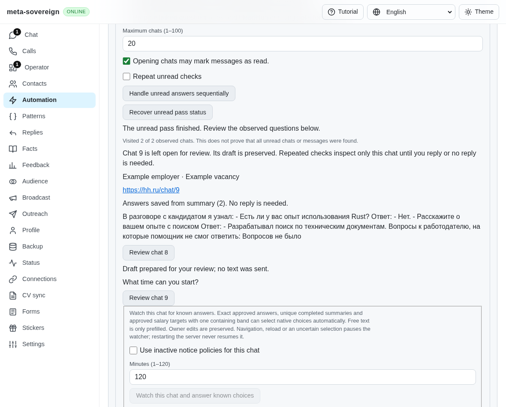

# Learn from completed unread recruiter summaries

On the published parent `3c8cb570`, a HeadHunter pass marked a completed recruiter-bot summary as needing no reply and moved to the next chat. It captured the transcript but saved zero answer facts. A unit regression also changed the summary between capture and processing and observed an incorrect second visit. [Pinned C13 and C15](https://github.com/konard/hh-job-application-automation/blob/fa0991b8c2d0896fb3b4be6c69947f0590094b15/docs/requirements/forms-and-chats.md#L227) · [PR #57](https://github.com/link-foundation/meta-sovereign/pull/57).

Open Automation, Chat or Operator and enable **Handle unread answers sequentially** for HeadHunter. With the routed example, chat 8 contains two completed answers, and chat 9 needs a text reply. The pass rechecks chat 8 against its acknowledged native history and saves the two facts with their source message ID. Each proposal has zero sends and remains unapproved. Chat 9 then opens with its draft for owner review. A visible questionnaire link quoted in a summary never opens a Forms slot.

An edited or unavailable summary or a failed storage acknowledgment holds chat 8 for review. The same-chat retry can recover without counting the facts again. Existing owner drafts and earlier actionable requests keep the chat open. Review-only passes capture the transcript without learning facts.

## Verification

91 focused checks pass on Node and 91 on Deno. The new regressions exercise stale and missing message evidence, a refused flush and same-chat retry, excluded private links and counterquestions, draft preservation and the foreground CLI and both Lino encodings. [Focused regressions](../../../js/tests/question-unread-summary.test.js).

The production Chromium fixture visits chats 8 and 9, verifies both persisted facts and the next draft, and counts zero outbound messages. The regression runs in the mandatory unread Forms group. [Browser regression](../../../js/tests/helpers/e2e-unread-summary.mjs).

Independent Playwright MCP at 390 × 844 shows the saved-answer receipt and the next held draft with no horizontal overflow. The fixture confirms both visits and zero sends. The browser console reported a missing fixture favicon. [Phone screenshot](../../screenshots/issue-56-unread-summary-mobile.png) · [Verification logs](data/unread-summary-learning.tar.gz) · [Checksums](data/unread-summary-learning.tar.sha256.json).

```sh
npm run build:web
RUN_BROWSER_E2E=1 E2E_EXECUTABLE_PATH=/opt/google/chrome/chrome \
  E2E_SCREENSHOTS=docs/screenshots node experiments/issue-56/verify-unread-summary.mjs
```




Authenticated HeadHunter verification and learning from earlier employer questions followed by owner replies remain open under HH10. [Acceptance inventory](reference-feature-inventory.md).
