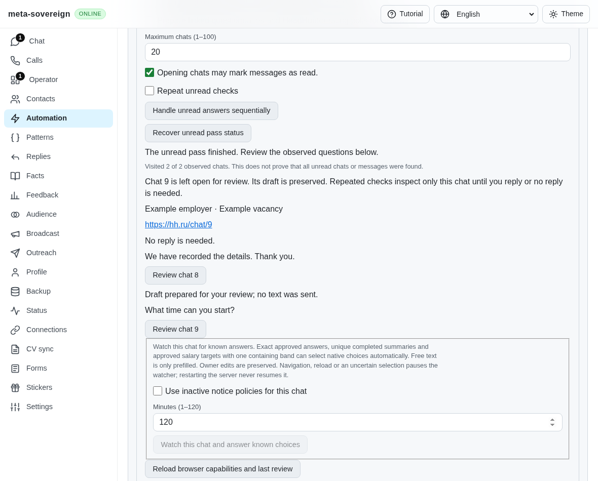
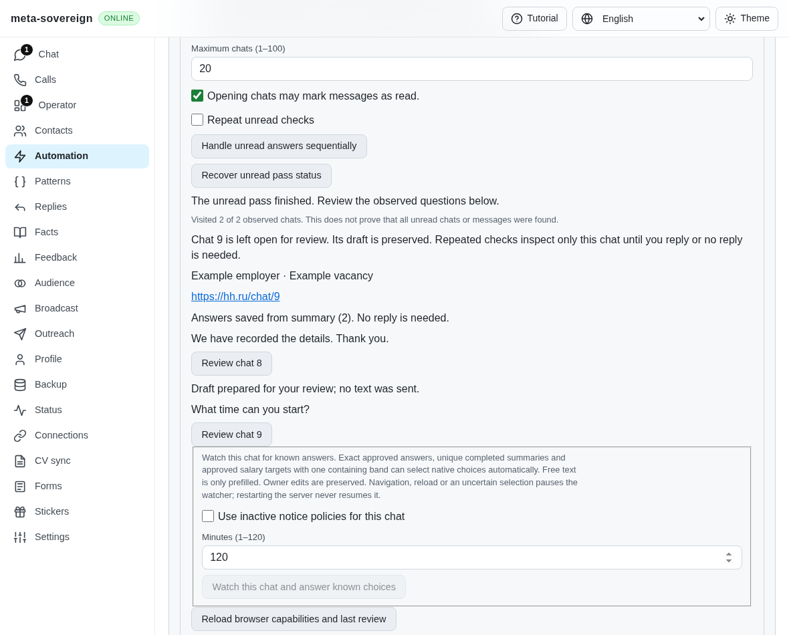

# Learn from each completed summary in a no-reply turn

The unread pass on commit `0970c12c` advanced after an approved no-reply follow-up but discarded the facts in the preceding recruiter summary. Two completed summaries in one pending turn kept only the final summary's facts. The decision already considered the whole rendered turn, while the learner received only its final bubble. [Pinned C13 and C15](https://github.com/konard/hh-job-application-automation/blob/fa0991b8c2d0896fb3b4be6c69947f0590094b15/docs/requirements/forms-and-chats.md#L227-L229)

Run the isolated Chromium fixture with an exact approved `[без ответа]` rule and sequential unread answers enabled.

```sh
RUN_BROWSER_E2E=1 E2E_EXECUTABLE_PATH=/opt/google/chrome/chrome \
  node --max-old-space-size=384 experiments/issue-56/verify-unread-summary.mjs --followup
```

Use `E2E_UNREAD_SUMMARY_BEFORE=1` when running against the parent. Both runs reach held chat 9 and leave its draft intact. The updated pass saves two unapproved facts tied to the earlier native message ID. The chat records zero outgoing messages. Additional checks cover two independent summaries, an unapproved marker, an earlier missing or changed archive row, and a combined receipt larger than a single summary.

The pass checks the fresh pending turn and rereads every expected summary from the acknowledged archive before saving any proposals. A changed turn or missing archive row holds the visit. An unanswered request or owner draft keeps the ordinary review path. [Focused tests](../../../js/tests/question-unread-summary.test.js) · [Registered native regression](../../../js/tests/e2e-question-unread-forms-browser.mjs)

The parent fails three focused regressions. Node and Deno each passed 44 checks on the fixed turn. Chromium reproduced the desktop result on both commits. An independent Playwright run verified the fixed receipt at 390 pixels with zero sends, page exceptions or horizontal overflow. The isolated host returned a favicon 404.





[Phone viewport](../../screenshots/issue-56-unread-summary-followup-phone.png) · [Logs](data/unread-summary-turn.tar.gz) · [SHA-256 manifest](data/unread-summary-turn.tar.sha256.json)

The case uses routed HeadHunter data. Authenticated checks and the remaining provider scope stay open under HH10.
