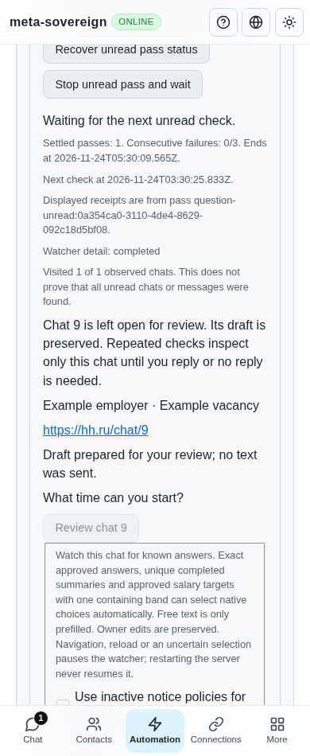
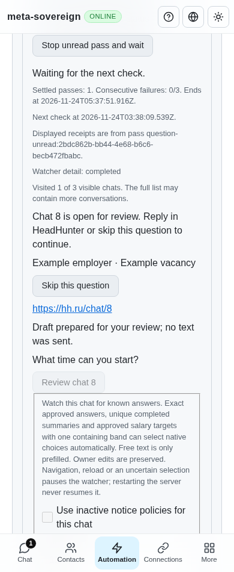
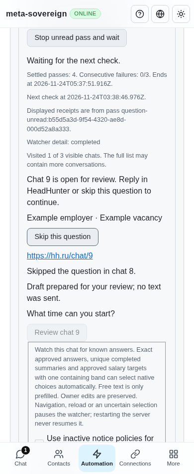

# Watch HeadHunter chats awaiting a reply

In the shared Questions controls, enable **Handle bot options and hold ordinary replies for review**, manual bot choices and repeated checks. Choose **Include already-read HeadHunter chats awaiting your reply**, confirm, and start the watch. The published parent `5a44c314` shows only unread review. In the routed fixture it opens unread chat 9 while already-read chat 8 still awaits an answer. [Pinned C7 requirement](https://github.com/konard/hh-job-application-automation/blob/fa0991b8c2d0896fb3b4be6c69947f0590094b15/docs/requirements/forms-and-chats.md#L221) · [PR #57](https://github.com/link-foundation/meta-sovereign/pull/57).

The explicit watch checks the visible conversation list in the inactive provider tab. It restores the original unread filter and keeps the current chat and its draft open for review. Further checks revisit only that chat until the watch observes an owner reply or confirms Skip for the exact held incoming message. A newer incoming message invalidates the old Skip. Settled visits rotate behind unchecked chats, including when each pass may visit only one conversation. The watch records partial coverage and never sends an ordinary reply or selects a bot choice.

In the foreground CLI, use `automations answers browser unread --source=hh --confirm=true --watch-waiting=true` and type `s` followed by Enter at the held-chat prompt. Both Lino encodings support starting the same watch and recovering its acknowledged Skip receipt.

## Reproduction

```sh
npm run build:web
RUN_BROWSER_E2E=1 E2E_EXECUTABLE_PATH=/opt/google/chrome/chrome \
  QUESTION_UNREAD_WAITING_SCREENSHOTS=docs/screenshots/issue-56-unread-waiting \
  npm run test:e2e:question-unread-waiting
```

The same scenario with `QUESTION_UNREAD_WAITING_BEFORE=1` on the parent uses the parent application and the same isolated provider fixture. The updated scenario uses actual native navigation with a one-chat limit. It verifies that chat 8 stays open across checks, that Skip preserves its draft and advances to chat 9, and that a visible owner reply ends the hold. Stop drains the watch. The provider fixture records zero sends throughout.







A separate Playwright MCP run at 390 pixels exercised Skip, advancement, Stop and the watch labels in English, Hindi, Russian and Chinese. This run used a fixture sender. [Phone screenshot](../../screenshots/issue-56-unread-waiting/mcp-waiting-phone.png).

The native WebKit check paused before visiting a chat because background focus could not be verified. It preserved the provider URL, unread filter, draft, visits and send count. Hosted Chromium and WebKit run this scenario in the existing native chat choice group.

Node passed 50 focused checks, including 13 browser registration checks. Deno passed all 37 focused checks. The text and binary Lino regressions each exercise exact Skip, cross-origin refusal and read-only recovery. [Logs](data/unread-waiting.tar.gz) · [SHA-256 manifest](data/unread-waiting.tar.sha256.json).

The [application handoff](application-chat-waiting.md) uses this watch after confirmed delivery. Tracking for HH10 remains open for the remaining provider workflows and authenticated verification. [Acceptance inventory](reference-feature-inventory.md).
