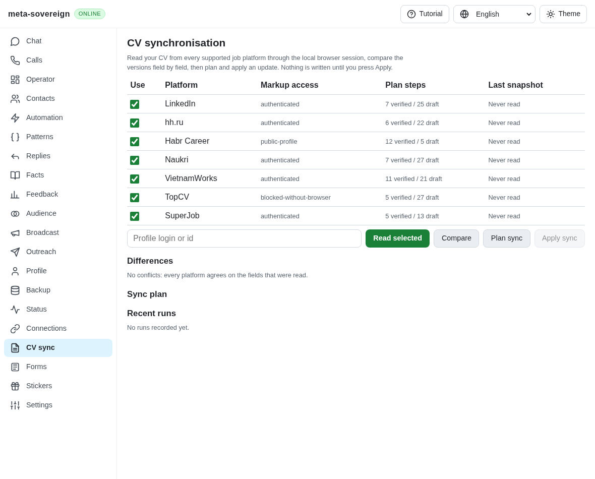
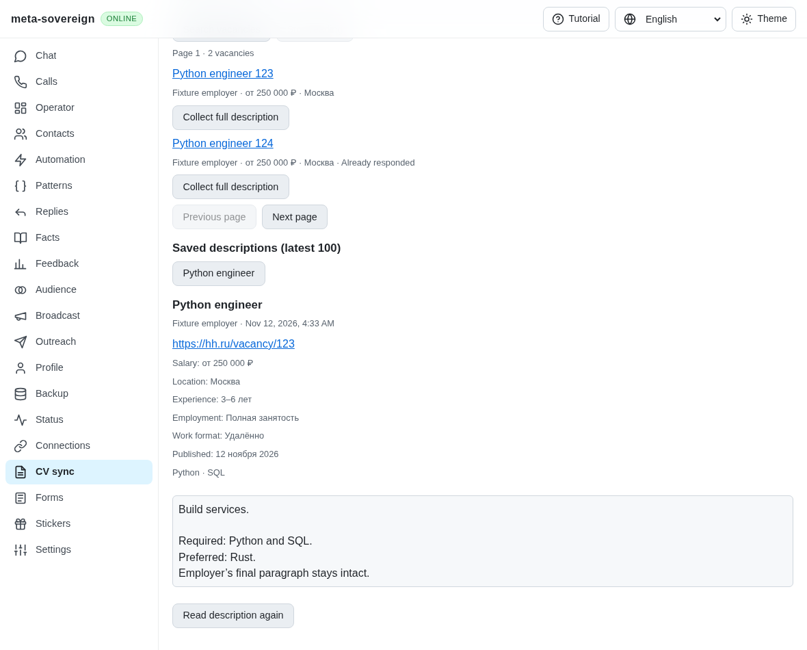
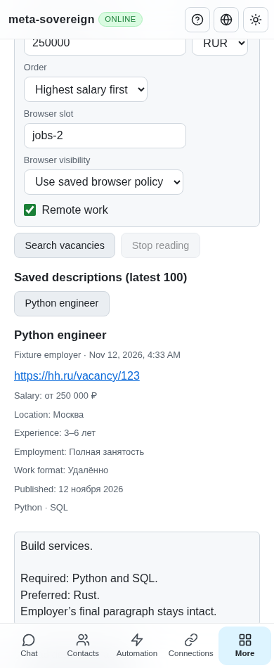

# HH vacancy search and collected descriptions

This unit addresses search/collection prerequisites of HH02 and HH03. Full HH
application/resume workflows and all unchecked inventory rows remain required.
PR57 stays draft and unmerged.

The published parent `727b3f6b` has an assignment vacancy reader and a canonical
success-only cache. It does not expose vacancy search/collection through all
three requested interfaces. Its reader drops visible employer metadata, and
the cache accepts a custom reader's empty description during refresh. Two
actual-parent regressions and an old-bundle screenshot preserve those gaps.

The implementation reuses that reader/cache. CLI commands `vacancies-search`,
`vacancies-collect` and `vacancies-stored`, default-Lino `/api/vacancies/*` routes
and the CV panel share finite owned operations. Search carries the chosen resume
hash, area, salary, currency, remote-work preference, ordering and explicit page.
Only exact native next-page evidence enables continuation. A changed filter,
login/challenge, transient blank or ambiguous identity refuses the read.

Collection retains complete visible employer prose, skills and optional salary,
location, experience, employment, work format and publication text. Canonical HH
vacancy aliases share the existing cache with assignment drafting. Failed reads
cannot overwrite a successful snapshot. Cached recovery does not resume work.
Browser visibility follows the saved jobs/slot policy by default; an explicit
override remains typed. Stop and shutdown drain issued launches and owned pages.
Application delivery remains unsupported by this read-only unit.

## Source comparison

Read-only comparison used HH reference commit
[`fa0991b8`](https://github.com/konard/hh-job-application-automation/tree/fa0991b8c2d0896fb3b4be6c69947f0590094b15),
dated 2026-11-05: vacancy card/pagination selectors, collected employer context,
resume-bound search, canonical-ID cache and failure preservation. No reference
implementation was copied. The product vision's configurable grouped fields and
shared loading/recovery rules apply to the existing CV surface. Reference
research, raw checks and screenshots accompany the final evidence archive.

## Verification

Twenty-seven focused Node and twenty-seven Deno checks cover exact filters,
metadata, cache reuse and refresh, late-launch cancellation, browser policy,
CLI, Lino text/binary, receipt validation and four locales. One mandatory
registry contract and four partition contracts pass in each runtime. Strict
lint, formatting, secrets and the unchanged duplication gate pass.
An isolated native provider fixture uses actual commander navigation and DOM
extraction; no HH network requests or application clicks are issued. Desktop and
phone controls, cached recovery and Stop are exercised separately from live
provider verification. Five native Chromium scenarios confirm six owned reads,
all closed, with zero provider clicks and no page errors. Three independent MCP
cases confirm two owned reads, all closed, with zero provider clicks and no page
errors. Reloading cached data does not replay a read.

Reproduce the original cache/metadata failures and old UI with
`python3 experiments/issue-56/vacancy-before.py`. Run focused code gates with
`python3 experiments/issue-56/verify-vacancies.py`; run the native fixture with
`RUN_BROWSER_E2E=1 E2E_EXECUTABLE_PATH=/opt/google/chrome/chrome node experiments/issue-56/vacancy-browser.mjs`.
The fixture initially omitted UTF-8 from its HTML content type; the first native
run detected corrupted punctuation. Its failed log and screenshot are retained
alongside the corrected fixture and passing run. The MCP fixture uses installed
full Chrome because the default headless-shell executable is absent locally.

The published parent's Checks run
[43150797918](https://github.com/link-foundation/meta-sovereign/actions/runs/43150797918)
belongs to `727b3f6b`, created 2026-11-12 03:50:01 UTC. Every browser shard and
other runtime job passes; macOS Node shard 3/3 fails the CAPTCHA deadline test.
Full raw log lines 121499–121509 report `form-session-missing` during status
recovery. That independent failure remains under investigation; its preserved
log does not establish a root cause. Exact new-head hosted checks are required.

## Visual evidence

Before, the existing CV view offers no vacancy controls:

After, the same view exposes native search results and the collected full prose:

Phone recovery retains the saved settings, metadata and full description:

Sources, parent reader snapshots, numbered raw logs, checksummed screenshots and
independent MCP counts are preserved in [the evidence archive](data/vacancies.tar.gz).
Application execution, complete résumé selection/export, expanded/live-provider
parity and every other unchecked inventory criterion remain required.
