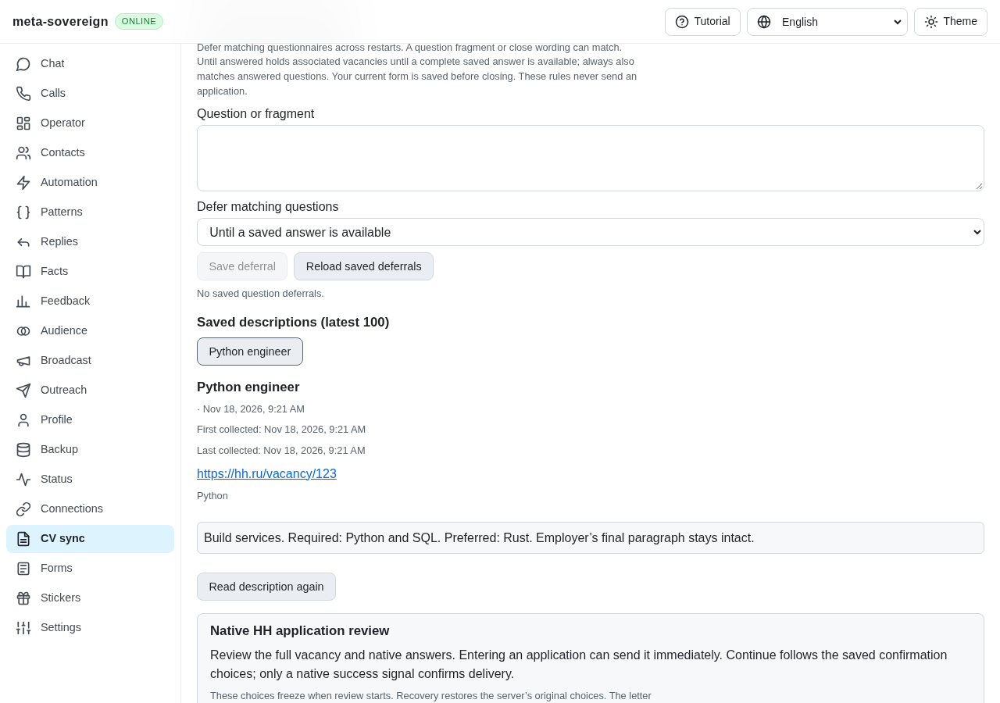
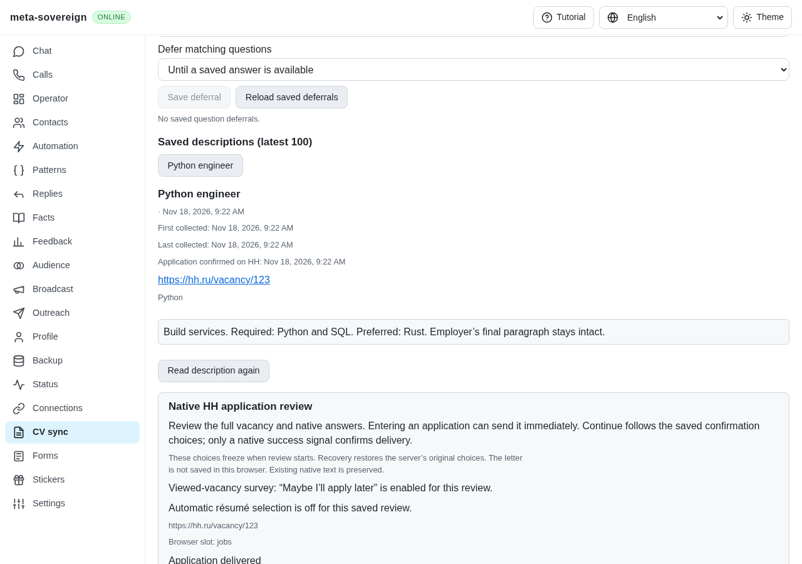
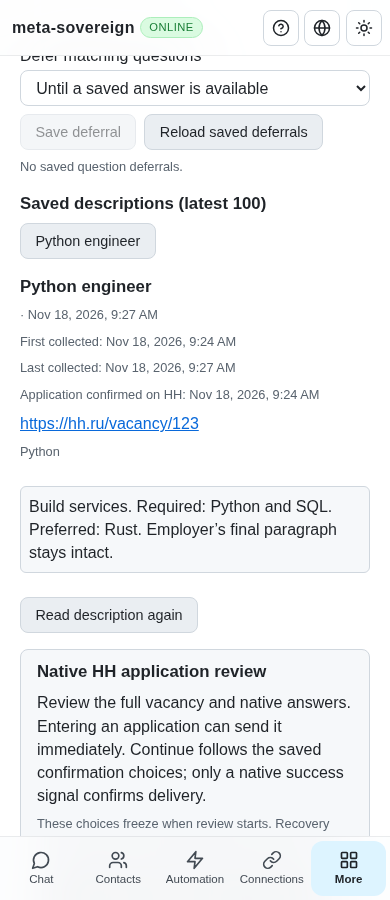

# Confirmed applications in the shared vacancy cache

PR: https://github.com/link-foundation/meta-sovereign/pull/57

The pinned HH insight implementation records `status: applied` and `appliedAt`
after confirmation. Meta-sovereign's application journal already reserves and
confirms delivery, but its separate full-description cache omitted this evidence.
`vacancyContent` also dropped those fields when importing the pinned cache.
A description refresh consequently could not preserve the application receipt.

The source reference is `konard/hh-job-application-automation` at
`fa0991b8c2d0896fb3b4be6c69947f0590094b15`:
`src/vacancy-insights.mjs` blob `43921a6b45c3bd80b594d75635f8d43a75e470dc`
and `src/vacancy-cache.mjs` blob `8200fc06aed2e3e65a3577e902251380f83d67b8`.
Both complete sources and independently checked blob hashes are archived.

A successfully collected snapshot now has encountered status. Only a bound native
delivery, after its application journal is acknowledged, marks an existing cache
record applied. Preview, challenge, limit, external and uncertain states cannot
create that evidence. A delivery without a collected description does not invent
a cache record. The first confirmation time survives repeated reads and refreshes;
provider description extraction cannot manufacture it. Exact private HTML and
observation times remain unchanged when only application evidence is recorded.
`appliedAt` is the local observation of native confirmation, not a provider-supplied
timestamp. Full-description capture times still describe actual description reads.

Optional validated metadata keeps older snapshots compatible and retains applied
legacy records. CLI, text/binary Lino and the offline browser API expose the same
saved evidence. The saved-description UI displays it in all four languages. A
rejected cache save restores the acknowledged description; the separate confirmed
journal stays reserved, and an explicit native read can finish storing the evidence
without another submission.

## Reproduction and verification

```sh
python3 -B experiments/issue-56/vacancy-application-before.py
node --max-old-space-size=384 --test --test-concurrency=1 \
  --test-timeout=10000 js/tests/vacancy-application.test.js
node --max-old-space-size=384 experiments/issue-56/vacancy-application-browser.mjs
```

The exact published parent `217682a5eed516feb640ac860b34bcbdbe6e065e`
fails all three selected new regression checks. Its real isolated native application
still succeeds exactly once, but the saved description has no applied receipt.
The corrected source passes 66 focused checks, including rejected-save concurrency,
restart, private markup, legacy migration, CLI, both wire formats and existing
application guards. The same mandatory application-panel browser scenario now also
requires the recovered cache receipt, four locales and a fitting phone viewport.
It retains one native submission, one deliberately lost entry response, no reload
replay and complete fixture cleanup. The full browser/runtime matrix stays in CI.

An independent MCP browser confirmed four locales, an acknowledged native refresh
that retained the receipt, fitting desktop/phone views, and no application mutation
on recovery. Both MCP attempts together opened one application and two read-only
refreshes; native outcomes record exactly one entry and one submission. All owned
pages and both browsers closed. The first MCP assertion incorrectly treated
navigation-aborted read requests as operation failures; its raw result is preserved.
The corrected probe retains those aborts separately, rejects other request failures
and requires HTTP 200 for the actual refresh. Initial MCP navigation also reported
the fixture's missing favicon and a browser cache-write error; the later probe
turned browser caching off. This evidence does not claim a clean console.

Before (confirmed delivery, absent cached receipt):



After (the same native-delivery workflow, recovered receipt):





The deterministic archive `data/vacancy-application-cache.tar.gz` and its SHA-256
manifest retain raw failures, passing checks, source snapshots, scripts and images.
HH03 remains unfinished pending its complete acceptance audit and hosted evidence.
The inventory stays **88 verified / 30 unfinished**. PR57 remains draft and unmerged;
no other requirement is accepted by this cache correction.
