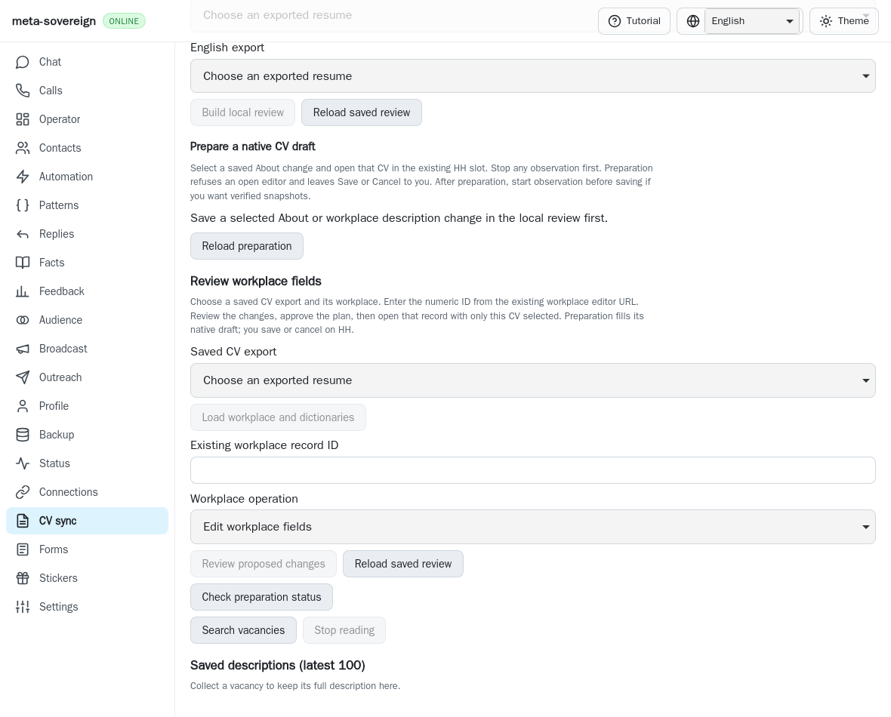
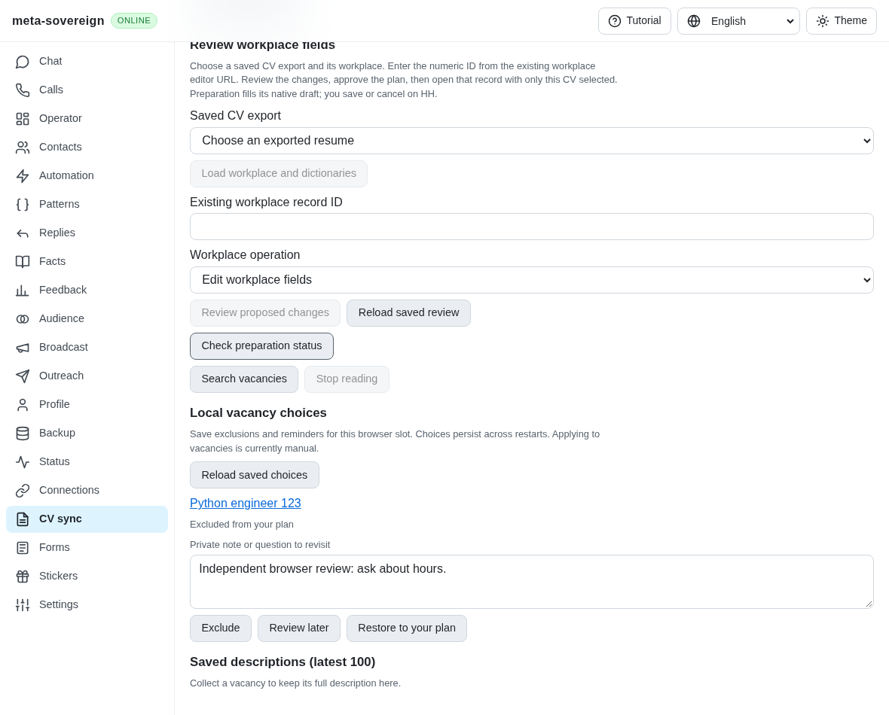
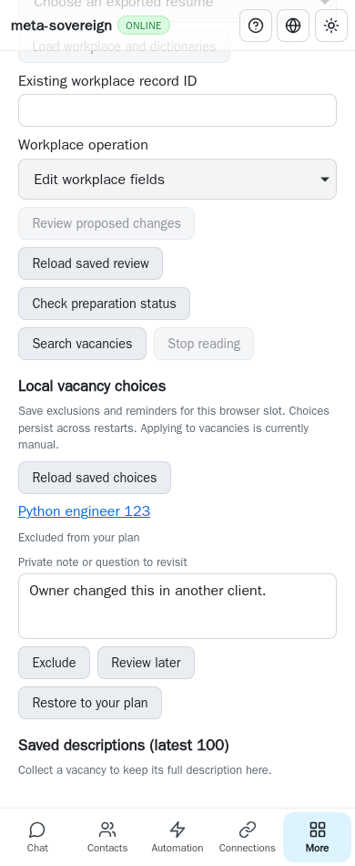

# Private vacancy choices (HH05 foundation)

PR: https://github.com/link-foundation/meta-sovereign/pull/57

The pinned HH reference preserves owner skips and deferred questions separately
from provider delivery outcomes. The parent `64a9b6e2` had search/collection but no
owner exclusion/reminder registry. This change adds that registry; it does not
complete HH05, HH06, HH07 or HH08. Applying is still manual, as the UI states.
Automatic responded/viewed filters, reason-specific retries, questionnaire
recognition/answers, session-only no-questionnaire controls and the guarded
application executor remain required.

Choices belong to one named browser slot. The canonical HH vacancy URL identifies
an entry containing a title, `skipped` or `deferred` state, private note and update
time. `secret:jobs-vacancy-choices:<slot>` uses the existing private-record boundary
and optional store encryption; ordinary peer synchronization excludes it. These
private planning notes do not attest to a submitted application or answered form.
Restoring removes the local choice without touching provider data.

The service requires the exact revision returned by `choices-stored`, including
the explicit `empty` revision for a new slot. Every acknowledged change gets a
fresh revision, including clearing the final entry. Stale writes fail with 409,
so a previous empty state cannot resurrect cleared choices. Shared job ownership
serializes writes, acknowledged readers wait for persistence or rollback, and
Stop drains issued work. A failed flush restores the previous acknowledged row.
Capacity is bounded to 1,000 entries and one million combined URL/title/note
characters. Existing entries are never silently dropped to make room.

CLI commands `vacancies-choices-stored`, `vacancies-choice-save` and
`vacancies-choice-clear` use the same service as GET
`/api/vacancies/choices-stored` and trusted POST `choice-save`/`choice-clear`.
Both text and binary Lino are verified, including 500-character CJK titles and
4,000-character CJK notes (13,617 text bytes versus 73,000 binary bytes for the
fixture). The bounded 128 KiB save route admits both encodings; model validation
still limits individual fields. Missing revisions, forged URLs, invalid slot
names, states and stored records are refused before changing data.

English, Russian, Chinese and Hindi CV controls save exclusions, reminders and
notes from search cards or the saved registry. Slot changes invalidate old
reads. A conflicting, malformed or unreceived reply disables further writes and
offers explicit reload; visible notes are retained. Reload recovers an issued
write without replay. Offline private records can be read; offline mutation is
unavailable. Twenty saved entries render initially, with explicit incremental
expansion.

## Reproduction and verification

Run the finite actual-parent experiment:

```sh
python -B experiments/issue-56/vacancy-choices-before.py
```

It restores parent production sources, asserts the missing service operation and
missing UI, captures the before screenshot, then restores and rebuilds current
sources unconditionally. The parent fails with `service.choice-save is not a
function` and `Saved owner vacancy choices must be available`.

Focused checks: 32 Node tests across owner choices, existing search, technology
controls and mandatory browser registration. These include held failed flush and
Stop, stale/empty revision replay, full capacity, private slot isolation, restart,
explicit CLI slot flags, both Lino transports, trusted-origin refusal, forged
receipts and four-language markup. Three WebKit scenarios exercise actual native
provider fixtures, restart, slot isolation, reversible exclusion, concurrent owner
revision refusal and phone layout: one provider read, zero clicks, zero page
errors. Independent Playwright MCP verifies lost-reply recovery without another
provider read, retained notes, restore and desktop/phone layout. No authenticated
provider was contacted. The runtime/browser matrix remains hosted validation.

The first browser attempt timed out after clicking search before entering the
fixture's normal query/resume settings; the fixture now enters those settings
like existing vacancy tests. A subsequent assertion incorrectly expected
`undefined` for a missing memory-store row; the store contract returns `null`.
Both logs are retained separately from the final passing evidence. Neither
observation justifies changing production search behavior or increasing deadlines.

All source snapshots, before/after logs, independent MCP results and screenshot
hashes are preserved in `data/vacancy-choices.tar.gz` and its manifest. The
unchanged duplication threshold passes at 6.48%. Screenshots below are committed
review artifacts.

Before:



After:




