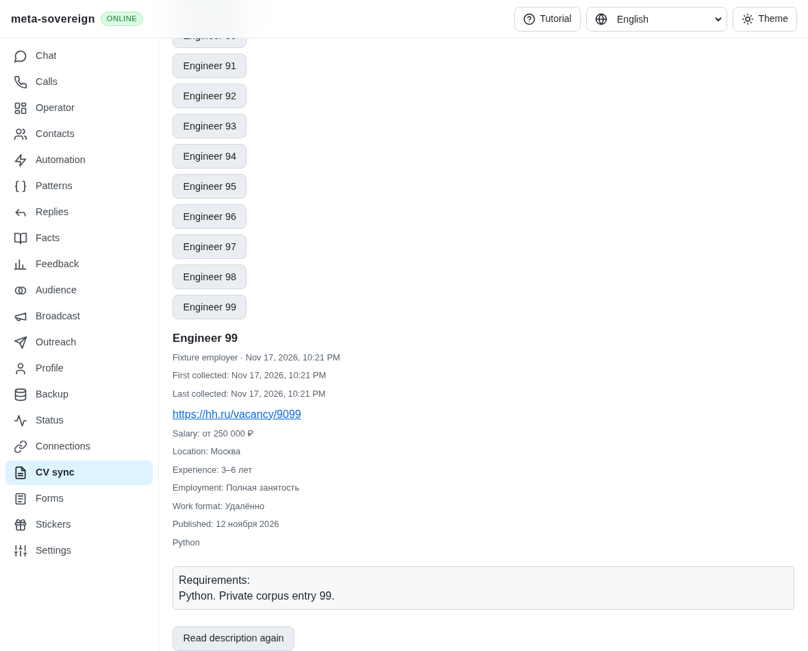
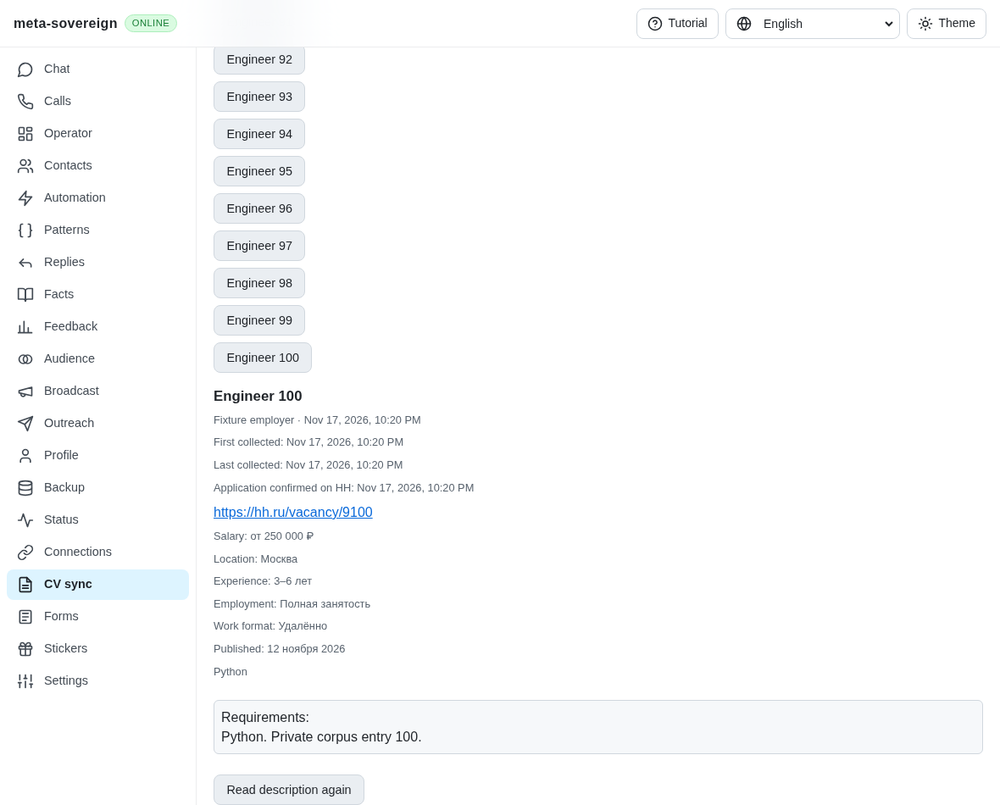
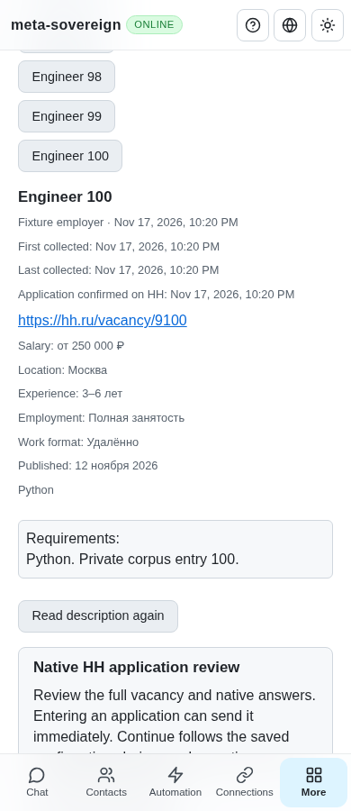

# Complete reads of the private vacancy corpus

PR: https://github.com/link-foundation/meta-sovereign/pull/57

The pinned HH cache's `all()` enumerates every stored vacancy. The shared server
reader instead sorted the cache and silently returned only its newest 100 entries.
The offline browser reader separately returned the first 100 inserted records.
Those restrictions hid acknowledged descriptions from CLI, API, UI, technology
statistics and exclusion review. Older corrupt identities were also never checked.

The reference is `konard/hh-job-application-automation` at
`fa0991b8c2d0896fb3b4be6c69947f0590094b15`, `src/vacancy-cache.mjs`,
blob `8200fc06aed2e3e65a3577e902251380f83d67b8`. The complete source and
verified blob hash are included in the evidence archive.

Server and offline reads now return the complete cache in capture order, newest
first. Exclusion review can reuse older acknowledged descriptions without reopening
the provider. Technology analysis and receipt validation admit complete corpora
above 100 records. Existing input/output byte limits, unique vacancy identities,
per-vacancy and total mention limits, cancellation and report digests remain in
force. A corpus exceeding the analysis budget fails explicitly; no partial report
is silently substituted. Discovery's separate finite page/card bounds still apply.

## Reproduction and checks

```sh
python3 -B experiments/issue-56/vacancy-corpus-before.py
node --max-old-space-size=384 --test --test-concurrency=1 \
  --test-timeout=10000 js/tests/vacancy-corpus.test.js
```

The exact published parent `51ff8bf0ac1cd703e722ad35602e6c0fc1924137`
fails seven of eight new checks. The finite input-budget control passes on both
versions. All 37 focused checks pass on the correction, including existing cache
durability, collection controls and technology analysis/receipt regressions. The
new checks cover 101 descriptions through durable restart, offline ordering, CLI,
actual HTTP text/binary Lino, complete analysis and saved-report recovery. They
also cover exclusion reuse of the oldest description and an older corrupt identity.
Only a bounded 145-record, approximately 4.3 MB input exercises budget refusal;
the local probe uses a 384 MiB JavaScript heap and concurrency one.

Independent Playwright MCP runs against exact-parent and corrected production
bundles use the same 101-record private fixture. The parent exposes 100 records;
the correction exposes all 101. Both verify newest-first order, full oldest-visible
prose, four locales, reload without replay, fitting desktop/phone views, zero
provider opens and zero mutations. Both owned servers/browsers close. These are
isolated fixtures, with no live HH requests or clean-console claim; the fixture
has no favicon. The parent fixture initially inherited closed stdin. A retained
bounded helper targeted only that fixture's inspected PID and emitted its normal
drain signal through Node's debugger; cleanup completed and all current sources
and the bundle were restored. The corrected fixture used an interactive stdin.

Before, the saved list ends at Engineer 99:



After, the oldest saved description and its confirmed application are accessible:





The checked archive `data/vacancy-corpus.tar.gz` and its per-file SHA-256 manifest
preserve sources, complete raw logs, parent comparisons, reference and screenshots.
HH03 stays unfinished until its full acceptance audit and hosted verification.
The inventory remains **88 verified / 30 unfinished**; PR57 stays draft and unmerged.
