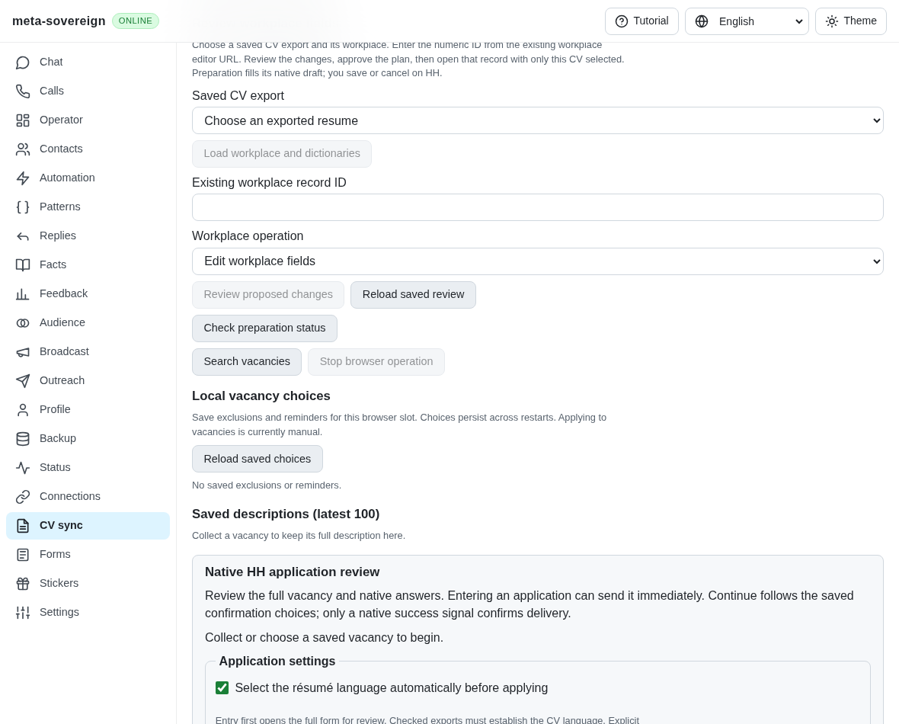
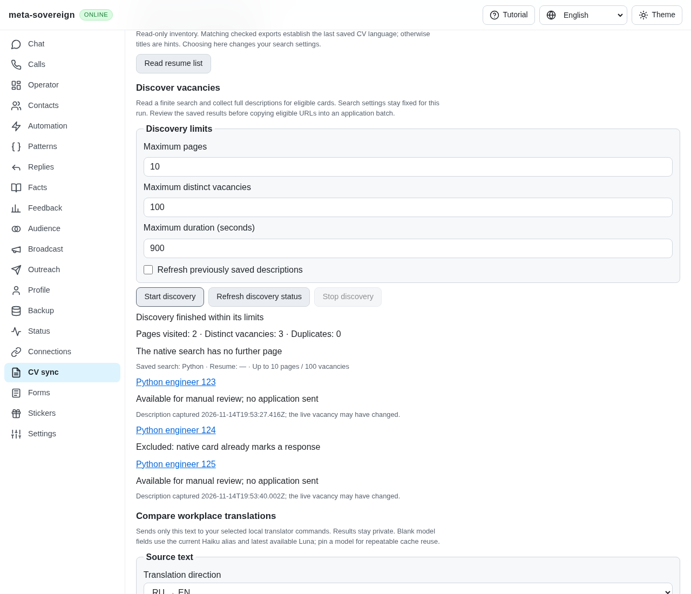
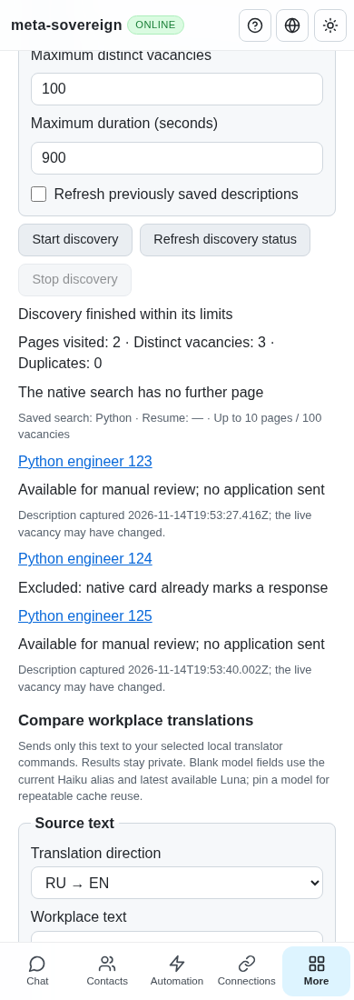

# Bounded automatic vacancy discovery

Discovery freezes the requested HH search, browser slot, visibility policy and
selection filters, follows only its validated native next page, and collects full
descriptions for eligible distinct cards. The worker stops at observed exhaustion,
a configured page/card limit or its deadline. This implements the finite automatic
search prerequisite of HH02/HH03/HH05; expanded authenticated parity, native viewed
state and every other incomplete inventory requirement remain required.

## Reproduction and behavior

On published parent `7998d2c5b63e7bd9f00fc7946ab50c6b99687f1c`, the CV workspace
supports individual search pages and description reads but has no finite discovery
control. Both probes select actual parent sources and restore them in `finally`:

```sh
python3 -B experiments/issue-56/discovery-before.py
python3 -B experiments/issue-56/discovery-before.py --native
```

The service probe fails all twelve discovery cases because the operations are
absent. The native probe saves the missing-control screenshot and fails its explicit
availability assertion. In the current UI, enter search settings under CV sync,
choose finite discovery limits and press Start discovery. Inspect the saved search,
completion reason, card decisions and description timestamps. Copying the eligible
URLs into the batch draft requires a separate batch start and confirmation.

The defaults are ten pages, one hundred distinct cards and fifteen minutes; hard
bounds are one hundred pages, one thousand cards and twenty-four hours. Every
native page must retain the exact frozen filters and consecutive pagination.
Canonical URLs deduplicate pages; a later positive responded marker supersedes
an earlier negative marker. Existing private choices and backed retry waits remain
in force. Each full description uses the existing success-only cache, with explicit
refresh available. Reads are sequential in the shared owned browser lane; discovery
also refuses admission while an application batch is waiting between operations.

Only acknowledged checkpoints become public progress. Refused writes retain the
previous durable descriptions and progress. Stop, lifetime expiry and service
shutdown cancel and drain the native reader. A saved running record without this
worker is displayed as interrupted; reading status or restarting the host never
recreates the worker. Reusing an ID observes its original run, while changed options
for that ID refuse. Public receipts bind the slot, identity, bounds, search and
filters; a missing or mismatched start receipt refuses.

The CLI exposes `vacancies-discovery-start`, `vacancies-discovery-status` and
`vacancies-discovery-stop`. Start stays in the foreground until completion or an
interrupt, then drains and closes its store. Its bounded flags include
`--max-pages`, `--max-vacancies`, `--duration-ms`, and existing search settings.
The same controls use guarded text/binary Lino routes and four-language React UI.
Default-off `MS_JOBS_DISCOVERY_DEBUG=1` reports only page/count/phase/error-code
metadata, excluding queries and vacancy prose.

## Focused verification

```sh
node --max-old-space-size=384 --test --test-concurrency=1 \
  js/tests/job-vacancy-discovery.test.js \
  js/tests/job-vacancy-discovery-controls.test.js \
  js/tests/vacancy-search.test.js js/tests/vacancy-controls.test.js \
  js/tests/cli-help-imports.test.js js/tests/cli-batch-admission.test.js \
  js/tests/job-application-batch-controls.test.js
DENO_V8_FLAGS=--max-old-space-size=384 deno test --allow-all --no-check \
  js/tests/job-vacancy-discovery.test.js \
  js/tests/job-vacancy-discovery-controls.test.js
python3 -B experiments/issue-56/discovery-native.py
```

The focused Node selection passes 47 cases; Deno passes 21. Cases cover native
pagination/filter binding, cache reuse, deduplication/responded precedence, finite
limits, stopped/expired/shutdown drainage, expiry before any read when admission consumes the lifetime, restart without replay, refused snapshot
acknowledgements, owner exclusions, backed retries, batch ownership, public receipt
validation, foreground CLI cancellation/listener removal, both Lino encodings,
cross-origin refusal and four-language render/handoff behavior.

One focused native Chromium scenario and an independent Playwright MCP flow use
actual native readers and owned routed HTML, without external HH traffic. Both
observe two pages, three cards, two descriptions, zero provider clicks, no recovery
replay, four locales and closed native resources. Copying the two eligible URLs
only fills an unconfirmed batch draft. Phone layout has no horizontal overflow.
The scenario is appended to the existing mandatory vacancy browser entry, retaining
all prior scenarios, engines, shards and CI deadlines.

The independent MCP fixture initially exhausted its shared ten-second single-action
wait while four sequential native readers were still completing. The retained
failure and closed-resource statistics distinguish this from a product failure.
Only this new multi-read scenario uses a finite forty-five-second completion wait;
production deadlines and existing test waits are unchanged. Initial fixture/import,
canonical timestamp and URL-serialization assertion errors are retained in logs.

Before:



After:



Phone:



## Evidence and remaining requirements

The [checked archive](data/vacancy-discovery.tar.gz) and
[per-file hashes](data/vacancy-discovery.tar.sha256.json) preserve source snapshots,
actual-parent failures, focused/native/MCP results, screenshots and hosted metadata.
Recreate them with `python3 -B experiments/issue-56/collect-vacancy-discovery.py`.

The earlier batch parent Checks run `43629631473` has now finished: nine runtime
jobs identify the omitted batch command names; the tenth failure is its aggregate
pipeline. The newly completed macOS Bun log records the missing names at lines
6112–6113. Its complete workflow log and earlier complete job logs are retained.
For published correction `7998d2c5`, four companion workflows pass and Checks
`43631952329` remains pending without a failed completed job at the latest recorded
inspection. This is not an aggregate passing claim; exact-head checks for discovery
remain required after publication. All 81 original incomplete rows stay open, and
PR57 remains draft and unmerged.
