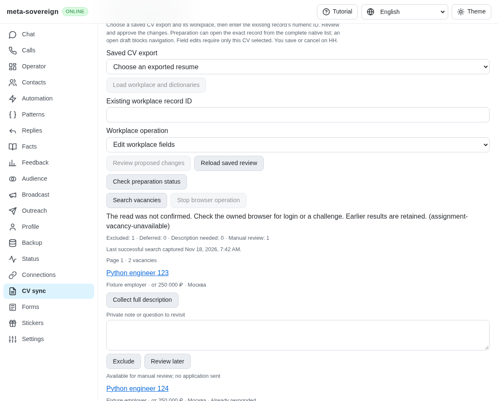
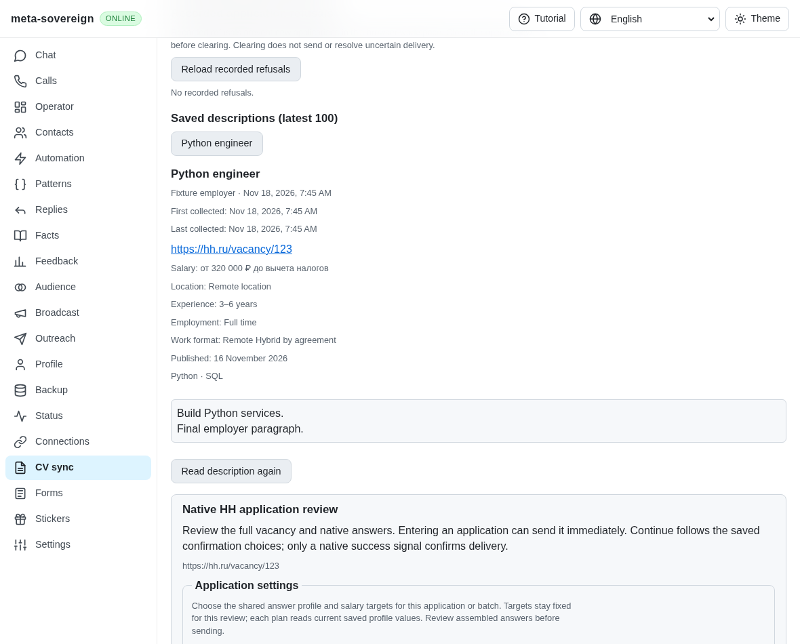
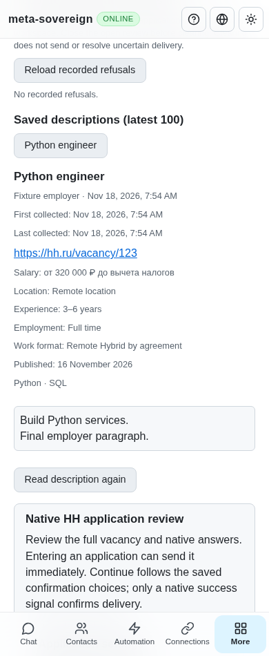

# Delayed native vacancy descriptions

[PR #57](https://github.com/link-foundation/meta-sovereign/pull/57) remains draft.
This completes the bounded description-loading correction within HH03. The
remaining HH03 and issue requirements remain required.

## Reproduction and cause

On published `cd4cd0b5`, open a vacancy whose native title or description is
hydrated after DOMContentLoaded. Collection immediately reports
`assignment-vacancy-unavailable`, and application context immediately refuses
the vacancy. The pinned reference's full-vacancy reader waits up to twenty
seconds for the description. Navigation completion alone did not establish
content readiness in either current caller.

Three focused regressions fail against the actual published callers, with two
compatible controls passing. The same native browser scenario on that source
shows the collection error and no saved description. Its owned browser and
server close even when the assertion fails.

## Behavior and verification

One shared read now waits only while the intended native title or description
is missing. It uses a monotonic twenty-second window and cancellable 250 ms
delays. Already loaded content returns after one read. CAPTCHA, a different
vacancy, ambiguous fields and malformed or oversized evidence do not authorize
another hydration read. The existing strict extraction, cache validation and
acknowledgement rules still decide whether content may be saved.

Both collection and held application review use this read. The collector keeps
its existing owned browser deadline and shutdown. Application review retains
ownership of its held browser; a failed read cannot replace its acknowledged
vacancy context. CLI, both Lino transports and the UI use these same services.
The wait never clicks, fills, submits or opens another browser.

`MS_ASSIGNMENT_VACANCY_DEBUG=1` enables default-off wait diagnostics for standalone
collection. Application context uses the existing application trace. Events
contain only lifecycle state and read counts, without vacancy text or URLs.

- Forty focused Node checks pass with one worker and a 384 MiB heap. These cover
  both callers, exact HTML preservation, strict refusal, cancellation, finite
  expiry and existing cache protection. A separate clock-controlled case
  refuses a content read that completes after the waiting window expires.
- The native scenario starts description hydration only after the first actual
  DOM extraction. This avoids relying on navigation timing. Production reads
  observe an empty description and then the complete visible text and exact
  private HTML. One search and one collection browser close, with zero provider
  clicks and no page errors. This scenario is awaited by an independently
  registered mandatory Chromium/WebKit vacancy-loading group.
- Independent Playwright MCP verification collects the delayed description,
  reloads its acknowledged cache and checks desktop/phone recovery. Its two
  fixture browsers close with zero provider clicks. The fixture server and MCP
  browser close separately from the user's running server.

The first native phone image was taken after viewport resizing moved the
scroll position. That original image is retained in the evidence; the corrected
scenario scrolls the saved description into view before capture. The final
desktop, phone and MCP images are inspected. Full platform/runtime/browser
checks remain hosted validation of the next published source.

The unchanged 6.5% duplication gate initially refused the draft at 6.51%.
Reusing the existing independent MCP cache inspection and the focused reader
setup restores it to 6.50%, with every assertion retained. The original gate
failure and incorrect first executable-path invocation remain in the archive.

The adjacent `data/vacancy-loading.tar.gz` and independent SHA-256 manifest
preserve the published callers, original failures, current sources, finite
checks, native/MCP receipts and screenshots. This unit alone does not accept
HH03 or complete issue #56.

Before:

After, desktop and phone:

