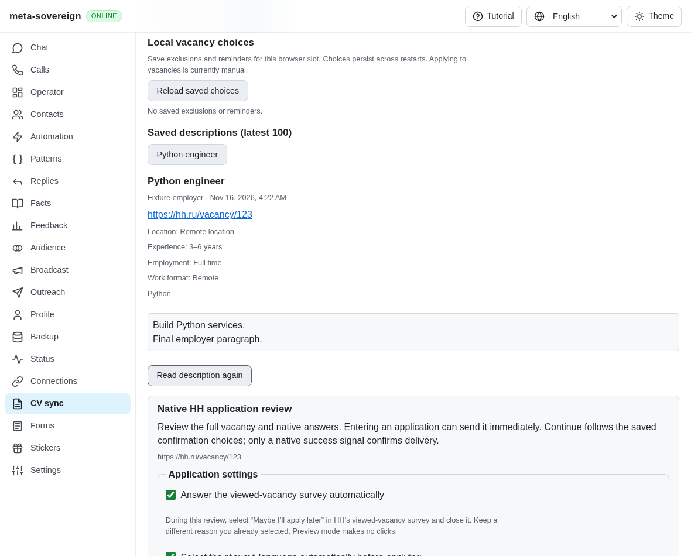
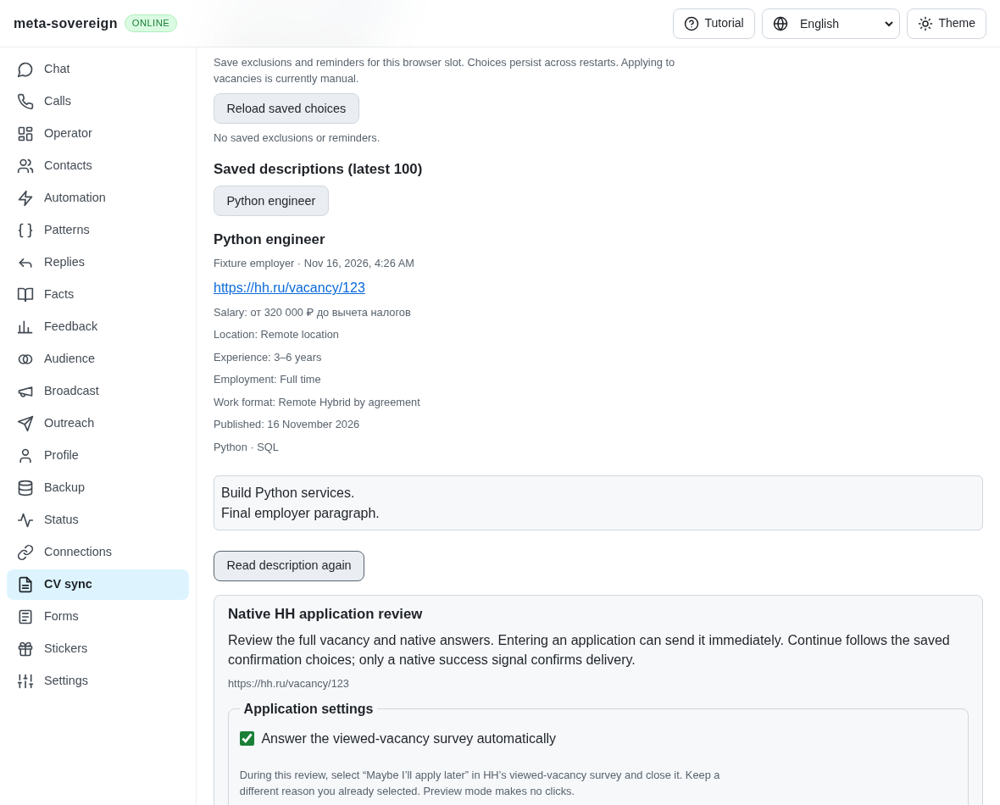
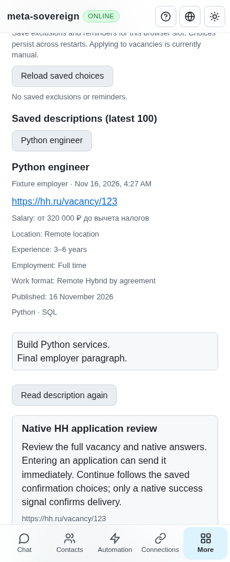

# Native vacancy metadata variants

The pinned vacancy reference at
[`fa0991b8`](https://github.com/konard/hh-job-application-automation/blob/fa0991b8c2d0896fb3b4be6c69947f0590094b15/src/vacancy-insights.mjs)
reads both net/gross compensation selectors, alternate skill tags, publication
text and multiple work-format rows. The shared reader accepted only the older
salary, skills, publication and single work-format selectors. A successful
description read could therefore cache incomplete metadata without a refusal.
The checked evidence retains the exact source used for this behavioral comparison;
the implementation uses the existing shared reader and copies no reference code.

At published parent `42431722feb68ee47ea7ccc70db066070cfacd9d`, run:

```sh
node --max-old-space-size=384 experiments/issue-56/vacancy-metadata-browser.mjs --before
```

The native page reaches the shared CV panel and real success-only cache, then
fails `modern gross salary retained`. Its problem screenshot lacks salary,
publication, the second work format and SQL. The corrected reader supports the
observed aliases, removes duplicate visible tags and retains all bounded visible
work-format rows. Equivalent salary/publication aliases are accepted only when
their trimmed text agrees. Conflicting aliases refuse the refresh, preserving
the acknowledged snapshot. Title/company uniqueness, challenge refusal, complete
visible prose, owned browser shutdown and existing metadata limits remain enforced.

The same command without `--before` now passes four synthetic variants: gross,
net, conflicting salary, and equivalent duplicate salary. It checks complete
prose, hidden-template exclusion, nested skill deduplication, cache-only reload
and phone overflow. Five owned provider pages close with no clicks. This scenario
is mandatory in the existing vacancies browser CI group for both engines.
Thirteen focused Node tests covering the shared reader, vacancy association and
failed-cache-write preservation also pass. Full runtime/browser matrices run in CI.

Independent Playwright MCP inspection confirms the modern fields and unchanged
cache recovery at 1180- and 390-pixel widths: two owned provider reads, zero
provider clicks, zero page exceptions, all resources closed. Its browser console
also records a missing favicon and `ERR_CACHE_WRITE_FAILURE` for `app.min.js`;
these are retained rather than presented as a clean console. The rendered app
and assertions complete successfully.

Before and after, with synthetic data:





The [plan](vacancy-metadata-plan.md), exact parent source, corrected source,
reference excerpts, assertions, logs and screenshot bytes are retained in
[`vacancy-metadata.tar.gz`](data/vacancy-metadata.tar.gz), with a checked
[SHA-256 manifest](data/vacancy-metadata.tar.sha256.json). These are deterministic
fixture checks, not authenticated HH validation. Expanded/live-provider parity
and all 60 unchecked inventory rows remain required; HH03 remains unchecked.
