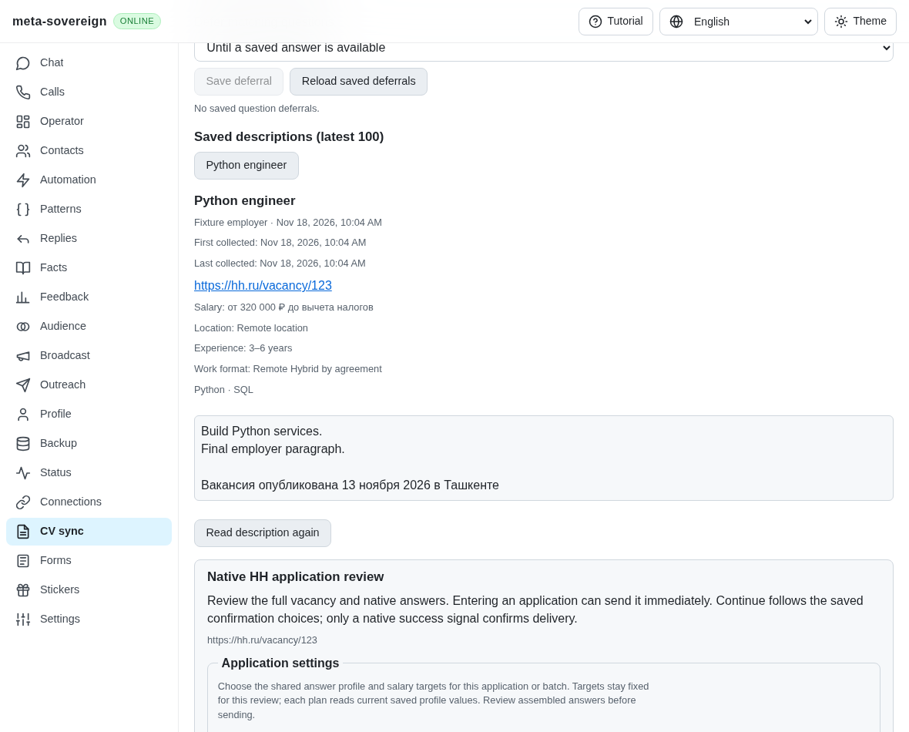
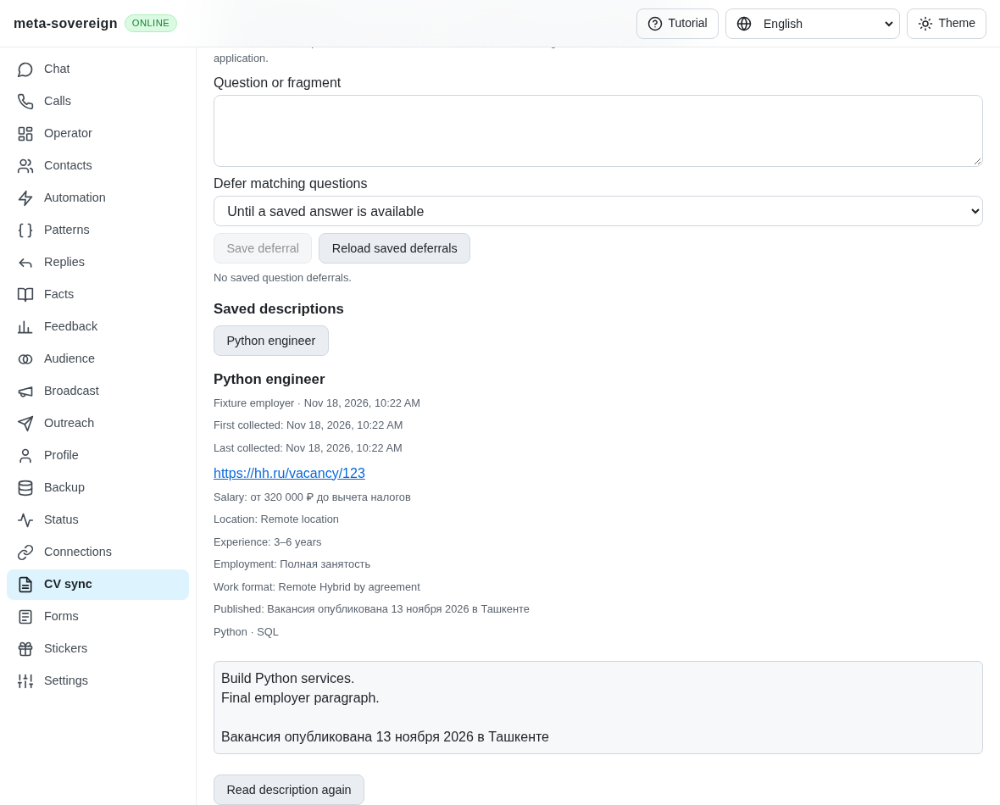
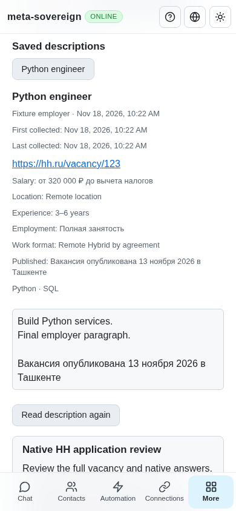

# Current HH vacancy metadata

PR: https://github.com/link-foundation/meta-sovereign/pull/57

On 18 November 2026, anonymous inspection of the public vacancy
`https://hh.ru/vacancy/139480236` found two fields outside the reader's older
selectors. Employment appears in a `dd` below `common-employment-text`.
Publication is a visible Russian publication sentence containing a semantic
`time[datetime]`, without either previously supported publication marker.
The published reader successfully collected the description but returned empty
employment and publication values. Its cached snapshot could therefore appear
complete while losing native metadata.

The corrected reader accepts the observed employment selector and publication
structure. The fallback recognizes the observed Russian publication prefix;
other languages retain their existing explicit marker support. It preserves
the provider's publication sentence, including nonbreaking spaces, rather than
inventing a publication date. Hidden dates and dates inside descriptions,
recommendations, forms or editable content cannot supply publication metadata.
Conflicting aliases or timestamps, missing/invalid timestamps, excessive dates
and oversized metadata refuse collection before replacing acknowledged content.
Equivalent old/new aliases and legacy pages remain supported.

The pinned reference `src/vacancy-insights.mjs` at
[`fa0991b8`](https://github.com/konard/hh-job-application-automation/blob/fa0991b8c2d0896fb3b4be6c69947f0590094b15/src/vacancy-insights.mjs)
reads the full description container; it has no separate expansion action.
The actual production DOM function captures all 3,035 visible description
characters and exactly 4,393 HTML characters on the observed public page.
The corrected function also captures both missing metadata fields. No skill
tags exist on that page; a zero count is retained. These are manual public-source
observations without login, owner profiles, application clicks or submissions.
They do not establish authenticated collection or live service recovery.

## Reproduction and verification

```sh
python3 -B experiments/issue-56/vacancy-modern-before.py
node --max-old-space-size=384 experiments/issue-56/vacancy-modern-browser.mjs
```

The first command temporarily selects the exact published parent
`4114717bd0adf286007f02e8067b9e409f82d03c`, runs the same finite native
scenario, verifies its missing-employment failure and restores the working reader.
Its screenshot shows missing employment/publication metadata, even though a
publication sentence in the synthetic employer description remains visible.

The correction passes four successful variants and eight refused refreshes
through real browser DOM, commander navigation, shared collection, acknowledged
cache and HTTP Lino routes. Text/binary recovery preserves exact employer HTML,
metadata and observation history. Description/form/recommendation/hidden date
decoys remain excluded. All 13 owned provider pages close with zero clicks.
The scenario is mandatory in the existing vacancies browser CI group; complete
browser/runtime matrices run in hosted CI.

Thirty focused local tests pass, covering existing extraction, HTML, loading and
four-language controls. Independent Playwright MCP verifies saved metadata in
four languages, cache-only reload, fitting desktop/phone views, two closed
provider pages, zero clicks and zero page exceptions. Both owned fixtures drain.
Screenshot review also exposed obsolete 100-description limits in translated
cache, exclusion and analysis wording. All four languages now describe the
complete corpus implemented by the earlier correction. The web bundle is rebuilt.

The duplication gate initially exceeded 6.5%. Reusing the existing native
metadata fixture and shared collection/screenshot controls brings the unchanged
gate below its limit. The focused scenario and independent MCP check pass again
after that refactor. A fixture launch without interactive stdin was stopped and
rerun; the final owned fixture has an explicit successful shutdown receipt.





## Limits and retained investigation

The independent public DOM observation passes, but a separate anonymous native
service probe refuses navigation before collection. Its captured page renders;
the cause of the navigation receipt refusal is not established. Earlier probe
setup failures used an unsupported MCP dynamic import and an incorrect commander
constructor argument; neither is presented as a production regression. The raw
logs, generated source and diagnostic screenshot are preserved. A manual probe
requires an explicit `HH_PUBLIC_SOURCE_URL`; automated checks use synthetic pages.
Public-page console errors and the fixture's missing favicon are retained without
a clean-console claim.

Source-bound evidence, raw logs, pinned reference, parent reader and screenshots
are in `data/vacancy-modern.tar.gz` with its per-file SHA-256 manifest. HH03 remains
unfinished pending the complete cache/configuration contract audit and live
service navigation evidence. The inventory stays **88 verified / 30 unfinished**;
PR57 stays draft and unmerged.

The parent Checks run `44279116597` has a cancelled Deno/macOS shard
(`134720613522`). Its preserved log reports 1,280 passed, zero failed and three
ignored tests at line 13,162, followed by cancellation at line 13,164. Its job
ran from 10:11:11 to 10:21:22 UTC at the existing ten-minute boundary. This is
retained as a separate unresolved CI investigation, without claiming a test
failure or a passing complete parent workflow.
