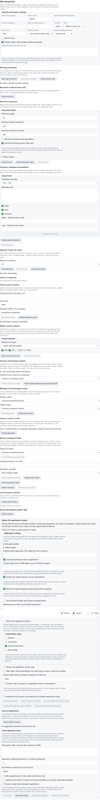
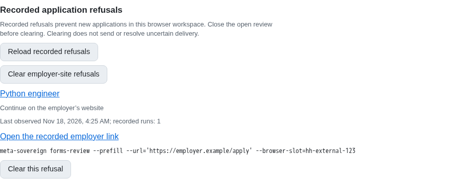
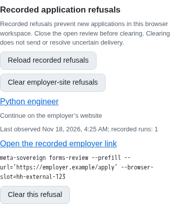

# Durable native application refusals

[PR #57](https://github.com/link-foundation/meta-sovereign/pull/57) remains draft. Acceptance remains 86 verified and 32 unfinished. This unit implements two permanent refusal reasons within HH05; the complete deferred-question, transient-retry and session policies remain required.

## Reproduction and cause

On published parent `e2acf88a7bdee8ba4df94015036b612463e7ebed`, enter a native application, observe an employer-site notice or a rendered résumé-visibility warning, close the review and reload. The application journal retains its own state, but there is no separate durable refusal list, reason-based clear operation or exclusion from subsequent search/discovery/batch admission. Twelve actual-parent regression assertions fail, with two compatible controls passing. The actual parent browser probe captures the missing recorded-refusal controls; source and bundle restoration run in `finally`.

The pinned reference README's skipped-vacancy contract requires recorded reasons, vacancy identity/title, known employer link, observation time and attempt count. External-site and résumé-visibility refusals are permanent until explicitly cleared. The current application holds did not implement that durable record.

## Shared behavior

The application writer now acknowledges a private, browser-slot-bound record when a bound native page reports either supported refusal. It preserves the application journal first, including issued and uncertain reservations. Repeated reads of the same application do not invent attempts. Challenges, limits and unbound pages do not invent refusal records. Only a positively confirmed delivery can remove its existing record automatically.

Application open, search selection, discovery and batch admission consult this record. The current review remains readable and closable. Owner choices remain separate. List and clear operations share validated data across CLI, text/binary Lino and the four-language UI. Clearing requires the current revision, drains persistence before acknowledgement, refuses concurrent application ownership and preserves uncertain delivery reservations. Failed saves restore acknowledged state; malformed/foreign/oversized records cannot replace it.

External notices expose an employer link only when exactly one visible, scoped, safe HTTP(S) destination is known. Hidden, ambiguous, credential-bearing and provider destinations are refused. A recorded link includes a shell-quoted `forms-review --prefill` command using a separate named browser slot. Recording or displaying the command does not follow the link or submit a form.

## Verification

- The focused service/interface/compatibility run passes 62 checks with one worker and a 384 MiB Node heap. It covers private disk restart, slot isolation, stale/malformed clears, failed acknowledgement, Stop draining, preserved owner choices, unknown delivery, discovery and batch exclusions, both wire formats, CLI, offline refusal and translated bounded UI.
- The native Chromium probe checks six employer-link variants, reload persistence, refused reopening, all four languages and persisted clearing. Owner values survive; provider submissions remain zero; all owned browsers close.
- Independent Playwright MCP verification checks the rendered résumé warning, retained owner answers, durable readback, phone layout and clear/reload recovery. It reports zero submissions and no scenario page errors. Its fixture server and browser close; the user's application server is separate.
- Desktop/phone PNGs are inspected. Scoped ESLint/Prettier, source/document limits and the unchanged duplication gate are required before publication. Full runtime/browser/platform checks remain hosted validation of the next exact source.

The adjacent `data/vacancy-native-skips.tar.gz` and hash manifest bind source, original source bytes, parent failures, focused/native/MCP receipts and screenshots. Current hosted runtime failures at the parent are investigated separately; this local evidence does not turn them into successful acceptance.

Before (the parent has no refusal section):

After, desktop and phone:

