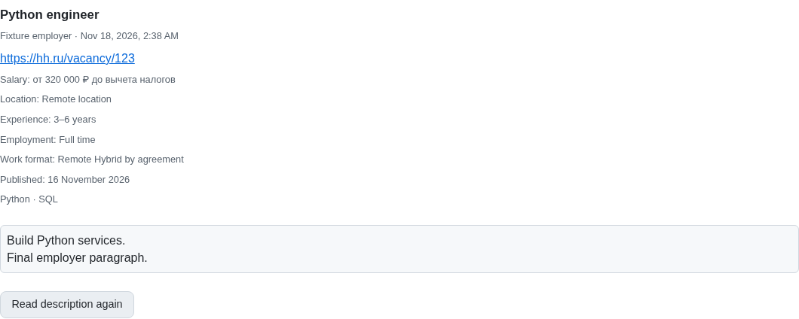
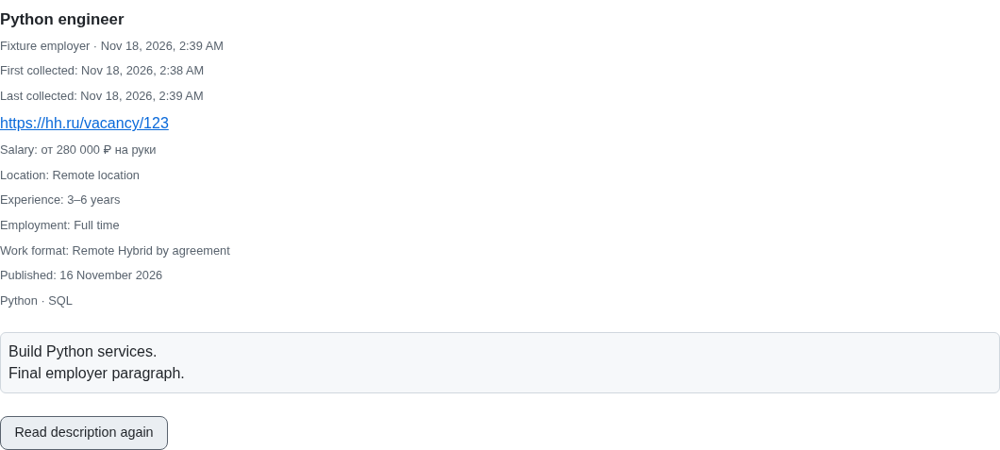
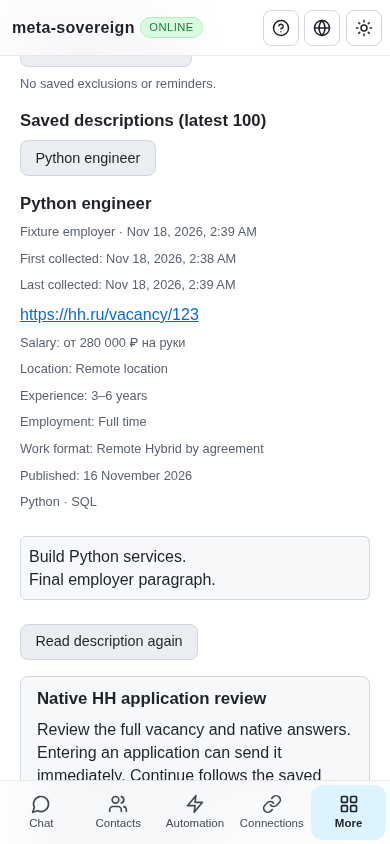

# Private vacancy observation history

The pinned HH [vacancy cache](https://github.com/konard/hh-job-application-automation/blob/fa0991b8c2d0896fb3b4be6c69947f0590094b15/src/vacancy-cache.mjs)
keeps both first and last observation times (A12). Parent `b873b283` retains only
the latest capture timestamp in the current projection, including after legacy
migration. Eight regressions fail against that actual parent; a compatibility
control for old snapshots passes.

A successful collection now records `firstSeenAt` and `lastSeenAt`. Refresh
retains the first acknowledged observation and advances the last observation
only with the acknowledged new snapshot. Reading cached data does not advance
these dates. Existing snapshots acquire their original capture as their first
observation on refresh; legacy records preserve both source dates. Missing
history remains absent until a real provider read. Malformed history refuses
refresh before opening a provider page and leaves the saved record unchanged.

The shared projection preserves this history through durable restart, CLI,
both Lino API formats and offline browser cache reads. A refused persistence
operation restores the complete previous record before releasing waiting
readers. The existing snapshot view displays localized first/last collection
labels in all four interface languages without inventing dates for old data.

## Reproduction and verification

```sh
python -B experiments/issue-56/vacancy-history-before.py
NODE_OPTIONS=--max-old-space-size=384 node --test --test-concurrency=1 --test-timeout=10000 js/tests/vacancy-history.test.js js/tests/job-vacancy-cache-durability.test.js js/tests/vacancy-legacy.test.js
deno test --allow-all js/tests/vacancy-history.test.js js/tests/job-vacancy-cache-durability.test.js js/tests/vacancy-legacy.test.js
NODE_OPTIONS=--max-old-space-size=384 node --test --test-concurrency=1 --test-timeout=10000 js/tests/vacancy-controls.test.js
NODE_OPTIONS=--max-old-space-size=384 node experiments/issue-56/vacancy-html-browser.mjs
```

All 24 cache checks pass under Node and Deno; six interface checks pass with
four-language rendering and old-snapshot controls. The mandatory existing
native metadata scenario verifies first observation retention, newer last
observation, refused refresh recovery, exact API/cache readback and reload
without another provider read. Its seven owned provider pages close with zero
provider clicks and no page exceptions. Scoped static checks and the small web
bundle rebuild pass. No full suite or runtime/browser matrix runs locally.

Playwright MCP additionally checks refreshed history, refused refresh recovery,
cache reload and a 390-pixel viewport. Its browser and the isolated fixture are
closed afterward. The MCP console includes the missing fixture favicon, a
cache-write diagnostic while replacing the bundle, and an explicitly refused
JSON-representation probe; these are not reported as a clean console. The
separate native scenario reports zero page exceptions.

| Previous display | Refreshed display |
| --- | --- |
|  |  |



The [source-bound evidence](data/vacancy-observation-history.tar.gz) includes
actual-parent failures, corrected sources, focused/native logs, screenshots
and cleanup receipts. Exact-source hosted verification is still required.
HH03 and all unfinished criteria remain open in
[PR57](https://github.com/link-foundation/meta-sovereign/pull/57).
