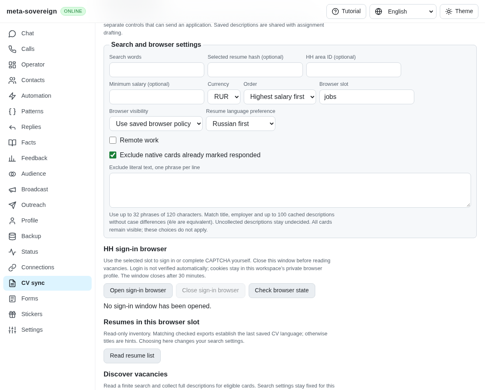
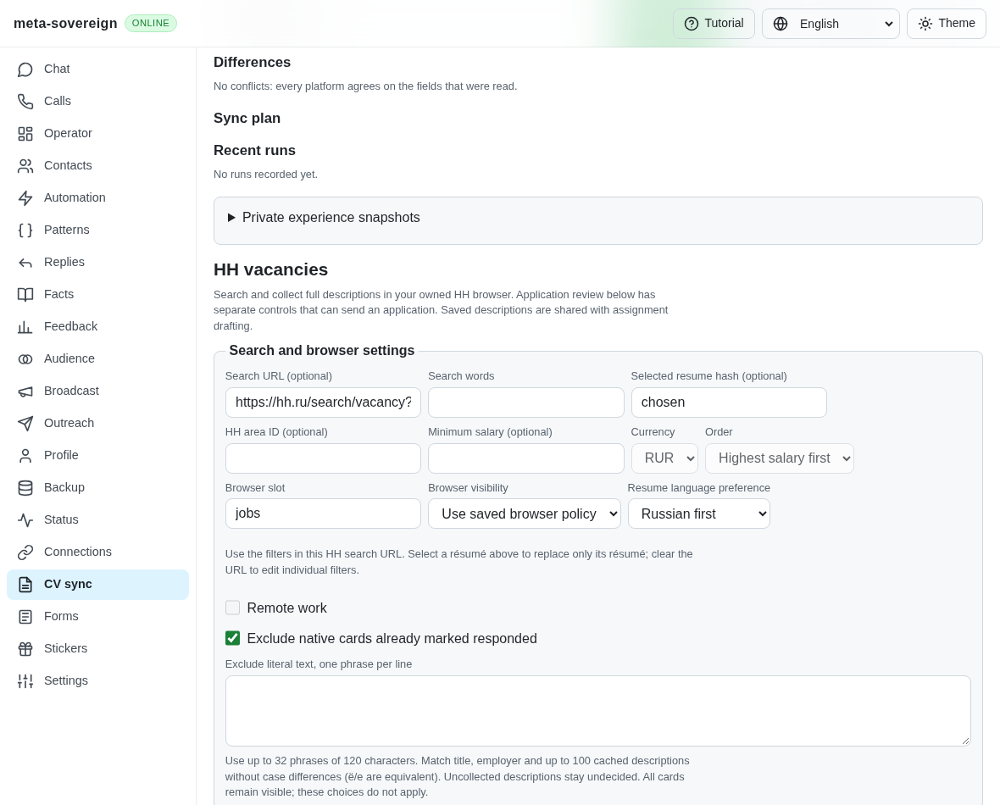
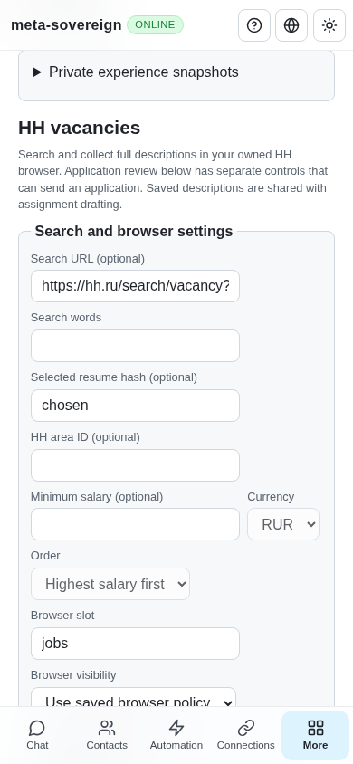

# Preserve owner-supplied HH search filters

The pinned HH [README](https://github.com/konard/hh-job-application-automation/blob/fa0991b8c2d0896fb3b4be6c69947f0590094b15/README.md)
supports an explicit search URL and retaining native filters while choosing a
résumé. At parent `406e8bdf`, CLI search accepts `--url` but its URL builder
ignores that input. Discovery also freezes only a fixed set of fields, losing
extra or repeated native filters. The browser has no search-URL control.

Search now preserves an owner's HTTPS `hh.ru/search/vacancy` URL, including
repeated areas, experience, employment and other native filters. Only explicitly
supplied typed fields replace corresponding URL fields. Missing currency,
ordering and page receive the existing defaults. Destination, credentials,
fragment, critical identities, bounds and private parameter names are checked
before browser admission. Pagination must retain the exact frozen filters;
discovery checkpoints and salary tiers retain them through durable restart.

CLI and both Lino formats share this behavior. The four-language browser UI
offers an optional URL and disables individual URL filter controls while it is
set. Résumé selection can replace only the URL résumé; clearing the URL restores
individual controls. Browser Search starts at page zero. CLI/API can use a page
already in the URL. Saved browser settings recover without reading the provider.

## Reproduction and verification

```sh
python -B experiments/issue-56/vacancy-search-url-before.py
python -B experiments/issue-56/vacancy-search-url-before.py --native
NODE_OPTIONS=--max-old-space-size=384 node --test --test-concurrency=1 js/tests/vacancy-search-url.test.js js/tests/vacancy-search-url-controls.test.js
deno test --allow-all js/tests/vacancy-search-url.test.js js/tests/vacancy-search-url-controls.test.js
NODE_OPTIONS=--max-old-space-size=384 node experiments/issue-56/vacancy-search-url-native.mjs
```

Five URL regressions fail against the actual parent; its typed-search control
passes. The parent browser reproduces the missing URL control. All ten new Node
and Deno checks and 34 focused compatibility checks pass. The native scenario
reads two actual fixture DOM pages, verifies exact next-page filters and selected
résumé, recovers at 390 pixels without replay, and closes with zero provider
clicks and page exceptions. It is registered in the existing mandatory vacancy
browser group for hosted Chromium and WebKit coverage.

Playwright MCP separately verifies pagination, reload without replay, all four
translated labels, disabled individual fields, invalid-URL refusal and phone
layout. Its browser, owned server and provider pages are drained. The MCP
console contains the fixture's missing favicon and cache-write diagnostics
during reload; it is not described as a clean console. The isolated native
scenario reports zero page exceptions. No live authentication/provider or full
local runtime/browser matrix is claimed.

| Previous settings                                                          | URL settings                                                                      |
| -------------------------------------------------------------------------- | --------------------------------------------------------------------------------- |
|  |  |



The [source-bound evidence](data/vacancy-search-url.tar.gz) preserves the actual
parent, corrected sources, pinned reference, focused/native/MCP logs and
screenshots. Exact-source hosted verification is still required. HH02 and all
unfinished criteria remain open in
[PR57](https://github.com/link-foundation/meta-sovereign/pull/57).
