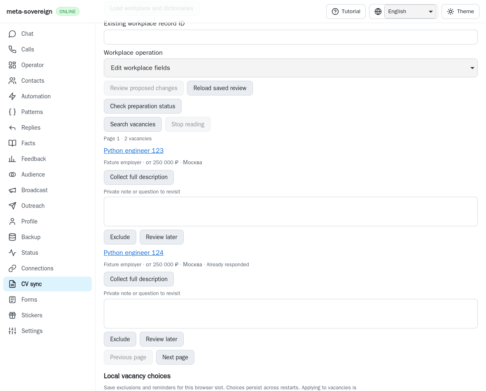
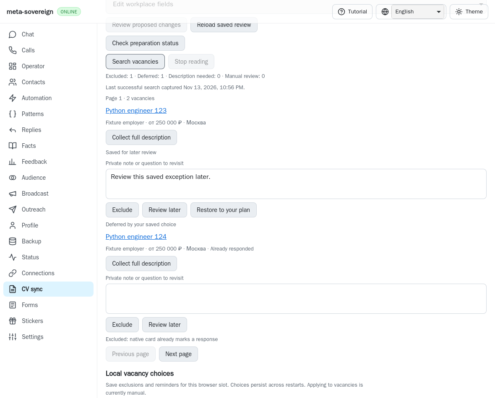
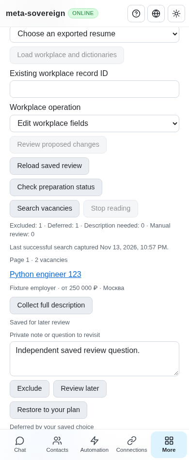

# Vacancy search selection review (HH05)

[PR #57](https://github.com/link-foundation/meta-sovereign/pull/57) remains a draft.
This unit adds selection evidence to native search results. HH05 still requires
native viewed-state handling, automatic retry reasons and questionnaire policies;
the application executor and every other unchecked criterion remain unfinished.

Every returned card retains its native position, metadata and pagination. A
separate decision explains a private exclusion or deferred review, a native
responded marker, a configured literal match, a missing description, or manual
review. No card disappears. Review is not an application receipt. The latest
named-slot choice revision binds the report; changing a saved choice, slot or
setting makes it stale until another successful search. Failed searches retain
the previous results and their capture time.

Optional exclusions match titles, employers and at most 100 cached descriptions.
They are literal lines: at most 32 distinct phrases of 120 characters within
4,000 characters. Comparisons normalize Unicode, case and Russian ё/е. No regular
expression executes. Missing prose stays undecided when exclusions are configured.
Description matches disclose the saved capture time and warn that live text may
have changed. Private notes stay out of selection receipts and provider URLs.
CLI, both Lino formats and English/Russian/Chinese/Hindi CV controls share the
options and validation. Existing local preferences retain settings. Responded
skipping defaults on and can be disabled; clearing lines reverses text filters.
Older servers explicitly display selection as unavailable.

```sh
node js/bin/meta-sovereign.js vacancies-search --query=Python \
  --skip-responded=true --exclude-text='unwanted phrase' --browser-slot=jobs
```

The actual parent `222f2e80` lacks this report and its controls. The reusable probe
verifies the missing backend decision, captures the original UI, then restores
every replaced source and the generated bundle:

```sh
python3 -B experiments/issue-56/vacancy-selection-before.py
```

Before, native results lack individual selection reasons:



After, all cards remain visible with reasons and a capture timestamp:



Review also exposed a cache defect. Assignment vacancy snapshots called `put()`
and `flush()` without restoring prior state on rejection. The real browser store
admits memory before persistence resolves, so failed collection could supply
unacknowledged prose to later filtering. Two actual-parent regressions reproduce
new-cache and refresh failures. The cache now uses the acknowledged-record helper
shared with job data; job cache reads wait for collection and restoration.
Assignment snapshot consumers use the same restoration helper. Persistent
restoration failure still rejects; unavailable storage is not hidden.

```sh
python3 -B experiments/issue-56/vacancy-cache-before.py
node --max-old-space-size=384 --test --test-concurrency=1 \
  js/tests/job-vacancy-selection.test.js \
  js/tests/job-vacancy-cache-durability.test.js \
  js/tests/job-choice-durability.test.js js/tests/assignment-vacancy.test.js \
  js/tests/vacancy-search.test.js js/tests/vacancy-reader-regression.test.js
RUN_BROWSER_E2E=1 E2E_BROWSER=webkit \
  node experiments/issue-56/vacancy-selection-browser.mjs
```

All 37 focused checks and four browser-registry checks pass. They cover exact slot/revision/card binding, malformed receipts,
Unicode literals, missing and cached prose, rejected actual snapshot puts, stale
controls, CLI and both transports. An isolated native WebKit scenario checks
collection, repeated search, changed owner choice, failed-search preservation,
settings reload and phone overflow. It joins the existing mandatory vacancy
group in both hosted engines. An independent MCP context checks title exclusion,
responded cards, stale choices, reload and reversible settings on desktop and
phone. Owned fixture browsers close with zero provider clicks and page errors.



The first local WebKit attempt timed out waiting for the initial reason. A retry
passed, but the first attempt did not capture enough state to explain the
difference. Both logs are retained. `E2E_TRACE_SELECTION=1` now captures bounded
field, summary and card state plus a screenshot on failure. No timeout increased.
Hosted matrices must verify the published commit; a passing local retry alone
does not explain this first failure.

The [checksummed archive](data/vacancy-selection.tar.gz) and
[manifest](data/vacancy-selection.tar.sha256.json) retain actual-parent sources,
failure/success logs, fixtures, changes and screenshots. Every unchecked original
acceptance criterion remains required.
